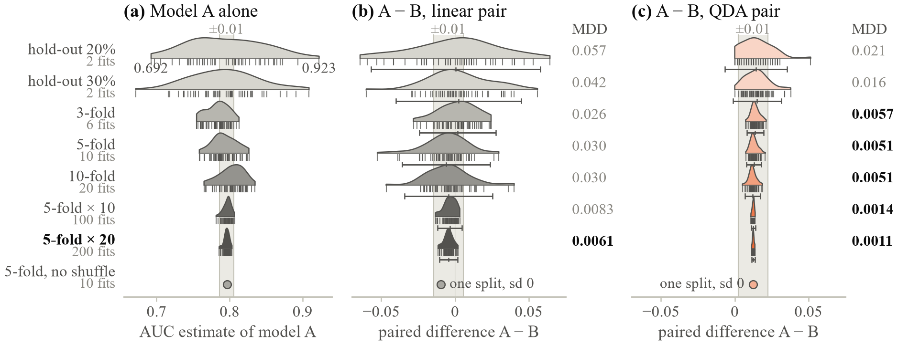

# Extension E1: Validation protocol design

**Author: TODO** (Kaggle: TODO)

<!--
Limit: <= 2 pages. Headings exactly Question / Protocol / Results / Conclusion.
Every number traces to a run_id: main pair = 20261022-064054_e1_validation_protocol
(reports/tables/e1_manifest.json), second pair = 20261022-064148_e1_validation_protocol_qda_pair
(reports/tables/e1_qda_manifest.json), comparison = 20261022-064412_r306_e1_pair_comparison,
pair screen = 20261022-063722_r300_e1_pair_screen (+ the 14 r300_* experiment runs).
Verification: R940 = 20261022-091211_r940_e1_pairs_check (reports/tables/r940_e1_pairs.csv: pooled gap,
28-pair check, 80 % power MDD, p_correct of 5 x 10), R941 = 20261022-092201_r941_e2_replica_truth
(summary.json e1_pair_gap, t = 250); reference SE 0.0019 and 1.84 sd: research/reports/verify_ext.md section 3.
Colab jobs: J20261022-063839-pro1-rext12 (R300), J20261022-064231-pro1-rext12 (E1 + R306).
Revised 2026-10-22 after verify round 1 (research/reports/verify.md section 4).
The owner must check and be able to explain every number.
History. Rewritten 2026-11-24 by Claude Code (workflow agent, formal-article job; previous text: git 259279b) as formal
prose: bullets turned into paragraphs, every abbreviation and term defined, archive identifiers only as bracketed
citations, confidence intervals written "(0.0051-0.0076)" instead of "[0.0051, 0.0076]", p_correct written P_correct,
Table 1 and Figure 1 placed after the result paragraphs (page layout), reference list in one formal style (full
entries: registry/references.md). No value was changed. Moved out of the visible text for the page limit:
(1) the 5-fold x 50 reference run gives A - B = -0.0029 (SE about 0.0019; summary.json "reference" of
20261022-064054_e1_validation_protocol; SE corrected in research/reports/verify_ext.md section 3);
(2) the trusted split SE is the se_split of scripts/compare_runs.py (5 x 20 paired sd 0.0031 vs mean within-run SE
0.0030, e1_paired_difference.csv column mean_within_rep_se); (3) Table 1 joins e1_paired_difference.csv and
e1_qda_paired_difference.csv as in reports/tables/r306_e1_pair_comparison.md (run 20261022-064412_r306_e1_pair_comparison);
both source tables are in reports/tables/.
History, 2026-11-24, review round (Claude Code workflow agent, fixer for E1 and E2; findings of two AI reviewers).
Baseline correction of the AI-use facts (evidence registry/ai_usage.md): the statement now also says that the AI drew the
figure (row 8, "Drafted E1-E4 (text, tables and figures ..."; row 24, 2026-11-23, "redrew the four extension figures ...
e1-e4 (figure and caption only)") and revised the text (rows 10 and 21, and the 2026-11-24 rewrite); the log list
"rows 3, 7, 8, 10 and 21" became "rows 3, 7, 8, 10, 21 and 24". The members still have to add an ai_usage.md row for the
2026-11-24 rewrite (registry edits were outside this job). Wording only, no value changed: lead-in "Use of generative AI."
as in E2-E4; house archive-tag sentence (HOUSE_STYLE section 2) at the end of Question; high-variance block defined over
all 20,000 rows (src/ssc/transductive.py resolve_columns takes the std over train+test; QDA pair config columns: highvar);
MDD introduced as an abbreviation; italic t; Schemes and Conclusion sentences split; "split SE" explained
(e1_paired_difference.csv mean_within_rep_se = sd of the 20 per-repeat differences / sqrt(20),
extensions/e1_validation_protocol/run.py); "test-AUC gap" became "true AUC gap" (R941 notes: population gap
corr30 - corr50, sd 0.0105 across 250-row samples); one name for the corrected t-test; captions open with a title sentence
and the table caption names runs instead of files (files: item (3) above); references in house style ("&", no comma
before the volume). Page budget: "only" dropped before "about 50% power", the 28-pair sentence shortened, "1.5 times the
median sd" became "1.5 times the median", and the Conclusion no longer repeats "200 fits per decision" (Table 1 and
Figure 1 show it); instead it now states the split noise of single runs (MDD 0.026-0.057, Table 1) and uses the defined
term "resolves 0.01". Not applied for lack of space: naming the two regimes after "pair per regime" (they follow in the
same paragraph). Registry note: kohavi1995 and bengio2004 are still "candidate" in registry/references.md and must be set
to "used" when E1 is submitted.
Main session 2026-11-25: AI-use statement lists row 25 of registry/ai_usage.md (formal rewrite). Measured: 2 pages, 1.93 used.
2026-11-25 (main session, at the member's request): the AI-use statement is removed from this part for now; the member will write the AI disclosure together with the contribution table (course rule 6 requires it in the submitted report; facts in registry/ai_usage.md; previous wording in git 63b56f9).
2026-11-25 (main session, at the member's request): the reference list of this part moved to one complete, alphabetical list for the whole document, reports/references.md (written by scripts/make_references.py from registry/references.md; built as part 'refs' after the extensions).
-->

## Question

When only the random seed of the split changes, how far do hold-out and *k*-fold estimates of the area under the receiver operating characteristic curve (AUC) move, and which scheme would we trust to choose between two models that differ by 0.01 AUC? The public leaderboard cannot decide: on its roughly 395 rows, the standard error (SE) of an AUC near 0.85 is about 0.02 (Hanley & McNeil, 1982). Because one *k*-fold cross-validation (CV) run cannot estimate its own variance without bias (Bengio & Grandvalet, 2004), we measured the split noise directly. Our final model, a transductive Gaussian mixture fitted without labels to the training and test rows, is saturated at CV AUC 1.0 [R003], so we studied supervised models. Bracketed identifiers cite the project archive: runs (R) and decisions (D). Cited works are listed in the References at the end of the document.

## Protocol

**Schemes.** We compared stratified, shuffled splits of the 250 labelled rows (scikit-learn; Pedregosa et al., 2011): a 20% or 30% hold-out (Kohavi, 1995), *k*-fold CV with *k* = 3, 5 and 10, and 5-fold CV repeated 10 or 20 times (5-fold × 10 and × 20), the latter being our official CV [D002]. Unshuffled 5-fold CV served as a control. Each scheme ran with 50 split seeds and fixed model seeds.

**Model pairs.** A rule fixed before this study [R300] chose, among 11 pairs of neighbouring candidates, the pair per regime whose official-CV gap was closest to 0.01; both models were scored on identical splits. The *linear pair* (official CV AUC 0.7910 vs 0.8011) is L2-penalised logistic regression (*C* = 0.05, LIBLINEAR; Fan et al., 2008) on the 30 (model A) or 50 (model B) features with the largest absolute correlation with the label, selected in each training fold. The *QDA pair* (0.9958 vs 0.9832) is quadratic discriminant analysis (QDA; Friedman, 1989) with regularisation 0.1 (A) or 0.3 (B) on the high-variance block, the 13 features whose standard deviation (sd) over all 20,000 rows exceeds 1.5 times the median.

**Criterion.** The minimum detectable difference (MDD) is twice the sd of the paired AUC difference over the 50 seeds, 2 × sd(A − B), with a 95% confidence interval (CI) from the χ² distribution; a scheme *resolves 0.01* if the whole CI lies below 0.01. A true gap equal to the MDD is detected with about 50% power at the 5% level (80% power needs 2.8 sd). We also report the probability of ordering a 0.01 pair correctly, *P*correct = Φ(0.01/sd), with Φ the standard normal distribution function, and the corrected *t*-test of Nadeau and Bengio (2003). We repeated the analysis for all 28 pairs of eight linear candidates [R940].

## Results

A hold-out split cannot rank the linear models (Table 1): a 20% hold-out estimate of model A ranges from 0.692 to 0.923 across seeds (Figure 1a), and its *P*correct is only 0.64. Repetition, not more folds, reduces the split noise: single 3-, 5- and 10-fold runs all have sd(A − B) of 0.013–0.015, whereas 10 and 20 repeats of 5-fold CV cut it to 0.0042 and 0.0031 (about 1/√*R* for *R* repeats).

Pairing also matters: identical splits lower the 5-fold × 20 sd from 0.0050 (unpaired) to 0.0031, and the split SE that one run estimates from its 20 repeats (0.0030) agrees, so our model-comparison script can rely on it. Without shuffling, all 50 seeds give the same split, so its zero spread is false precision.

The studied linear pair is only about 0.004 apart: pooling all 1,000 repeats gives A − B = −0.0044 (SE 0.0004) [R940], so the official CV's −0.0101 was a 1.84-sd draw, favoured by selecting the pair closest to 0.01. The MDD, however, depends on sd(A − B), not on the gap, and it transfers: over all 28 linear pairs, the 5-fold × 20 sd is 0.0018–0.0046, and 25 pairs keep the whole MDD CI below 0.01 [R940]. As the pair is not 0.01 apart, *P*correct is a normal-shift extrapolation, not an observed rate.

| Scheme (fits) | Linear: MDD (95% CI) | *P*correct | QDA: MDD (95% CI) |
|------------------|--------------------------|----------|--------------------------|
| hold-out 20% (2) | 0.057 (0.048–0.072) | 0.64 | 0.021 (0.018–0.026) |
| hold-out 30% (2) | 0.042 (0.035–0.053) | 0.68 | 0.016 (0.014–0.020) |
| 3-fold (6) | 0.026 (0.022–0.032) | 0.78 | 0.0057 (0.0048–0.0072) |
| 5-fold (10) | 0.030 (0.025–0.037) | 0.75 | 0.0051 (0.0043–0.0064) |
| 10-fold (20) | 0.030 (0.025–0.037) | 0.75 | 0.0051 (0.0043–0.0063) |
| 5-fold × 10 (100) | 0.0083 (0.0070–**0.0104**) | 0.992 | 0.0014 (0.0011–0.0017) |
| **5-fold × 20 (200)** | **0.0061 (0.0051–0.0076)** | 0.9995 | 0.0011 (0.0009–0.0013) |

*Table 1. Split noise by scheme. MDD = 2 × sd(A − B) over 50 split seeds; Pcorrect for the linear pair; in parentheses after each scheme, the model fits per decision between the two models. Runs as in Figure 1.*

*Figure 1. Split-seed spread of the estimates. Ticks: 50 per scheme; curves: their density over the observed range, scaled to equal height (darker: more fits per decision). (a) AUC of model A, linear pair; (b) A − B, linear pair; (c) A − B, QDA pair. Bars: mean ± MDD; MDD in bold where its whole 95% CI lies below 0.01. Shaded: ±0.01 around the pooled 5-fold × 20 mean (linear −0.0044, QDA 0.0126). Runs `20261022-064054_e1_validation_protocol`, `20261022-064148_e1_validation_protocol_qda_pair`.*

## Conclusion

To choose between two similar supervised models (AUC about 0.80) that may differ by 0.01, we would trust only stratified 5-fold CV repeated 20 times, with both models scored on the same splits. It is the only scheme tested that resolves 0.01 (MDD 0.0061; 95% CI 0.0051–0.0076), which supports our official protocol [D002]. Ten repeats are borderline; single *k*-fold runs, for any *k*, and hold-out splits are inadequate (MDD 0.026–0.057). The verdict depends on the criterion: even 5-fold × 20 is inconclusive at 80% power (0.0086; 95% CI 0.0071–0.0107), whereas for ordering alone 5-fold × 10 ranks a 0.01 pair correctly with probability ≥ 0.93 for all 28 pairs [R940]. Near the ceiling, the QDA pair's split noise is 4.5–6.1 times smaller in every *k*-fold scheme and one 3-fold run suffices, so a protocol must be sized for its hardest decision. Split noise is, however, conditional on our 250 rows and thus a lower bound. Across simulated 250-row samples from a generator fitted to our data, the linear pair's true AUC gap has sd 0.0105, 3.4 times the 5-fold × 20 split noise (model-based [R941]); the corrected *t*-test, which allows for this variance, finds the linear difference significant in at most 1 of 50 executions. Finally, the evidence comes from two pairs (plus the 28-pair check) on one data set with fixed hyper-parameters.
