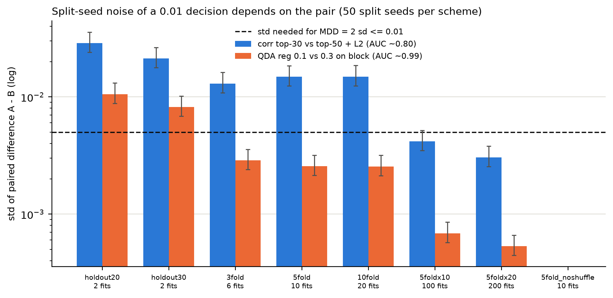

# Extension E1: Validation protocol design

**Author: TODO** (Kaggle: TODO)

*AI use: Claude Code (Anthropic; Claude Opus 5.5) designed this protocol, wrote and ran its code on Google Colab and drafted this text; a separate AI verification round re-checked the numbers against the archive (R940, R941). [TODO owner: say what you re-ran, rewrote and checked.] Log: `registry/ai_usage.md`, rows 3, 7, 8, 10 and 21.*

<!--
Limit: <= 2 pages. Headings exactly Question / Protocol / Results / Conclusion.
Every number traces to a run_id: main pair = 20261022-064054_e1_validation_protocol
(reports/tables/e1_manifest.json), second pair = 20261022-064148_e1_validation_protocol_qda_pair
(reports/tables/e1_qda_manifest.json), comparison = 20261022-064412_r306_e1_pair_comparison,
pair screen = 20261022-063722_r300_e1_pair_screen (+ the 14 r300_* experiment runs).
Verification: R940 = 20261022-091211_r940_e1_pairs_check (reports/tables/r940_e1_pairs.csv: pooled gap,
28-pair check, 80 % power MDD, p_correct of 5 x 10), R941 = 20261022-092201_r941_e2_replica_truth
(summary.json e1_pair_gap, t = 250); reference SE 0.0019 and 1.84 sd: research/reports/verify_ext.md section 3.
Colab jobs: J20261022-063839-pro1-rext12 (R300), J20261022-064231-pro1-rext12 (E1 + R306).
Revised 2026-10-22 after verify round 1 (research/reports/verify.md section 4).
The owner must check and be able to explain every number.
-->

## Question

When only the **split seed** changes, how far do hold-out and k-fold AUC estimates move, and **which scheme would we trust to choose between two models that differ by 0.01 AUC?** The public leaderboard cannot decide this: on ~395 rows the standard error of an AUC near 0.85 is about 0.02 (Hanley & McNeil, 1982). One k-fold run cannot estimate its own variance without bias (Bengio & Grandvalet, 2004), so we measure the split noise directly. Our transductive GMM is saturated at CV AUC 1.0 (R003), so we study supervised candidates.

## Protocol

- **Schemes** (stratified, `shuffle=True`; scikit-learn, Pedregosa et al., 2011): hold-out with 20 % or 30 % validation rows (Kohavi, 1995); k-fold with k = 3, 5, 10; 5-fold repeated 10 and 20 times (5 × 20 is the official protocol, D002); 5-fold with `shuffle=False` as a control. Each scheme runs with 50 split seeds; model seeds stay fixed.
- **Pairs**, scored on identical splits, were fixed before E1 by a rule in R300 (of 11 neighbouring pairs, the one per regime whose official-CV gap was closest to 0.01). *Linear* (0.7910 vs 0.8011): in-fold |corr| top-30 vs top-50 features + L2 logistic regression (liblinear, C = 0.05; Fan et al., 2008). *Ceiling* (0.9958 vs 0.9832): QDA with `reg_param` 0.1 vs 0.3 (Friedman, 1989) on the 13-column high-variance block.
- **Criterion**: **MDD = 2 × sd(A − B)** over the 50 estimates, with its χ² 95 % CI; a scheme *resolves 0.01* if the whole CI lies below 0.01. A true gap equal to the MDD is detected with only about 50 % power at α = 0.05 (80 % power needs 2.8 sd). We also report p_correct = Φ(0.01 / sd), the chance of ordering a 0.01 pair correctly, and the Nadeau–Bengio (2003) corrected t-test. R940 repeats the analysis for all 28 pairs of 8 linear candidates.

## Results

| Scheme (fits) | MDD [95 % CI] | p_correct | QDA: MDD [95 % CI] |
|------------------|--------------------------|----------|--------------------------|
| hold-out 20 % (2) | 0.057 [0.048, 0.072] | 0.64 | 0.021 [0.018, 0.026] |
| hold-out 30 % (2) | 0.042 [0.035, 0.053] | 0.68 | 0.016 [0.014, 0.020] |
| 3-fold (6) | 0.026 [0.022, 0.032] | 0.78 | 0.0057 [0.0048, 0.0072] |
| 5-fold (10) | 0.030 [0.025, 0.037] | 0.75 | 0.0051 [0.0043, 0.0064] |
| 10-fold (20) | 0.030 [0.025, 0.037] | 0.75 | 0.0051 [0.0043, 0.0063] |
| 5-fold × 10 (100) | 0.0083 [0.0070, **0.0104**] | 0.992 | 0.0014 [0.0011, 0.0017] |
| **5-fold × 20 (200)** | **0.0061 [0.0051, 0.0076]** | 0.9995 | 0.0011 [0.0009, 0.0013] |

*Table 1. MDD = 2 sd(A − B) over 50 split seeds; linear pair unless marked QDA; fits per decision in brackets. Sources: `reports/tables/e1_paired_difference.csv`, `e1_qda_paired_difference.csv`, joined in `r306_e1_pair_comparison.md`.*

- **Hold-out cannot decide.** A 20 % hold-out estimate of model A ranges from 0.692 to 0.923 across seeds; under a normal approximation it would order a 0.01 pair correctly only 64 % of the time (p_correct).
- **Repeats help; more folds do not.** 3-, 5- and 10-fold all have sd(A − B) 0.013–0.015; 10 and 20 repeats cut it to 0.0042 and 0.0031 (about 1/√R).
- **Pairing matters.** Identical splits cut the 5 × 20 sd from 0.0050 (unpaired) to 0.0031; the within-run SE (0.0030) matches it, so the `se_split` of `compare_runs.py` can be trusted. Without shuffling, all 50 seeds give one split: zero spread is false precision.
- **The studied linear pair is only about 0.004 apart.** Pooling all 1,000 repeats gives A − B = −0.0044 (SE 0.0004; R940; reference 5 × 50: −0.0029, SE about 0.0019). The official seed's −0.0101 was a 1.84-sd draw, favoured by picking the pair closest to 0.01. The MDD depends on sd(A − B), not on the gap, and it transfers: over all 28 linear pairs the 5 × 20 sd is 0.0018–0.0046, and 25 pairs keep the whole MDD CI below 0.01 (R940). p_correct at 0.01 is a normal-shift extrapolation, not an observed rate.

*Figure 1. sd of A − B by scheme (log scale; bars: 95 % CI); blue: linear pair, orange: QDA pair; dashed: MDD = 0.01. Run `20261022-064412_r306_e1_pair_comparison`.*

## Conclusion

To choose between two similar supervised models (AUC about 0.80) that may differ by 0.01, we would trust only **stratified 5-fold repeated 20 times, with both models scored on the same splits**. It is the only scheme we tested whose MDD CI lies wholly below 0.01 (0.0061 [0.0051, 0.0076]; 200 fits per decision), which supports D002. 5 × 10 is borderline; a single k-fold, for any k, or a hold-out is not adequate. The verdict depends on the criterion: at 80 % power even 5 × 20 is inconclusive (0.0086 [0.0071, 0.0107]); for ordering alone, 5 × 10 already gets a 0.01 pair right with probability ≥ 0.93 for all 28 pairs (R940). Near the ceiling (QDA pair) split noise is 4.5–6.1 times smaller in every k-fold scheme and one 3-fold suffices, so a protocol must be sized for the hardest decision. Cautions: split noise is conditional on these 250 rows, a lower bound. Across 250-row replica samples the population gap of our pair has sd 0.0105, 3.4 times the 5 × 20 split noise (R941, model-based), and the Nadeau–Bengio test, which takes this view, finds the linear difference significant in at most 1 of 50 executions. We studied two pairs (plus the 28-pair check) on one data set, with hyper-parameters fixed.

**References.** Bengio & Grandvalet (2004), *JMLR* 5:1089–1105. Fan et al. (2008), LIBLINEAR, *JMLR* 9:1871–1874. Friedman (1989), *JASA* 84:165–175. Hanley & McNeil (1982), *Radiology* 143:29–36. Kohavi (1995), *Proc. IJCAI-14*:1137–1143. Nadeau & Bengio (2003), *Machine Learning* 52:239–281. Pedregosa et al. (2011), scikit-learn, *JMLR* 12:2825–2830.
