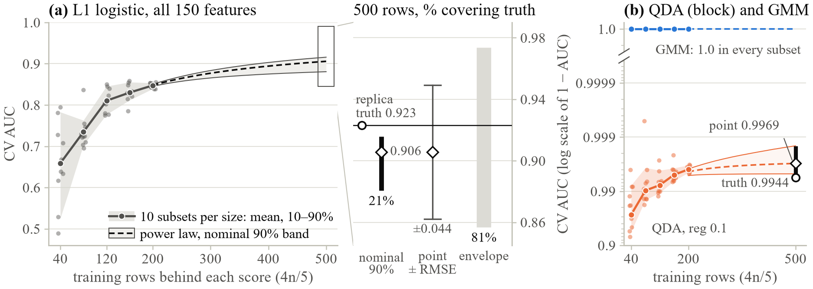

# Extension E2: Learning curve

**Author: TODO** (Kaggle: TODO)

*Use of generative AI. Claude Code (Anthropic; Claude Opus 5.5) designed this study, wrote and ran its code on Google Colab, drew the figures, and drafted and revised this text; a separate AI verification round re-checked the numbers against the archive [R941, R942]. TODO (owner): state what you re-ran, rewrote and checked. The log is in `registry/ai_usage.md`, rows 3, 7, 8, 10, 16, 21, 24 and 25.*

<!--
Limit: <= 2 pages. Headings exactly Question / Protocol / Results / Conclusion.
Every number traces to a run_id: (a) L1 baseline = 20261022-070248_e2_learning_curve (reports/tables/e2_manifest.json),
(b) QDA = 20261022-070339_e2_learning_curve_qda_block (e2_qda_manifest.json),
(c) GMM = 20261022-070445_e2_learning_curve_gmm (e2_gmm_manifest.json),
comparison = 20261022-070518_r307_e2_model_comparison, label requirement = 20261022-070600_r304_label_requirement,
regularisation side result = 20261022-063711_r300_l1_c02 (official CV 0.8729),
boundary rows = R422 20261022-193028_r422_linear_ceiling_r921 (summary.json real_boundary_counts, converged posterior
n_0.1_0.9 = 189; reports/tables/r422_real_boundary_counts.csv). Corrected 2026-10-22 (fix round 2): the earlier 203
(20261022-072942_r321_e3e4_proxy_test, gmm_proxy.n_boundary_0.1_0.9) counts S003's own compressed score, not a posterior
(research/reports/r2_noise.md section 3.3; research/reports/fix_round1.md section 7).
Verification: R941 = 20261022-092201_r941_e2_replica_truth (reports/tables/r941_e2_replica_truth.csv),
R942 = 20261022-094142_r942_e2_coverage (reports/tables/r942_e2_coverage.csv); see research/reports/verify_ext.md section 4.
The R308 back-test (20261022-071154_r308_e2_backtest) is no longer used as an argument: one sample cannot show the
average behaviour of the procedure (R942).
Colab jobs J20261022-070426-, -070740-, -071012-pro1-rext12.
Revised 2026-10-22 after verify round 1 (research/reports/verify.md section 4).
Figure 1 redrawn 2026-11-01 (ext_figures, Claude Code) by
extensions/e2_learning_curve/run.py --replot 20261022-070248_e2_learning_curve, from the run's archived
bootstrap.csv, extrapolation.csv and summary.json (nothing refitted): the legend now says "nominal 90%" for the
band and the AUC(500) interval (R942: 21% coverage), and the figure is drawn at its printed size, 70% of the
text width (legend 6.5 pt; before about 3.5 pt). The image link pins that width ("width=70%", read by
scripts/build_report.py; pandoc/Word use the PNG's natural size, also 70%).
The owner must check and be able to explain every number.
History, 2026-11-24 (formal-article rewrite by Claude Code, workflow agent for E2; baseline = git commit 259279b; measured
with the project builder: 2 pages, 1.93 used): rewritten as formal prose. Bullet points became paragraphs with topic
sentences; abbreviations and terms are defined at first use (AUC, sd, QDA, GMM, CV, SE, RMSE, high-variance block,
transductive, effective training size, nominal interval, envelope, replicas, replica truth); run codes appear only as
bracketed citations; the model labels (a)-(c) were replaced by model names; the Table 1 intervals are written as en-dash
ranges in parentheses (square brackets are reserved for archive tags) and its last row is labelled x = 500 (fit axis =
effective training size, config fit.x_axis effective, target_n 500). No value was changed. The reference list uses
ISO-abbreviated journal names and "et al." for three or more authors (full entries: registry/references.md; article
titles removed in the review round below).
Added from archive files named above: panel (b)'s QDA power-law point 0.9969 and replica truth 0.9944 in the Figure 1
caption (r307_e2_model_comparison.md; r941_e2_replica_truth.csv, qda_hv at t = 500; drawn by scripts/make_ext_figures.py).
Moved out of the visible text for the page limit (all still in the archive): S002's official CV AUC 0.9958 and "nested
tuning reaches 0.9999 in S005" (registry/submissions.csv; core report Table 1); the log-linear point's replica bias
+0.017 (R942, r942_e2_coverage.csv bias_log_linear_point 0.0165); "L1 is constant up to 20 labels" (R304,
r304_label_requirement.md, frac_constant 1.0 and AUC 0.5 for 2-20 labels); the Results copy of "QDA: median above 0.99
from 75 labels" (kept in the Conclusion as "about 75 for a median AUC of 0.99"); the notation "5-fold x 4" (the text says
"repeated four times"); the "joined in" wording of the Table 1 source line.
Checks for the owner: (1) Corrected 0.031 -> 0.030 (r942_e2_coverage.csv bias_power_law_point -0.030458; 0.031 was
-0.0305 rounded twice). (2) The 70% remark above describes the former figure e2_learning_curve.png; since commit 259279b
Figure 1 is ext_e2.png, drawn by scripts/make_ext_figures.py at the full text width, and its link carries no width hint.
History, 2026-11-24, review round (Claude Code workflow agent, fixer for E1 and E2; findings of two AI reviewers).
Baseline corrections: (a) power-law replica bias 0.031 -> 0.030 in Results and Conclusion (r942_e2_coverage.csv and
experiments/20261022-094142_r942_e2_coverage/summary.json, l1_all bias_power_law_point -0.030458 = pl_point_mean
0.89251 - truth 0.92297; the 0.031 of the baseline, of the run's notes.md and of verify_ext.md section 4 is
ext_e2_fan.md's -0.0305 rounded a second time); (b) "+0.040 over 250 training rows" became "0.041 above its value at 250
training rows": the two power-law point fits differ by 0.0411 (r307_e2_extrapolation_comparison.csv, l1_all
power_law_point 0.905719 at x = 500 and 0.864570 at x = 250), whereas 0.040 is the median bootstrap gain
(gain_250_500_median 0.03977), which the sentence did not name; (c) AI-use facts, evidence registry/ai_usage.md: the log
list adds row 24 (2026-11-23, "redrew the four extension figures ... e1-e4 (figure and caption only)"; old "rows 3, 7, 8,
10, 16 and 21") and the statement says "drafted and revised" (rows 10 and 21, and the 2026-11-24 rewrite); the members
still have to add an ai_usage.md row for the 2026-11-24 rewrite (registry edits were outside this job).
The quoted 0.91-0.92 is now placed between the point fit 0.906 and the replica truth 0.923 (no derivation is archived;
verify_ext.md section 4 "Suggested wording"); "(against 0.847 with 200)" left that sentence because 0.847 opens the
paragraph. Figure 1 caption: QDA's point 0.9969 is no longer repeated (the figure prints it); instead the caption gives
the QDA replica calibration, which explains the low replica truth 0.9944: r941_e2_replica_truth.csv, qda_hv mean vs
e2_observed_cv_mean at t = 40/80/120/160/200 = 0.9667/0.9729, 0.9856/0.9903, 0.9897/0.9923, 0.9916/0.9950, 0.9925/0.9960
(0.0062/0.0047/0.0026/0.0034/0.0035 lower); R941 summary.json check_500.qda_hv truth_in_e2_90 false and
truth_in_e2_envelope false; R941 notes.md "the replica is slightly too hard at the QDA ceiling". Other wording, no value
changed: QDA's label requirement names its regularisation (r304_label_requirement.md qda_hv = reg 0.1 on the block,
median over 50 label sets; the core report's 80 and 120 labels are other QDA variants and mean AUCs); the 189 boundary
rows are counted with the fitted (converged) mixture posterior (r422_real_boundary_counts.csv), unlike the core's true
class probability; Question split into one sentence per model ("L1 baseline" introduced; for the page limit "three of our
submitted models" became "three submitted models" and "1.5 times the median sd" became "1.5 times the median"); house
archive-tag sentence (HOUSE_STYLE section 2); defined terms in italics; RMSE defined as an abbreviation; "at 500 rows"
dropped after "replica truth" in Results (part of its definition); caption keys written "key: description" with the run
ids at the end; Table 1 caption cites runs (files: reports/tables/e2_*, r307_e2_model_comparison.md); references without
article titles (house style).
Main session 2026-11-25: '0.041 above its value at 250 training rows' -> 'at x = 250' (the power law at x = 250, not the n = 250 mean; r307_e2_extrapolation_comparison.csv); AI-use statement lists row 25. Measured: 2 pages, 1.94 used.
-->

## Question

How does the area under the receiver operating characteristic curve (AUC) change with the training-set size (50, 100, 150, 200 or 250 of our 250 labelled rows), what AUC should 500 rows give, and with what confidence? We study three submitted models. S001, the L1 baseline, is L1-penalised logistic regression on all 150 features (inverse regularisation strength *C* = 0.1). S002 is quadratic discriminant analysis (QDA; Friedman, 1989) with regularisation 0.1 on the high-variance block, the 13 features whose standard deviation (sd) over all 20,000 training and test rows exceeds 1.5 times the median, chosen without labels. S003, our final transductive Gaussian mixture model (GMM), fits two Gaussian components to these 13 features of all 20,000 rows, test rows included, by expectation–maximisation (Dempster et&nbsp;al., 1977) and uses labels only to name them. Bracketed identifiers cite the project archive: runs (R).

## Protocol

For each size *n* we drew 10 stratified subsets without replacement, shared by all models (at *n* = 250, the full data), and scored each by stratified 5-fold cross-validation (CV) repeated four times (scikit-learn; Pedregosa et&nbsp;al., 2011), with a new CV seed per subset and a fixed model seed. Each score comes from models trained on 4*n*/5 rows, so we fitted the curves against this *effective training size*, *x* = 40–200.

We extrapolated with an inverse power law, AUC(*x*) = *a* − *b*·*x*−*c* with *a* ≤ 1 (Figueroa et&nbsp;al., 2012), fitted to the five size means, weighted by standard error (SE), with SciPy's `curve_fit` (Virtanen et&nbsp;al., 2020). Its 90% interval comes from 2,000 bootstrap refits over the subset scores (Efron, 1979); we call it *nominal* because it under-covers (Results). A log-linear fit, an unweighted fit and a fit without *n* = 50 test the curve form; the union of all intervals is the *envelope*. A coverage simulation replayed the procedure on 100 *replicas*, samples of 250 rows simulated from a parametric model of our data in which each model's AUC at 500 training rows (the *replica truth*) is known [R941, R942]. A label-requirement analysis trained each model on 2–200 labelled rows (50 label sets each) and scored the rest [R304].

## Results

The L1 baseline is data-limited: its mean AUC rose by 0.19 from *n* = 50 to 250 without levelling off (Table 1, Figure 1a). The power law predicts AUC(500) = 0.906, 0.041 above its value at *x* = 250, but the curve form matters more than this gain (log-linear fit 0.945; fit without *n* = 50, 0.869).

| *n* (*x*) | L1: mean | L1: sd (min–max) | QDA: mean (sd) | GMM: mean |
|---|---|---|---|---|
| 50 (40) | 0.659 | 0.100 (0.489–0.795) | 0.973 (0.022) | 1.000 |
| 100 (80) | 0.735 | 0.040 (0.695–0.836) | 0.990 (0.005) | 1.000 |
| 150 (120) | 0.810 | 0.028 (0.775–0.850) | 0.992 (0.003) | 1.000 |
| 200 (160) | 0.830 | 0.021 (0.785–0.859) | 0.995 (0.0014) | 1.000 |
| 250 (200) | 0.847 | 0.006 (0.839–0.856) | 0.996 (0.0005) | 1.000 |
| **Power law, *x* = 500** | **0.906** | (0.881–0.916) | **0.997** (0.995–0.999) | 1.000 |

*Table 1. Mean and spread of the CV AUC over 10 subsets per size n. In parentheses after n, the effective training size x; at n = 250 only CV-seed noise remains, and the GMM's sd is always 0. Last row: power-law point at x = 500 and nominal 90% bootstrap interval. Envelopes at x = 500: L1 0.857–0.974; QDA 0.995–1 (log-linear up to 1.008). Runs as in Figure 1; comparison [R307].*

The nominal 90% interval is far too narrow: it contained the replica truth (0.923 [R941]) in only 21% of the 100 replicas, the envelope in 81%, and the power-law point was on average 0.030 too low, with a root-mean-square error (RMSE) of 0.044 [R942]. The bootstrap resamples subsets of one sample and so misses the variation between samples. The replicas are model-based (their L1 curve lies 0.034 above ours at *x* = 80), so 0.923 is indicative only, but the under-coverage is a property of the procedure.

QDA is nearly saturated (0.973 with 40 training rows), and the GMM's CV is at its ceiling, 1.0 in every subset (Figure 1b). With only two labels, one per class, the GMM ranked the unseen rows perfectly in all 50 label sets, whereas QDA reached a mean AUC of 0.950 at 30 labels [R304].

*Figure 1. Learning curves and extrapolation to 500 rows. (a)&nbsp;L1 baseline. Dots: single subsets; line and band: their mean and 10–90% range; dashed line and outlined band: power law and its nominal 90% band. Side panel: the 500-row box enlarged. Diamond and dark bar: point fit 0.906 and nominal 90% interval; bracket: point ± 0.044 (replica RMSE); light bar: envelope; line and ring: replica truth 0.923 [R941]; percentages: coverage in 100 replicas [R942]. (b) QDA and GMM as in (a), on a log scale of 1 − AUC; for QDA the replica curve runs 0.003–0.006 below our CV means at every size, hence the low replica truth (0.9944) [R941]. AUC 1.0 is drawn one decade above 0.9999 (axis break). Runs `20261022-070248_e2_learning_curve` (a), `20261022-070339_e2_learning_curve_qda_block` and `20261022-070445_e2_learning_curve_gmm` (b).*

## Conclusion

From *n* = 50 to 250, the L1 baseline's mean CV AUC rose from 0.659 to 0.847 and its sd across the 10 subsets fell from 0.100 to 0.021 (*n* = 200), while QDA rose only from 0.973 to 0.996 and the GMM stayed at 1.000. For 500 rows the power law predicts an L1 AUC of 0.906. Inside the observed range the trend is well determined (SE of a size mean 0.007–0.03), but the extrapolation reaches 2.5 times the largest training size with three parameters fitted to five points, and the bootstrap interval under-covers (21% for a nominal 90%, bias −0.030 [R942]). We therefore quote about 0.91–0.92 for 500 training rows, between the point fit and the replica truth (0.923), with a realistic uncertainty of about ±0.04 (envelope 0.86–0.97). For QDA, 500 rows would add less than 0.002 (+0.0008; replica bias −0.0005 [R942]); for the GMM, nothing.

For the core task, more labels would help only the weaker supervised models: the GMM, fitted to all 20,000 rows, ranks perfectly with two labels, whereas QDA (regularisation 0.1) needs about 75 for a median AUC of 0.99 [R304]. As it uses only our 250 labelled rows, this extension cannot show where the GMM still errs: the roughly 1% of test rows near its decision boundary (189 of 19,750 with fitted posterior probability 0.1–0.9 [R422]).

<!-- small -->
**References.** Dempster, A. P. et&nbsp;al. (1977). *J.&nbsp;R. Stat. Soc. B* 39, 1–38. Efron, B. (1979). *Ann. Stat.* 7, 1–26. Figueroa, R. L. et&nbsp;al. (2012). *BMC Med. Inform. Decis. Mak.* 12, 8. Friedman, J. H. (1989). *J. Am. Stat. Assoc.* 84, 165–175. Pedregosa, F. et&nbsp;al. (2011). *J. Mach. Learn. Res.* 12, 2825–2830. Virtanen, P. et&nbsp;al. (2020). *Nat. Methods* 17, 261–272.
<!-- /small -->
