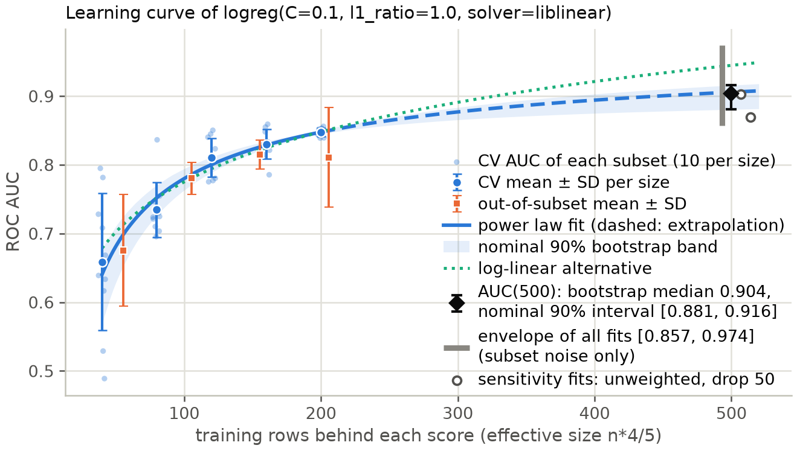

# Extension E2: Learning curve

**Author: TODO** (Kaggle: TODO)

*AI use: Claude Code (Anthropic; Claude Opus 5.5) designed this study, wrote and ran its code on Google Colab, drew the figures and drafted this text; a separate AI verification round re-checked the numbers against the archive (R941, R942). [TODO owner: say what you re-ran, rewrote and checked.] Log: `registry/ai_usage.md`, rows 3, 7, 8, 10, 16 and 21.*

<!--
Limit: <= 2 pages. Headings exactly Question / Protocol / Results / Conclusion.
Every number traces to a run_id: (a) L1 baseline = 20261022-070248_e2_learning_curve (reports/tables/e2_manifest.json),
(b) QDA = 20261022-070339_e2_learning_curve_qda_block (e2_qda_manifest.json),
(c) GMM = 20261022-070445_e2_learning_curve_gmm (e2_gmm_manifest.json),
comparison = 20261022-070518_r307_e2_model_comparison, label requirement = 20261022-070600_r304_label_requirement,
regularisation side result = 20261022-063711_r300_l1_c02 (official CV 0.8729),
boundary rows = R422 20261022-193028_r422_linear_ceiling_r921 (summary.json real_boundary_counts, converged posterior
n_0.1_0.9 = 189; reports/tables/r422_real_boundary_counts.csv). Corrected 2026-10-22 (fix round 2): the earlier 203
(20261022-072942_r321_e3e4_proxy_test, gmm_proxy.n_boundary_0.1_0.9) counts S003's own compressed score, not a posterior
(research/reports/r2_noise.md section 3.3; research/reports/fix_round1.md section 7).
Verification: R941 = 20261022-092201_r941_e2_replica_truth (reports/tables/r941_e2_replica_truth.csv),
R942 = 20261022-094142_r942_e2_coverage (reports/tables/r942_e2_coverage.csv); see research/reports/verify_ext.md section 4.
The R308 back-test (20261022-071154_r308_e2_backtest) is no longer used as an argument: one sample cannot show the
average behaviour of the procedure (R942).
Colab jobs J20261022-070426-, -070740-, -071012-pro1-rext12.
Revised 2026-10-22 after verify round 1 (research/reports/verify.md section 4).
Figure 1 redrawn 2026-11-01 (ext_figures, Claude Code) by
extensions/e2_learning_curve/run.py --replot 20261022-070248_e2_learning_curve, from the run's archived
bootstrap.csv, extrapolation.csv and summary.json (nothing refitted): the legend now says "nominal 90%" for the
band and the AUC(500) interval (R942: 21% coverage), and the figure is drawn at its printed size, 70% of the
text width (legend 6.5 pt; before about 3.5 pt). The image link pins that width ("width=70%", read by
scripts/build_report.py; pandoc/Word use the PNG's natural size, also 70%).
The owner must check and be able to explain every number.
-->

## Question

How does the AUC change when a model is trained on 50, 100, 150, 200 or 250 of our labelled rows? What AUC should we expect from **500 training rows**, and how much confidence does the spread allow? We answer for (a) the supervised baseline, L1 logistic regression on all 150 features (C = 0.1; S001); (b) supervised QDA with `reg_param` 0.1 (Friedman, 1989), the model of S002 (CV 0.9958; nested tuning reaches 0.9999 in S005), on the 13-column high-variance block, which is chosen without labels from the train+test features; (c) our final transductive GMM, which fits two Gaussian components to the features of all 20,000 rows by EM (Dempster et al., 1977) and uses labels only to name them.

## Protocol

- **Subsets**: for each n, 10 stratified subsets drawn without replacement; all three models see identical subsets (at n = 250, each is the full data).
- **Scoring**: stratified 5-fold × 4 CV inside each subset (scikit-learn; Pedregosa et al., 2011), a different CV seed per subset, model seed fixed. Each score comes from models trained on 4n/5 rows, so we fit against this **effective training size** x = 40–200.
- **Extrapolation**: an inverse power law AUC(x) = a − b·x^(−c), a ≤ 1 (Figueroa et al., 2012), fitted to the five means weighted by their standard error (SciPy `curve_fit`; Virtanen et al., 2020). A nominal 90 % interval comes from 2,000 bootstrap refits over the subset scores (Efron, 1979). Log-linear, unweighted and drop-n = 50 fits test the curve form; the union of all intervals is the *envelope*.
- **Checks**: a **coverage simulation** (R942) replays the whole procedure on 100 replica 250-row samples from a parametric model of our data (R941), where the AUC at 500 rows is known. A **label-requirement** run (R304) trains on 2–200 labelled rows (50 label sets each) and scores the rest.

## Results

| n (x) | (a) L1: mean | (a) L1: std [min, max] | (b) QDA: mean (std) | (c) GMM |
|---------------|-----------|---------------------------|----------------------|---------|
| 50 (40) | 0.659 | 0.100 [0.489, 0.795] | 0.973 (0.022) | 1.000 |
| 100 (80) | 0.735 | 0.040 [0.695, 0.836] | 0.990 (0.005) | 1.000 |
| 150 (120) | 0.810 | 0.028 [0.775, 0.850] | 0.992 (0.003) | 1.000 |
| 200 (160) | 0.830 | 0.021 [0.785, 0.859] | 0.995 (0.0014) | 1.000 |
| 250 (200) | 0.847 | 0.006 [0.839, 0.856] | 0.996 (0.0005) | 1.000 |
| **500, power law** | **0.906** | [0.881, 0.916] | **0.997** [0.995, 0.999] | 1.000 |

*Table 1. CV AUC over 10 subsets per size (n = 250: CV-seed noise only; GMM std 0); last row: power-law point and nominal 90 % bootstrap interval. Envelope at 500 rows: L1 [0.857, 0.974]; QDA [0.995, 1] (log-linear exceeds 1: 1.008). Sources: `reports/tables/e2_*`, joined in `r307_e2_model_comparison.md`.*

- **(a) L1 is data-limited.** The mean rises by 0.19 from n = 50 to 250 and has not flattened; the spread falls from 0.100 to 0.021. The power law gives AUC(500) = 0.906 (+0.040 over 250 training rows), but the curve form matters more: log-linear gives 0.945, the fit without n = 50 0.869.
- **The nominal 90 % interval is far too narrow.** On 100 replica samples (R942) it covers the replica truth at 500 rows (0.923; R941) in only 21 %; the power-law point is low by 0.031 on average (RMSE 0.044; log-linear +0.017), and the envelope covers 81 %. The bootstrap resamples subsets of one sample, so the noise of a new sample is missing. The replica is model-based (0.034 too high at x = 80), so 0.923 is indicative; the under-coverage is a property of the procedure.
- **(b) QDA is nearly saturated** (0.973 with 40 training rows), **and (c) the GMM's CV is at its ceiling at every size**: every subset scores 1.0. In R304 the GMM ranks the unseen rows perfectly in all 50 label sets with only **2 labels** (one per class). QDA reaches 0.950 at 30 labels and a median above 0.99 from 75; L1 is constant up to 20.

*Figure 1. L1 baseline (a), run `20261022-070248_e2_learning_curve`. Diamond: bootstrap median of AUC(500), 0.904, with the nominal 90 % interval (the text uses the point fit, 0.906); grey bar: envelope.*

## Conclusion

**Expected score at 500 rows.** For the supervised baseline we expect an **AUC of about 0.91–0.92 with 500 training rows**, against 0.847 with 200. The spread fixes the trend inside the observed range (SE of a size mean 0.007–0.03), but the extrapolation reaches 2.5 times beyond the data, with 3 parameters on 5 points. A coverage simulation on replicas shows the bootstrap interval under-covers (21 % for a nominal 90 %, bias −0.031; R942), so we quote about 0.91–0.92 with an honest uncertainty of about ±0.04 (envelope 0.86–0.97). For QDA, 500 rows would add less than 0.002 (+0.0008; replica bias −0.0005, R942); for the GMM, nothing.

**Implication for the core task.** More labels would help only the weak supervised models. With the mixture fitted on 20,000 unlabelled rows, two labels give a perfect ranking, against about 75 for QDA with `reg_param` 0.1 (median AUC 0.99; R304). E2 sees only our 250 labelled rows, so it cannot show where the GMM can still err: the ~1 % of test rows near its boundary (189 of 19,750 with a posterior of 0.1–0.9; R422).

**References.** Dempster et al. (1977), *J. R. Stat. Soc. B* 39:1–38. Efron (1979), *Ann. Statist.* 7:1–26. Figueroa et al. (2012), *BMC Med. Inform. Decis. Mak.* 12:8. Friedman (1989), *JASA* 84:165–175. Pedregosa et al. (2011), scikit-learn, *JMLR* 12:2825–2830. Virtanen et al. (2020), SciPy 1.0, *Nature Methods* 17:261–272.
