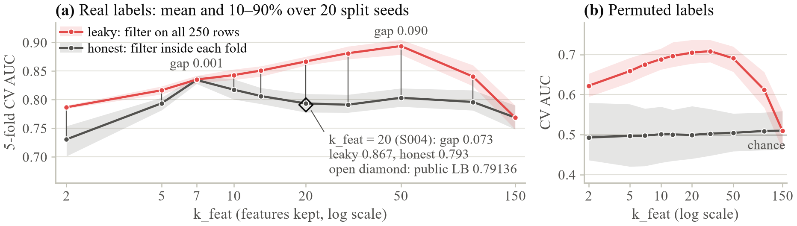

# Extension E3: Information leakage

**Author: TODO Full Name** (Kaggle: TODO)

<!--
Sources (all numbers): E3 run 20261022-063908_e3_leakage (Colab job J20261022-064045-pro1-rext34) ->
reports/tables/e3_grid.csv (= experiments/<run>/cells.csv), e3_null.csv, e3_leaderboard.csv (refreshed with S004 by
run.py --refresh-lb); S004 = registry/submissions.csv, pre-registration B005.
Proxy test AUC: run 20261022-072942_r321_e3e4_proxy_test -> reports/tables/r321_e3_proxy.csv (proxy_auc_hard).
Replicas: run 20261022-161150_r944_e3_replica_decomp -> reports/tables/r944_e3_replica_decomp.csv, per_draw.csv.
Corrected SE = gap_mean / corrected_t (cells.csv, k_feat 20, 5-fold: 0.0733 / 3.72 = 0.0197).
LB SE 0.0233 = public_lb_se_approx in e3_leaderboard.csv (Hanley-McNeil at AUC 0.79, 395 rows).
Edited 2026-10-22 by fix_ext34 (Claude Code) after verification round 1 (verify.md items 15, 19 = synthesis corrections 13, 17).
Length: the figure reports/figures/e3_gap_vs_kfeat.png (gap vs k_feat, one line per k_fold) was taken out to keep
the page within 2 A4 pages; its 2- and 10-fold values are now a table column. Its fonts are legible only at
>= 80 % of the text width, which does not fit. Checked with XeLaTeX, Calibri 11 pt, A4, 2.54 cm margins.
History. Rewritten 2026-11-24 by Claude Code (workflow agent, formal-article rewrite; scratchpad SPEC.md) as a formal
article: run-in fragments turned into paragraphs; abbreviations and terms defined (CV, AUC, LB, SD, SE, GMM, replicas,
leak optimism); archive codes only as bracketed tags (R321 = run 20261022-072942_r321_e3e4_proxy_test, R944 = run
20261022-161150_r944_e3_replica_decomp); k_feat and k_fold set with subscripts in the text (the figure keeps k_feat);
Table 1 header cells shortened so that the header fits on one line (numbers unchanged); reference list without titles
for the page limit (authors, year, journal, volume, pages; full entries in registry/references.md). No value changed.
Moved out of the visible text for the page limit (values kept here): untagged numbers come from run
20261022-063908_e3_leakage, except 61 and 48 (R943 = run 20261022-100104_r943_e4_null_step, summary.json e3_counts:
61 features with |corr| > 1/sqrt(250), 47.6 expected under pure noise; tagged [R943] in the text since the review) and
the replica values in "What is specific to this sample" (R944: per_draw.csv and notes.md); the caption file names e3_grid.csv, e3_null.csv and r321_e3_proxy.csv (see Sources above);
"SD over 20 split seeds 0.014" at k_feat = 20 in the Conclusion (it is in Table 1); "open diamond: S004 public score
0.79136" in the Figure 1 caption (the figure labels it and the Results text cites it); for k_feat = 20-50 leaky CV is
0.047-0.098 above the proxy (e3_grid.csv vs r321_e3_proxy.csv); with 10 folds honest CV is 0.015 below the proxy at
k_feat = 20 (e3_leaderboard.csv, r321_e3_proxy.csv); the file reference reports/tables/e3_leaderboard.csv after B005.
Reworded, please confirm: "The exact zero at k_feat = 7 is partly luck" -> "the vanishing gap at k_feat = 7 is also
partly luck". The 5-fold mean gap at k_feat = 7 is 0.00076, not exactly 0 (Table 1: 0.001 +- 0.003; it is exactly 0 in
19 of the 20 split seeds: cells.csv gap_min 0, gap_max 0.0153 = 20 x gap_mean); the 10-fold gap is exactly 0; the
replica median 0.006 (per_draw.csv, 0.0059) is the 5-fold one.
History 2026-11-24 (review round, Claude Code fixer for E3; findings XF7, XF9, XF13-XF17, XL20-XL25). Baseline values
corrected from the archive: "|bias| <= 0.004" -> "<= 0.0044" (r944_e3_replica_decomp.csv, k_fold 5, k_feat 10:
honest_bias_mean -0.004374; R944 notes.md "|bias| <= 0.0044"); "re-selects these seven in every fold" -> "in almost every
fold" (e3_grid.csv k_feat 7, 5-fold: fold_overlap_with_leaky_set 0.9986, shown as 1.00 in Table 1; fold_scores_grid.csv:
leaky and honest fold AUCs differ in 1 of 100 folds, repeat 8 fold 4; with 10 folds in 0 of 200). The reviewers confirmed
the "vanishing gap" rewording above. Reworded, claim unchanged: "More folds put less of each validation part into the
selection" -> "More folds shrink the share of each validation part in the leaky selection" (under leaky selection the
validation part is always inside the selection set; its share 1/k_fold shrinks). Moved out of the text: "(1.2 SE)" after
"0.028 below its proxy AUC" (0.028 / 0.0233, the Hanley-McNeil SE at AUC 0.79 and 395 rows, e3_leaderboard.csv
public_lb_se_approx; registry/beliefs.md B005: -1.2 SE), because the core report states the same S004 shortfall from its
expectation as 1.35 SE with R440's SE at the expected AUC; "0.075 (3.2 SE)" keeps E3's SE 0.023. AI statement: added
"drew the figure" (registry/ai_usage.md rows 8 and 24), "and revised" (rows 10 and 21 and this 2026-11-24 rewrite) and
row 24 (2026-11-23 redraw of ext_e3.png and its caption); "uploaded submission S004" back to the baseline "uploaded S004"
for length; the archive-tag sentence now in house wording (HOUSE_STYLE section 2) and moved from Question to the end of
the AI statement, as in E1. Terms: SD -> sd (HOUSE_STYLE section 3); "ten" -> "10"; "corrected paired t-test" ->
"corrected t-test"; SE defined in a full clause; "hence the flat null gap" -> "so the null gap is flat"; Results sentence
split; Figure 1 caption restructured; references in house style ("&", no comma after the venue). Baseline wording restored
for length: "(61 here, 48 under pure noise)" (now tagged [R943]) and "is 0 at 150". Not applied for the page limit (each
costs a line; E3 has no free line): glossing C, "corrected SE" and "null SEs" (XL26) and citing LIBLINEAR (Fan et al.,
2008; XF25, XL27), which the core report's software line cites. Typeset with draft_build.py: 2 pages, 1.94 used.
Main session 2026-11-25: leak optimism by k_fold now says it is the k_feat = 20 value (0.053-0.054 with 2, 5 or 10 folds; r944_e3_replica_decomp.csv leak_optimism_mean 0.0540 / 0.0536 / 0.0530), so it no longer reads against the 0.015 at k_feat = 2; AI-use statement lists row 25. Measured: 2 pages, 1.94 used.
2026-11-25 (main session, at the member's request): the AI-use statement is removed from this part for now; the member will write the AI disclosure together with the contribution table (course rule 6 requires it in the submitted report; facts in registry/ai_usage.md; previous wording in git 63b56f9).
2026-11-25 (main session, at the member's request): the reference list of this part moved to one complete, alphabetical list for the whole document, reports/references.md (written by scripts/make_references.py from registry/references.md; built as part 'refs' after the extensions).
-->

## Question

We study a filter keeping the *k*feat features most correlated with the label (largest absolute Pearson correlation). Fitted once to all 250 labelled rows before *k*fold-fold cross-validation (CV), it is *leaky*, as the validation rows help to select the features (Ambroise & McLachlan, 2002; Hastie et al., 2009, Sec. 7.10.2); refitted inside each fold on the training part only, it is *honest*. By how much does leaky CV overstate the area under the receiver operating characteristic curve (AUC) relative to honest CV and to the public leaderboard (LB), and how and why does the gap vary with *k*feat and *k*fold? Bracketed identifiers cite the project archive: runs (R) and pre-registered beliefs (B). Cited works are listed in the References at the end of the document.

## Protocol

Both procedures used one scikit-learn pipeline (Pedregosa et al., 2011): standardisation, the filter and an L2-penalised logistic regression (*C* = 0.1, fixed seed). They differed only in the rows the filter used and shared all splits: 10 values of *k*feat (Table 1) for 2, 3, 5 and 10 folds, each with 20 stratified split seeds (with 5 folds, the official splits of our validation protocol). We report means and standard deviations (sd) over seeds and test the gap, leaky minus honest CV, with the corrected *t*-test of Nadeau and Bengio (2003). Two checks test the code: the gap must be exactly zero at *k*feat = 150, where all features are kept, and honest CV must be near 0.5 with permuted labels (30 permutations × 5 seeds). The final model (*k*feat = 20, fitted to all rows) is the same for both procedures; we submitted it once, as S004, with a pre-registered expected score [B005]. As the public LB scores only about 395 test rows, with a standard error (SE) of 0.023 (Hanley & McNeil, 1982), we also scored every *k*feat on all 19,750 test rows against proxy labels from our transductive Gaussian mixture model (GMM; fitted without labels to all training and test rows; public AUC 0.99923) [R321]. The proxy is not a leaderboard score.

## Results

| *k*feat | Leaky | Honest | Gap ± sd | *p* | Overlap | Gap, 2 / 10 folds | Null gap | Proxy |
|---:|---:|---:|---:|---:|---:|---:|---:|---:|
| 2 | 0.787 | 0.731 | 0.056 ± 0.020 | 0.052 | 0.66 | 0.062 / 0.056 | 0.129 | 0.776 |
| 5 | 0.816 | 0.794 | 0.023 ± 0.010 | 0.14 | 0.81 | 0.020 / 0.025 | 0.162 | 0.821 |
| **7** | 0.835 | **0.834** | **0.001 ± 0.003** | 0.84 | **1.00** | 0.014 / 0 | 0.178 | 0.852 |
| 10 | 0.843 | 0.818 | 0.025 ± 0.014 | 0.098 | 0.87 | 0.040 / 0.025 | 0.187 | **0.864** |
| 13 | 0.851 | 0.806 | 0.044 ± 0.010 | 0.011 | 0.82 | 0.064 / 0.044 | 0.196 | 0.841 |
| **20** | 0.867 | 0.793 | **0.073 ± 0.014** | 0.0003 | 0.78 | 0.087 / 0.063 | 0.206 | 0.820 |
| 30 | 0.881 | 0.791 | 0.090 ± 0.014 | 0.0001 | 0.75 | 0.107 / 0.082 | 0.206 | 0.783 |
| **50** | **0.894** | 0.803 | **0.090 ± 0.014** | < 0.0001 | 0.77 | 0.115 / 0.085 | 0.186 | 0.825 |
| 100 | 0.840 | 0.796 | 0.044 ± 0.012 | 0.004 | 0.84 | 0.063 / 0.037 | 0.103 | 0.805 |
| 150 | 0.769 | 0.769 | 0 (exact) | 1 | 1 | 0 / 0 | 0 | 0.802 |

*Table 1. Leaky and honest 5-fold CV AUC (mean and sd over 20 split seeds, official splits). Gap: leaky minus honest CV; p: corrected t-test; overlap: share of the all-rows feature set also selected in the folds; null gap: gap with permuted labels (leaky 0.61–0.71, honest 0.49–0.51); proxy: all-rows model against GMM proxy labels on the 19,750 test rows [R321]. Run 20261022-063908_e3_leakage.*

Both checks passed (Table 1). At *k*feat = 20, more folds reduced the gap (0.087, 0.082, 0.073 and 0.063 for 2, 3, 5 and 10 folds) because honest CV rose from 0.767 to 0.805 (overlap 0.629 to 0.855) while leaky CV stayed at 0.854–0.867. Under permuted labels the gap was flat (0.201, 0.206 and 0.210 for 3, 5 and 10 folds). S004 scored a public AUC of 0.79136 (Figure 1a, open diamond), inside the pre-registered 90% range 0.785–0.854 [B005] and 0.028 below its proxy AUC of 0.820.

*Figure 1. Leaky and honest 5-fold CV AUC by the number of features kept. (a) Real and (b) permuted labels; means and 10–90% bands; vertical segments: the gap. Run 20261022-063908_e3_leakage.*

## Conclusion

**How much leaky CV overstates the AUC.** At the submitted *k*feat = 20 (5 folds), leaky CV exceeded honest CV by 0.073 (corrected SE 0.020, *p* = 0.0003) and the public score by 0.075 (3.2 SE); the gap reached 0.090 with 5 folds (*k*feat = 30–50) and 0.115 with 2 folds. Honest CV matched the public score to within 0.002, partly by chance (public SE 0.023). Against the proxy, leaky CV was 0.047 too high and honest CV 0.026 too low, as the honest fold models select and fit on only 200 of the 250 rows.

**How the gap depends on *k*feat, and why.** The gap is not monotone. For a noise feature whose correlation with the label over all *n* = 250 rows is *s*, the training-part and validation-part correlations in a fold have expected product *s*² − 1/*n*, so a noise feature kept for its large |*s*| tends to agree in sign on both parts and adds spurious signal to the validation rows. Here seven features have |*s*| = 0.34–0.40 (5–6 null SEs, 1/√*n*) and all others |*s*| ≤ 0.24. At *k*feat = 7 the in-fold filter re-selects these seven in almost every fold, and the gap vanishes; further features are mostly noise selected by chance, and the gap grows. The summed optimism Σ(*s*² − 1/*n*) peaks when all features with |*s*| > 1/√*n* are kept (61 here, 48 under pure noise) [R943]; the AUC gap levels off earlier (*k*feat = 20–30 under the null, 30–50 here) and is 0 at 150.

**What is specific to this sample.** For *k*feat ≤ 10 leaky CV lies within 0.021 of the proxy and honest CV 0.017–0.046 below it, so our small-*k*feat gap mainly reflects the pessimism of honest CV. This is atypical: on 100 simulated replicate data sets (replicas) from a parametric model fitted to our data, honest CV was unbiased for its own fold models (|bias| ≤ 0.0044), and the mean small-*k*feat gap (0.015 at *k*feat = 2) was leak optimism, the excess of leaky CV over the test AUC of its own fold models [R944]. Our gap of 0.056 at *k*feat = 2 lies at the 96th percentile of the replicas, and replicas with such gaps have a low honest estimate (bias −0.037); the vanishing gap at *k*feat = 7 is also partly luck (replica median 0.006).

**How the gap depends on *k*fold, and why.** More folds shrink the share of each validation part in the leaky selection but make its correlation noisier; to first order the effects cancel, so the null gap is flat. On the real data the gap shrinks because larger training parts help the honest filter find the seven strong features, while leak optimism stays constant (0.053–0.054 with 2, 5 or 10 folds at *k*feat = 20 [R944]).

**Consequence.** Leaky CV would also pick the wrong model, *k*feat = 50 (proxy AUC 0.825), whereas honest CV picks *k*feat = 7 (0.852), close to the proxy optimum at *k*feat = 10 (0.864). Every label-dependent step, feature selection included, belongs inside the pipeline that is refitted in each fold.
