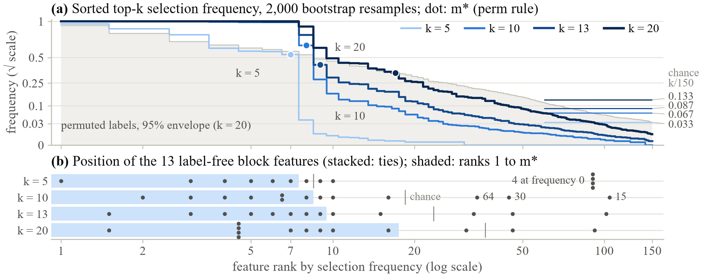

# Extension E4: Stability of the feature ranking

**Author: TODO Full Name** (Kaggle: TODO)

*AI use: Claude Code (Anthropic; Claude Opus 5.5) designed this study, wrote and ran its code on Google Colab, drew the figures and drafted this text; a separate AI verification round re-checked the numbers against the archive (R943). [TODO owner: say what you re-ran, rewrote and checked.] Log: `registry/ai_usage.md`, rows 3, 7, 8, 10, 16 and 21.*

<!--
Sources (all numbers): E4 run 20261022-071414_e4_feature_stability (Colab job J20261022-071554-pro1-rext34) ->
reports/tables/e4_frequency.csv, e4_drop.csv, e4_stable_sets.csv, e4_usefulness.csv, e4_paired.csv,
e4_infold_selection.csv, reports/figures/e4_frequency_sorted.png.
Null comparison of the largest step and null calibration of the rules: run 20261022-100104_r943_e4_null_step ->
reports/tables/r943_e4_drop_vs_null.csv (frac_null_step_ge_obs = 0.02 = 1 of 50; +1-corrected p = 2/51 = 0.039).
Stable set vs label-free block: run 20261022-074624_r320_e4_stable_vs_block -> reports/tables/r320_usefulness.csv,
r320_paired.csv, r320_feature_table.csv. (The proxy test AUC of R321, r321_e4_proxy.csv, is no longer quoted here.)
Best linear model: run 20261022-063713_r300_block_l2_c1 (reports/tables/r300_candidates.csv, 0.898).
Config: extensions/e4_feature_stability/config.yaml (drop.primary_rule: perm).
Edited 2026-10-22 by fix_ext34 (Claude Code) after verification round 1 (verify.md item 18 = synthesis
corrections 16-17; verify_ext.md section 3). The former Table 1 (drop position by rule, e4_drop.csv) was merged into the figure (its panel labels
give m* for every rule) and one sentence of Results. Checked with XeLaTeX, Calibri 11 pt, A4, 2.54 cm margins.
Figure 1 redrawn 2026-11-01 (ext_figures, Claude Code) by
`extensions/e4_feature_stability/run.py --replot 20261022-071414_e4_feature_stability`, from the run's archived
frequency.csv, null_sorted_curves.csv and drop.csv (nothing recomputed): one row of four panels at the full text
width, printed text 6.3-7 pt (before: 2-3 pt), log rank axis, legend inside the figure. The panel titles now give
m* under the perm rule only; all four rules are in the Results sentence below the figure. Place the figure at
100% of the text width (its natural size): E4 measures 1.86 pages (plain spacing, content-fitted tables;
1.94 with equal-width tables), as before the redraw.
-->

## Question

The 150 features are ranked by |corr(feature, target)| on bootstrap resamples. How often does each enter the top
k (chance rate k/150)? Does the sorted frequency drop sharply, and does the drop move with k? Does a model on the
features above the drop match or beat all 150? How does being stably selected relate to being worth keeping?

## Protocol

*Ranking.* B = 2000 bootstrap resamples of the 250 rows (seed 2026; Efron 1979), each giving a Pearson |corr|
ranking (no model). The same resamples serve k = 5, 10, 13 and 20 (13 = size of the label-free high-variance
block). *Drop position m\*(k).* Pre-registered primary rule *perm*: the features above the
rank-wise 95% envelope of 50 permuted-label curves. Secondary rules: the largest step between sorted frequencies
(*gap*), frequency ≥ 0.5 (*half*), and the Bonferroni bound of Bin(B, k/150) (*binom*). *Usefulness.* L2
logistic regression (C = 0.1) on the official CV (5-fold × 20 seeds; corrected paired t-tests, Nadeau & Bengio
2003) with all 150 features, with
*naive* sets chosen on all 250 rows (biased as in E3; Ambroise & McLachlan 2002), and with *honest* sets re-chosen
in each fold, by stability selection (Meinshausen & Bühlmann 2010) or as the top-m by |corr|. *R320:* L2
logistic, QDA (reg 0.1) and the team's transductive GMM (K = 2, train+test features, D007; all scikit-learn,
Pedregosa et al. 2011) on the block, the in-fold stable set (top-10, frequency ≥ 0.5) and their difference.

## Results

*Figure 1. (a) Sorted selection frequency for k = 5, 10, 13, 20 (log rank, square-root frequency); dots: m\* under
the primary perm rule; grey: 95% envelope of the 50 permuted-label curves for k = 20; right: chance k/150. (b) Sorted
position of the 13 label-free block features (ties stacked); shaded: ranks 1 to m\*; tick: first rank below chance.
Run 20261022-071414_e4_feature_stability (e4_frequency.csv, e4_drop.csv, null_sorted_curves.csv); block:
r320_feature_table.csv (R320).*

Features 98, 17, 100, 112, 80, 77 and 46 (|corr| 0.34–0.40) are selected in ≥ 98.5% of resamples for k = 10, 13
and 20, and share five places at k = 5 (0.53–0.95). Feature 49 (|corr| 0.24) reaches 4% / 65% / 79% / 92%; all
others are ≤ 28% at k = 10. m\* for k = 5 / 10 / 13 / 20: perm 7 / 8 / 9 / 17, gap 7 / 8 / 8 / 8, half
7 / 8 / 8 / 9, binom 7 / 17 / 22 / 28. The largest step (0.49 / 0.37 / 0.37 / 0.30) is exceeded by 1 of the 50
permuted-label curves for every k (p ≈ 0.02–0.04; R943).

| feature set (chosen in-fold) | n | L2 logistic | QDA | transductive GMM |
|---|---:|---:|---:|---:|
| all 150 | 150 | 0.769 ± 0.018 | n/a (n < p) | 1.000 (R003) |
| stable (top-10, freq ≥ 0.5) | 7.6 | 0.832 ± 0.005 | 0.961 ± 0.006 | 0.983 ± 0.003 |
| above the perm drop, k = 20 | 17 | 0.797 ± 0.015 | – | – |
| label-free block | 13 | **0.862 ± 0.007** | **0.996 ± 0.001** | **1.000 ± 0.000** |
| block minus stable | 6.4 | 0.765 ± 0.011 | 0.917 ± 0.008 | 0.932 ± 0.031 |

*Table 1. Official CV AUC, mean ± SD over 20 seeds. Sources: e4_usefulness.csv (all150, honest_stable,
honest_drop_top_m), r320_usefulness.csv; GMM on all 150: run 20261022-050732_r003_gmm2_all. Block plus stable set:
0.860 / 0.996 / 1.000, no gain over the block.*

**Paired differences** (L2, e4_paired.csv). *Above the drop vs all 150:* honest stable set at k = 10 +0.063 (split
SE 0.004, p = 0.038); the 17 features above the primary drop at k = 20 +0.028 (p = 0.30). *Naive − honest:*
−0.001 at k = 10 (in-fold sets match, Jaccard 0.94), +0.034 at k = 5 (p = 0.016), +0.069 for the 17 features
(p = 0.0006). *Stability selection − honest top-m:* −0.033 to +0.002, never significantly positive.
*Stable − block* (r320_paired.csv): −0.030 / −0.035 / −0.017 for L2 / QDA / GMM (p = 0.018 / 0.0006 / 0.009).

## Conclusion

**Sharp drop, and its dependence on k.** Yes, at about the 5% level: only 1 of 50 null curves has a larger step
(thinnest margin at k = 20). The strong group of 7 (+ feature 49) is above the drop for k = 10, 13 and 20; at
k = 5 the seven compete for five places and the curve is cut inside the group. Which weaker features also clear the drop depends on k:
under the pre-registered perm rule m\* grows to 17 at k = 20, where nine features with |corr| 0.13–0.18 beat the
noise envelope. Gap and half stay at 7–9, but half admits pure-noise features in 72–100% of null curves at k ≥ 10
(perm: 6–8%; R943). Binom (17–28) fails because a noise feature with a lucky sample correlation is reproduced by
every resample: with no signal the top feature reaches 0.84 at k = 10 (95% quantile).

**Stably selected vs worth keeping.** For a linear model the stable features are worth keeping (+0.063 over all
150), while the 17 above the primary drop at k = 20 add little (+0.028); naive selection biases this only for the
unstable (k = 5) or weak (k = 20) sets. But every stable set equals the top-m set by |corr|: stability measures how
reproducible the *marginal* correlation is, not whether a feature carries information. Six of the 13 block
features are never in the top-10 / freq ≥ 0.5 set (frequency 0.002–0.28; 15, 30, 64 below chance; under perm, 67
is stable at k = 13 and 20, and 8 and 26 at k = 20). Their signal lies in the variance: between the two label-free
GMM components their standardised mean difference is about 0 (15, 30, 64), while log variance ratios reach −1.0,
+0.63 and +0.83 (8, 64, 67). Alone these six give QDA 0.917 and the GMM 0.932: close to the best linear model on all
13 block columns (0.932 with the block chosen in each fold, 0.938 with the train+test block; R249) and well
above L2 logistic regression with C = 0.1 on the block (0.862, Table 1). Conversely, the second most stable feature, 17, is an exact linear combination of
the block (label-free R² = 1 − 3e-14) and adds nothing (QDA +0.0004, p = 0.44). Stability and usefulness coincide
only when the signal is in the class means; usefulness depends on the model and must be judged by honest CV. For
the team's covariance-based final model the |corr| ranking is the wrong guide.

**References.** Ambroise, C. & McLachlan, G. J. (2002), *PNAS* 99, 6562–6566. · Efron, B. (1979), *Annals of
Statistics* 7, 1–26. · Meinshausen, N. & Bühlmann, P. (2010), *J. R. Stat. Soc. B* 72, 417–473. · Nadeau, C. &
Bengio, Y. (2003), *Machine Learning* 52, 239–281. · Pedregosa, F. et al. (2011), scikit-learn, *JMLR* 12,
2825–2830.
