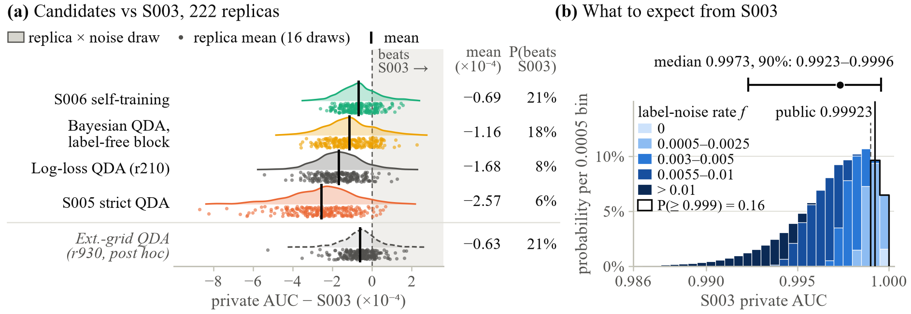

# DSAI4203 Small-Sample Classification Challenge: Core Report

**Team: TODO_TEAM_NAME** (Kaggle team: TODO_KAGGLE_TEAM_NAME)

Members: TODO Full Name 1, TODO Full Name 2, TODO Full Name 3 (roles: contribution table)

**In short.** A two-component Gaussian mixture fitted without labels to all 20,000 rows ranks test rows almost perfectly; label noise, not the model, should limit its private score (expected ≈ 0.997). Final selections (D010, default case; TODO: tick them on Kaggle, 23–25 Nov): **S003**, this mixture (*transductive*; public 0.99923), and **S005**, a QDA on the labelled rows only (*strictly inductive*; public 0.99953).

<!--
Limit: <= 6 pages INCLUDING this title block, tables, figures, the AI disclosure and the references.
English only. Every number must trace to a run_id or sub_id; no sandbox/ results.
Figures/tables only from scripts: link figures/<name>.png; paste tables from tables/<name>.md.
Measured 2026-11-23 after the review fixes (Times New Roman 11 pt, code spans also in Times New Roman, references in 10 pt
via the small markers): 6 pages, 5.91 used, about 4 lines free at the end of page 6 (the members' TODOs need about 3-4).
Sections run on without page breaks; if a section ends 2-3 lines short of a page, the next one starts on a new page and the
part can grow by 0.3 page (seen in this revision): check the page count after every edit.
Layout: build_report.py keeps each figure with its caption and does not float it, so a figure that no longer fits moves to the
next page and leaves a gap. The text is ordered so that pages 1-5 fill (Figure 3 and Table 1 after "What each upload showed",
Figure 6 after "Negative results"); one added line on pages 1-5 can cost up to 0.1 page. Check with
  .venv\Scripts\python.exe scripts\build_report.py --parts core --out (a PDF outside reports/)
Sources per section: docs/ARCHIVE_RULES.md section 10. Checks before export: reports/README.md.

History. Draft written 2026-11-01 by Claude Code (workflow agent core_writer); revised the same day by Claude Code (workflow
agent core_fixer) after three AI reviews (numbers, claims, rubric; research/reports/review_round1.md). Rewritten 2026-11-23
by Claude Code (workflow agent writer) around six figures and the Times New Roman layout (previous text: git HEAD): prose
shortened and reordered; the reviewed facts and caveats kept. Changes of fact: "the repository has none yet" -> all runs
predate the first commit (D016, first commit 2026-11-15); R900 ranges printed at two decimals (0.48-0.50 / 0.70;
0.48-0.57 / 1.00), as in Figure 2 (S003's Null B mean is 0.5725 exactly).
Revised 2026-11-23 by Claude Code (workflow agent fixer) after three AI reviews of that rewrite (numbers, claims, reader):
counts 139 -> 140 official runs and 214 -> 215 archived runs (the 2026-11-01 S005 re-run 20261101-123515_r201_qda_block);
KS tests sourced to R001; Null A folds are not the official ones (R900 per-perm split_sig); Section 4 (iii) limited to the
five candidates of Figure 4a (R936 also lists GMM variants r105 / r155 / r102 at -1.0 / -1.7 / -1.0e-6); D010 case wording
(no ruling or only the unsupervised use allowed -> default, D015; both forbidden -> case 3); Figure 1c described as S003's
estimate; S005/S006 leads compared with R936's predicted sd of their public scores (public_pred_sd 3.3e-4 / 6.6e-4; the sd
of the public difference itself is 3.23e-4 / 6.54e-4); semi-supervised EM with two components per class lost 3.7e-6 (R103);
a summary line added under the title. Moved out of the running text in this revision for the page limit: "We also corrected
two of our own claims" (both corrections are listed below and the facts stay in Sections 2 and 4); "Private LB: after the
deadline"; the R249 64-row comparison table, re-computed in R440; full venues of the "Also used" references (in
registry/references.md; the three book entries that could not be identified now name the book).
Details moved out of the running text in that rewrite (all still in the archive): hold-out P(correct order at 0.01) = 0.64,
a normal approximation for a pair about 0.004 apart (R940), and the 5- and 10-fold MDD 0.030 (core_protocol_schemes.md);
the corrected t-test inflates 1/J to 1/J + 50/200, and "wins most folds" = fold win rate > 0.5 (docs/VALIDATION_PROTOCOL.md);
BIC: K = 3 +851, tied / diagonal / spherical > 1e5 worse (R101); E3 leak: corrected SE 0.020; the S005/S006 leads of
3.0-3.3e-4 are 12-13 of about 39,000 public pairs (R936); second-selection gains 1.45e-5 (S006) and 4.1e-6 (S005) under
R936's R156 weights, 2.0e-5 and 7e-6 under the flat combined prior and 2.31e-5 and 1.0e-5 under the flat train-only prior
(R425; the text says "at most 2.3e-5"), i.e. about 1/15 of the replica sd of S003's R156-weighted private AUC, 3.1e-4
(R936; per-level sds 2.9-5.5e-4 for f > 0); per-candidate mean differences -0.63 / -0.69 / -1.16 / -1.68 / -2.57e-4 (Figure 4a, core_selection.md);
labels-only L1 logistic (all features) 0.847 and LDA 0.86, TabPFN / TabICL on the block 0.989 / 0.999 (Figure 5,
core_landscape.md, R251); R441 = R206 re-run on 80 new folds with new label draws; R920: a label-free likelihood search finds
the same 12 informative columns (margin 13.0 nats); R901: ids, row order and duplicates carry no signal; the two earlier claims we
corrected (zero label noise was called "nearly impossible", R922: it is disfavoured only 5:1, kept in Section 4; QDA and
the mixture are "indistinguishable" only in CV, D011); three of the 30 saturated official runs are re-runs of S003; official split signature 5708ce5c3828 (all official runs, S003 included); reproduction re-run of the README route
20261022-212507_final_s003_gmm2_hv.
Numbers come from reports/tables/r440_core_numbers.csv (R440 audit; its 7 failed claims are not used) unless another
source is named. Generated inputs (do not edit by hand):
  .venv\Scripts\python.exe scripts\submission_history.py   -> reports/tables/core_submission_history.{csv,md}
  .venv\Scripts\python.exe scripts\make_core_figures.py    -> reports/figures/core_*.png, reports/tables/core_*.{csv,md,json}
Figures (inputs with sha256 and the script's cross-checks: reports/tables/core_manifest.json). Heights of F1 and F2 were
reduced on 2026-11-23 through the script's size parameters (F1_H 1.48 -> 1.32, F1 figsize 2.12 -> 1.96, zoom 0.62 -> 0.56,
colour bar lowered; F2 figsize 2.36 -> 2.17, H_AX 1.62 -> 1.43, row labels re-spaced): printed 1.99 -> 1.83 in and
2.28 -> 2.09 in; the F1c x squeeze is now 4.19x (core_data.md). Figures 3, 5 and 6 are shown at 94.5% width: their smallest
text is 8 pt, so it prints at >= 7.5 pt; Figures 1, 2 and 4 (7.5 pt text) stay at full width.
Figure changes in the 2026-11-23 review fixes (same sizes): F1a shows only the 20 structured features (the 130 noise
features, all |r| <= 0.03, are a note); F1c titled as S003's groups; F2a band = pooled 5 x 20 mean +- 0.01 (as in E1's
figure), title 'split seeds'; F3 questions all phrased as questions, legend moved off the axis break; F4 S005 mean label
boxed, shorter group headers; F6a legend shows the mean tick, r930 named in its label; F6b bands labelled by the
simulated levels inside them (0.003-0.005, 0.0055-0.01); maths text ($v_1$, $f$) in Times New Roman.
  Figure 1 = figures/core_data.png (F1): data/raw train+test features; S003 scores (20261022-050708_r003_gmm2_hv test_pred.npy);
    R901 summary.json (block13, sd ratios 1.675 / 1.473); R150 feature taxonomy. Table view: tables/core_data.md.
  Figure 2 = core_protocol.png (F2): E1 paired_estimates.csv + paired_difference.csv; R900 r900_perm_null_{A,B}_per_perm.csv.
    Table views: core_protocol_schemes.md (MDD 0.057 / 0.030 / 0.030 / 0.0083 / 0.0061), core_protocol_nulls.md.
  Figure 3 = core_journey.png (F3): registry/submissions.csv; E3 summary.json leaky_auc_mean 0.867. Table 1 = core_journey.md.
  Figure 4 = core_selection.png (F6): (a) research/r935_r933_pooled.npz, the archived input of R936, checked against R936
    private.csv (tn0, csv8, weighted_r156); (b) R922 r922_likelihood_fine.csv + r922_private_by_flip.csv, each noise level
    taken as normal; this reproduces R922's summary within 6e-5 (core_predictive.md). Table view: core_selection.md.
  Figure 5 = core_landscape.png (F4): fold_scores.csv of the 14 runs listed in core_landscape.md (r003_sup_l1_all,
    r200_lda_block, r201_knn_block, r203_lgbm_block_nested, r200_l1_block, r201_svm_block, r202_gpc_ard_block,
    r201_qda_block, r003_sup_qda_hv, r255_bqda_eb_hv, r209_selftrain_qda_lw, r003_gmm2_hv, r251_tabpfn2_hv, r251_tabicl_hv);
    0.947 = R154.
  Figure 6 = core_unlabeled.png (F5): (a) R441 label_budget_evals.csv, label_budget_first_hit.csv; (b) r404_boundary.csv.
    Table views: core_label_budget.md, core_budget_curves.csv, core_boundary.md.
Run ids behind the short labels: R001 20261022-051627_r001_data_structure; R002 20261022-053218_r002_informative_subspace;
R003 20261022-050647_r003_sup_l1_all to 20261022-050732_r003_gmm2_all (8 runs); R101 20261022-064201_r101_bic_model_choice;
R103 20261022-073702_r103_replica_bootstrap;
R150 20261022-064606_r150_taxonomy; R154 20261022-065605_r154_class_structure; R205 20261022-072747_r205_select_supervised;
R206 20261022-074712_r206_label_budget; R249 20261022-082329_r249_sup_comparison;
R251 20261022-073743_r251_tabpfn2_all, 20261022-073935_r251_tabpfn2_hv, 20261022-074251_r251_tabicl_all, 20261022-074643_r251_tabicl_hv;
r201 = S005 20261022-071234_r201_qda_block; r209 = S006 20261022-080632_r209_selftrain_qda_lw; r210 20261022-082047_r210_qda_block_nll;
r255 20261022-070200_r255_bqda_eb_hv + 20261022-070202_r255_bqda_eb_trainonly;
R900 20261022-091506_r900_perm_null_a + 20261022-092943_r900_perm_null_b; R901 20261022-094812_r901_id_order_dupes;
R910 20261022-091211_r910_s003_gmm2_hv; R920 20261022-100551_r920_generator_alternatives;
R921 20261022-094951_r921_bayes_regret_replicas; R922 20261022-092146_r922_label_noise_private;
R936 20261022-172146_r936_final_selection; R404 20261022-194238_r404_inductive_pooled; R425 20261022-191747_r425_flip_grid_reweight;
R440 20261022-184020_r440_core_numbers; R441 20261022-182022_r441_label_budget_rerun; r930 20261022-095943_r930_qda_block_nll_ext;
E1 20261022-064054_e1_validation_protocol; R940 20261022-091211_r940_e1_pairs_check; E3 20261022-063908_e3_leakage;
E4 20261022-071414_e4_feature_stability; R320 20261022-074624_r320_e4_stable_vs_block;
README config route 20261022-212507_final_s003_gmm2_hv. Submissions: S001-S006 in registry/submissions.csv.
Other number sources: B004 under other priors = R922 summary.json posterior_by_prior; P(beats S003) 6-21% and the
mean differences 0.63-2.57e-4 = reports/tables/r936_private_weighted.md (tn0, csv8, weighted_r156) = core_selection.md;
flat-prior gains = R425 summary.json; R205 grid caveat = R205 notes.md; 4.4e-11 = R910 notes.md;
Null A/B ranges = reports/tables/r900_perm_null_{A,B}_summary.csv = core_protocol_nulls.md;
30 of 140 = registry/experiments.csv (split_sig 5708ce5c3828) + fold_scores.csv; sd ratios 1.68 / 1.47 = R901
summary.json block.ratio_profile; r930 post-hoc and tn1 -4.7e-4 = research/reports/r2_inductive.md section 2, reports/tables/r936_private.csv;
r930 predicted public 0.99910 and case 3 = D013 item 1 (r404_public_abc.csv); 80% power MDD = E1 draft / research/reports/verify.md F1;
upload times = registry/submissions.csv submitted_at_utc; boundary AUCs (0.804 / 0.806) = core_boundary.md;
fixed-reg label budgets 40 / 80 = core_label_budget.md rows marked * (table only); first commit = D016.
-->

*Codes* (see `registry/`): S submission, R or r run, D decision, B pre-registered belief, E extension, I idea.

## 1. Problem formulation
<!-- Task (250 rows, positive rate, 150 features, 19,750 test rows, ROC AUC, ~2% public / ~98% private); why it is hard; EDA facts with run_id; train vs test; the goal = expected private AUC, not public. -->
We rank 19,750 unlabelled test rows from 250 labelled rows (113 positive) with 150 features, scored by ROC AUC. The public leaderboard (LB) uses about 2% of the test rows (≈ 395; competition rule 3) and the private LB the rest, so our target is the **expected private AUC**. Every estimate is noisy: with p/n = 0.6 models fit noise easily, a 50-row fold at AUC 0.80 has a Hanley–McNeil standard error (SE) of 0.065, and the public score has SE 0.020 at AUC 0.85 and 0.0016 at 0.999 (Hanley & McNeil, 1982).

**Structure in the features** (Figure 1; found after seeing the labels: Limitation 1). Only 20 features correlate with any other, spanning 12 dimensions; the other 130 are noise (R150). The 13 features with sd above 1.5 × the median form the *high-variance block*; a two-component Gaussian mixture fitted to it on all 20,000 rows splits training labels into components with positive rates 0.000 and 0.991 (R002). Train and test show no detectable shift (all 150 KS tests p ≥ 0.01, R001; train-vs-test AUC 0.499, R901).

*Figure 1. All 20,000 train + test rows. (a) Correlations of the 20 structured features (roles as inferred under `make_classification`). (b) sd over the median sd; the 13 above 1.5 form the block (R901). (c) The block on the two directions where the S003-score-weighted groups (training rows: by label) differ most and least in variance: S003's estimate, not the true classes; ellipses: 1 and 2 sd; x squeezed 4.2×.*

**The generator.** The data match scikit-learn's `make_classification` (Guyon, 2003) exactly: 12 informative, 8 redundant and 130 noise columns, one Gaussian cluster per class, `class_sep` ≈ 0.70 and a per-column affine map (R150, R920; we modelled no other generator). Under the fitted generator the classes differ mainly in covariance (covariance-only and means-only rules reach AUC 0.9998 and 0.947; S003's fit agrees, Figure 1c), the best possible (Bayes) AUC is 0.99995, and only ≈ 186 test rows (1%) have a true class probability in (0.1, 0.9) (R154). Good models differ near this boundary; a near-Bayes model is limited by label noise (Section 4). We used the generator **only to simulate replicas with known labels**; no replica trained a submitted model; we never sought the seed or hidden labels (D010).

## 2. Validation protocol
<!-- docs/VALIDATION_PROTOCOL.md (D002, frozen by D015); why (E1 MDD); comparing models; leakage control; public-LB trust; final-selection rule decided in advance (D010, given in Section 4).
Shortened 2026-11-23 (details kept in the archive): hold-out P(correct order at 0.01) = 0.64 (normal approximation; pair ~0.004 apart, R940)
and the 5- / 10-fold MDD 0.030 are in core_protocol_schemes.md; the corrected t-test inflates 1/J to 1/J + 50/200 and the protocol
also needs a fold win rate > 0.5 (docs/VALIDATION_PROTOCOL.md); BIC: tied, diagonal or spherical covariances > 1e5 worse (R101). -->
**Official CV** (D002): stratified 5-fold CV repeated 20 times (seed 2026 + *r* for repeat *r*; fixed model seeds), on the same splits for all official runs, compared fold by fold. Every preprocessing and selection step is in one scikit-learn pipeline (Pedregosa et al., 2011), refitted per training part; feature-only steps, such as the block rule and the mixture, may use all 20,000 rows but never see a label (D007). A model is better only if its paired mean difference over the 100 folds exceeds 2 split SE (sd of the 20 per-repeat differences / √20), the corrected t-test of Nadeau & Bengio (2003) gives p < 0.05, and it wins most folds (`docs/VALIDATION_PROTOCOL.md`; `scripts/compare_runs.py`). The public LB is a bug check, not a ranking tool; every upload was pre-registered (`registry/beliefs.md`), and the final-selection rule (D010: S003 + S005 unless the instructor rules otherwise; Section 4) predates the last two public scores.

**Why 5-fold × 20** (E1; Figure 2a). For two neighbouring linear models, 50 split seeds per scheme give a minimum detectable difference (MDD = 2 sd of the paired difference, about 50% power) of 0.057 for a 20% hold-out but **0.0061 [0.0051, 0.0076] for 5-fold × 20**, the only scheme whose 95% CI lies below 0.01 (5-fold × 10: 0.0083 [0.0070, 0.0104]); at 80% power even 5 × 20 is inconclusive (0.0086 [0.0071, 0.0107]). Ten folds, not five, do not help (0.030 for both), and leave-one-out gives no per-fold AUC.

*Figure 2. (a) E1: paired AUC difference of two neighbouring linear models, 50 split seeds per scheme. (b, c) R900: 20 label permutations, each a mean AUC over 100 folds (5 × 20, seed 2026); null A stratifies on the permuted labels, null B uses the official folds; black tick: mean; crosses: controls (leaky filter and label reader should fire, random scores should not), red where they fire.*

**Leakage control** (Figure 2b, c). In E3, a |corr| filter fitted on all 250 rows, not inside each fold, inflated CV by 0.073 at 20 features (p = 0.0003). Permutation tests with positive controls found no leak (R900): seven honest pipelines average 0.48–0.50 when trained and scored on permuted labels (null A) and 0.48–0.57 scored on the true labels (null B; the mixture's scores are bimodal), while a leaky-filter control reaches 0.70 and a label-reading control 1.00. Ids, row order and duplicates carry no signal (R901).

**When CV saturated.** From S003 on, 30 of the 140 official runs scored AUC 1 in all 100 folds (three are re-runs of S003, none strictly inductive; `registry/experiments.csv`). CV then cannot resolve gaps below about 3·10⁻⁴: on the 222 replicas described next, the paired CV test of strict QDA against the mixture was non-significant, although on clean test labels strict QDA was worse on every one (R936; D011). "Not significant" is not "equally good". We therefore added three tools: label-free BIC on the 20,000 rows (Schwarz, 1978), which picks K = 2 full-covariance components (R101); out-of-fold log-loss, for calibration; and a parametric bootstrap (Efron & Tibshirani, 1993) that re-runs every procedure with the official splits on 222 replicas from the fitted generator, with test-label noise at rates the data support, and scores it on the replica's private split (R936, R425).

## 3. Submission history
<!-- The journey: one row per upload (CV, pre-registered expectation, public, surprises in SE units); question asked, LB answer, what changed. Private scores appear only after the deadline.
Table 1 below is reports/tables/core_journey.md (scripts/make_core_figures.py), the compact form of core_submission_history.md
with 5-decimal public scores and the surprises in SE units. Its SE convention is R440's (Hanley-McNeil at the expected AUC,
198/197); registry/beliefs.md quotes record_lb.py's SE at the observed score (179/216), hence +0.6 / -1.2 / +0.6 / +0.4 SE
there for S002 / S004 / S005 / S006. Upload days (UTC): S001-S003 2026-10-21, S004-S006 10-22 (shown in Figure 3).
The S005/S006 leads of 3.0-3.3e-4 are 12-13 of about 39,000 public pairs (R936). -->
Figure 3 and Table 1 show the six uploads. Each asked one question and was pre-registered with an expected score and a belief (B001–B007). S001–S003 (one batch, R003) and S005–S006 each went up within two minutes, so no score in a batch could steer the next model: by design (D008, D010), public scores checked the pipeline and calibration, not model choice.

**What each upload showed.** **S001**: linear CV holds; L1 logistic regression (Tibshirani, 1996) landed 0.7 SE below expectation. **S002**: the signal lies mainly in the covariance; on the block, QDA (Friedman, 1989) scores 0.9958 and LDA 0.878. **S003**: the unlabelled structure transfers. It scored about 0.999, as B003 predicted, and was first on the public LB at upload. But B003's reason (errors on boundary rows) looks wrong: the shortfall from 1, 7.7·10⁻⁴, is 15 times what the fitted mixture predicts for itself with clean labels (5.2·10⁻⁵; R101), which points to label noise. **S004** (E3): the honest CV matched the LB (0.002 away, well within the SE of about 0.02; the leaky CV is 0.075 too high); the score fell inside the registered 90% range 0.785–0.854, but our point expectation, taken from a proxy score, was 1.35 SE too high. **S005** and **S006**, the candidates for the second selection, are a strictly inductive QDA that never sees test features and a self-training QDA (Yarowsky, 1995) with Ledoit–Wolf covariances (Ledoit & Wolf, 2004). Both landed in their pre-registered 80% intervals and slightly above S003, an outcome we had given about 20% (S005) and 25–28% (S006). Their leads, 3.0–3.3·10⁻⁴, are at most about one predicted sd of their public scores given S003's (3.3–6.6·10⁻⁴; R936), so they changed nothing (D010).

*Figure 3. The six uploads on a nines scale (AUC x at −log10(1 − x); exact 1 above the break). CV: official 5 × 20; public score ± 1 Hanley–McNeil SE at the expected AUC (≈ 395 rows), arrow from the pre-registered expectation; red: the same model's leaky CV. "Final": D010's default, not yet ticked.*

| Sub   | Model                          | CV AUC ± sd     | Expected   | Public   | z(exp)   | z(CV)   |
|:------|:-------------------------------|:----------------|:-----------|:---------|:---------|:--------|
| S001  | L1 logistic, all features      | 0.8469 ± 0.0120 | 0.8500     | 0.83589  | −0.72    | −0.57   |
| S002  | QDA, label-free block          | 0.9958 ± 0.0011 | 0.9900     | 0.99277  | +0.55    | −0.60   |
| S003  | Transductive GMM (final)       | 1.0000 ± 0.0000 | 0.9990     | 0.99923  | +0.14    | −0.48   |
| S004  | E3: corr top-20 + L2           | 0.7934 ± 0.0142 | 0.8200     | 0.79136  | −1.35    | −0.10   |
| S005  | Strict QDA, nested reg (final) | 0.9999 ± 0.0002 | 0.9988     | 0.99953  | +0.42    | −0.21   |
| S006  | Self-training QDA-LW           | 1.0000 ± 0.0000 | 0.9991     | 0.99956  | +0.30    | −0.29   |

*Table 1. Uploads (`registry/submissions.csv`). CV: official 5 × 20, sd over repeats. Expected: pre-registered. z = (public − expected or CV)/SE, SE as in Figure 3. S002 chose its columns with train+test features; S003 and S006 also use the unlabelled test rows; S001, S004 and S005 use no test data.*

**What we learned.** All six landed within 1.4 SE of expectation and 0.1–0.6 SE below their CV means. A common small shortfall is expected, not a sign of CV optimism: all six share the same ≈ 395 public rows and their label noise, which does not show in the training labels (R922). B004 (S003's private AUC ≥ 0.999 and within 0.001 of public, 70%) also looks too confident (Section 4), though untested.

## 4. Final solution
<!-- Pipeline as in configs/final_s003_gmm2_hv.yaml + run_id, commit, split signature; why the rule picked it; CV and comparison; Kaggle final selections and why; reproduction: README.md 'Reproducing the final submission'.
Second-selection gains: 1.45e-5 (S006) and 4.1e-6 (S005) under R936's R156 weights; 2.0e-5 and 7e-6 under R922's flat prior,
2.31e-5 and 1.0e-5 under its train-only variant (R425); about 1/15 of the replica sd of S003's private AUC, 3.1e-4 (R936).
"Up to two" selections: D008 (docs/COMPETITION_RULES.md section 3: confirm the number on the Submissions tab). -->
**Model** (`configs/final_s003_gmm2_hv.yaml`, class `ssc.transductive.TransductiveGMM`). No setting is tuned on labels (all set by hand; Limitation 1). (1) Columns: the 13 features whose sd over the 20,000 train+test rows exceeds 1.5 × the median sd, standardised with train+test statistics. (2) One K = 2 full-covariance Gaussian mixture, fitted by EM (Dempster et al., 1977; `GaussianMixture`, `n_init` 5, `reg_covar` 1e-6, `random_state` 0), serves all folds. (3) In each training fold the labels only name the components: *r*(*k*) = (Σ *P*(*k*|*x*)·*y* + *α*·*π*) / (Σ *P*(*k*|*x*) + *α*) over the fold's rows, with *α* = 1 and *π* the fold's positive rate. (4) *s*(*x*) = *P*(*k* = 1|*x*)·*r*(1) + *P*(*k* = 2|*x*)·*r*(2), averaged over the 100 fold models (8 decimals).

**Run and provenance.** Run `20261022-050708_r003_gmm2_hv` (AUC 1 in all 100 official folds, split signature `5708ce5c3828`) produced S003 (sha256 prefix `3aae140e5837753f`). Fresh Colab re-runs (original script; README config route) are bit-identical; on Windows the scores differ by up to 4.4·10⁻¹¹, changing 1 of the 19,750 8-decimal values (R910). All runs predate our first git commit (D016), so provenance rests on these re-runs (D013) and on a code bundle saved after the run (consistent with it, but no proof of what ran; D012). Reproduction: `README.md`, "Reproducing the final submission".

**Why this model.** (i) Label-free BIC selects exactly this mixture (R101). (ii) On 1,000 replicas its expected AUC is 2.6·10⁻⁷ below the Bayes optimum (R921). (iii) On 222 replicas the five alternatives in Figure 4a all have a lower mean private AUC, by 0.63–2.57·10⁻⁴, though each beats S003 on 6–21% of the replica private splits (R936); these gaps are model-based (Limitation 2). (iv) Its design was chosen after seeing the labels (Limitation 1), but no setting came from a CV search, so its CV has no tuning optimism, which is real here: a nested choice among 46 supervised configurations scores 0.9995 ± 0.0006, vs 0.9999–0.99998 for the best single runs, partly through a coarser grid (R205; Varma & Simon, 2006).

*Figure 4. (a) R936: private AUC − S003's on 222 replicas (clean training labels, test-label noise weighted as in R156); r930 is post hoc. (b) R922: S003's private AUC given the training labels and public score (flat prior on f; each noise level taken as normal); solid line: public score; dashed: 0.999.*

**Final selections** (D010). D010 replaced our setup protocol's rule (simplest model within a CV tolerance band, from a clean git commit; `docs/VALIDATION_PROTOCOL.md` §5), which failed: 30 runs tie at CV 1, none from a commit (D004). Kaggle scores a team by its better selection (up to two, D008), but on the replicas a second selection adds at most 2.3·10⁻⁵ to the expected private AUC (R936, R425); it is insurance against the open rule question on S003's use of the test features. Rule 4 bans outside data and Kaggle's Foundational Rule 4b bans hand-labelling or human prediction of test records; the test features are competition data, no test label is used, and our mixture is fitted without labels. D007 adopts this reading, but no instructor ruling is recorded yet (TODO members: ask; record date and answer). Until then the default is S003 + S005, as S005 complies under any reading. If the instructor explicitly allows both uses of the test features, the unsupervised fit and S006's retraining on algorithmic pseudo-labels of the test rows (D014), D010 picks S003 + S006; if only the first, the default stands (D015). If the instructor forbids both (case 3, revised by D013), D010 picks S005 and r930, an extended-grid QDA, not uploaded (predicted public 0.99910; R404). r930 is post hoc (we extended the grid after r210 picked its floor); on the replicas it leads S005 by 1.9·10⁻⁴, but under flipped training labels it falls 4.7·10⁻⁴ below S003, which S005 covers (R936). Foundation-model runs and S004 are never selected.

**Expected private score** (Figure 4b). S003's private AUC is likely about 0.002 below public: a gap expected from label noise, not a failure. A near-Bayes model scores about 1 − f/2, where f is the share of labels assigned at random (`flip_y`; maximum-likelihood f = 0.003, support 0–0.015; f = 0 is disfavoured only 5:1). Given the training labels and public score (flat prior on f), S003's private AUC has median 0.9973, mean 0.9968, 90% interval 0.9923–0.9996 and P(≥ 0.999) = 0.16 (B008; B004 said 70%), 0.14–0.17 under three other priors and 0.51 under a log-uniform one (R922; the replicas agree, R425).

## 5. Analysis
<!-- What worked / did not, with evidence; negative results; CV vs expected vs public; what each extension taught the core task; limitations; more data/time (E2).
Labels-alone numbers not repeated in the text (in Figure 5 / core_landscape.md / r249_comparison.csv): L1 logistic, all features 0.847 (S001); LDA 0.86. -->
**What the labels alone can do** (Figure 5). Among 587 supervised configurations (R249), no other family came near QDA on the block (S005: 0.9999). Linear models stay below 0.947, the population limit for linear rules (R154); the best penalised one 0.932 (0.938 with the train+test block). Naive Bayes scored 0.87, kNN 0.902 (Hastie et al., 2009), tree ensembles ≤ 0.914 (LightGBM, Ke et al., 2017; XGBoost, Chen & Guestrin, 2016), RBF-SVM 0.951, a Gaussian process 0.976 (Rasmussen & Williams, 2006).

*Figure 5. Fold AUCs of 14 models on the official 5 × 20 splits; bars count the folds at exactly 1 (none lies between 0.9984 and 1). Labels-only block models re-derive the block in each training fold.*

**What the unlabelled rows add** (Figure 6). They cut the labels needed: in R441 (a re-run of R206), mean validation AUC reaches 0.99 with 2 labelled rows for the mixture (perfect in all 400 evaluations), about 20 for self-training, 80 for Bayesian QDA with a normal-inverse-Wishart prior (Murphy, 2007) on the label-free block and 120 for S005's label-only QDA; with the regularisation fixed at 0.003, chosen with all 250 labels, QDA needs 40 and 80 on the label-free and in-fold blocks (not plotted). They also sharpen the ranking at the boundary: on the ≈ 185 boundary rows per replica the mixture nearly matches the true probabilities (0.804 vs 0.806) and beats every other procedure in all 222 replicas (R404).

**Negative results.** *Refining the mixture* (restarts, bagging, no regulariser, semi-supervised EM with K = 2, Nigam et al., 2000, self-training) changed the expected AUC by at most 2.4·10⁻⁸ on 40 replicas drawn from the fitted mixture (the true model there; R103); pseudo-labelled quadratic logistic regression (Lee, 2013) lost 4.5·10⁻⁴, supervised feature selection 3.5·10⁻⁴, a mixture on all 150 features 3.4·10⁻⁵ (8 replicas), two components per class in semi-supervised EM 3.7·10⁻⁶ and tied covariances 0.23. *Foundation models:* TabPFN v2 (Hollmann et al., 2025) and TabICL v2 (Qu et al., 2026) scored 0.985 and 0.993 on all features (block: Figure 5; R251), below QDA; their weights come from outside the competition, so they stayed analysis-only (rule 4; D010). *Feature stability* (E4, R320): the bootstrap-stable features are the top-|corr| ones, and QDA on them scores 0.961 (block: 0.996; p = 0.0006).

*Figure 6. (a) R441: validation AUC by labelled rows, 80 official folds × 5 label draws (one at 200); line: mean; band: 10–90%; curves start where all fits are defined. (b) R404: AUC on the ≈ 185 boundary rows (true probability 0.1–0.9) of 222 replicas, clean labels; dark bar ±2 Monte-Carlo SE, light ±1 sd.*

**Limitations.** (1) The block and K = 2 were chosen after R001/R002 had seen the training labels, so S003's CV is not fully blind to them. But the block is reproduced from the test rows alone, its threshold 1.5 lies in the gap between the 13th and 14th largest sd ratios (1.68 and 1.47; Figure 1b), BIC picks K = 2 without labels, and the public score used unseen labels. (2) Replica comparisons assume the fitted generator, which is somewhat harder for supervised QDA than the real data (R936), so replica gaps are model-based. (3) An AI assistant did almost all recorded work: design, code, runs, uploads, drafting (below). (4) More labels would help the supervised models (E2), not the near-Bayes mixture.

## Use of generative AI
<!-- Rule 6: tool, purpose, who checked it; from registry/ai_usage.md. Every member must be able to explain every detail.
Adapted from the draft paragraph in registry/ai_usage.md (2026-11-01). Its two clauses marked "keep only when true" (members
confirmed the decisions / each member can explain the parts they own) are left out because they are not true yet; add them
back only when they are. Replace the TODO with what each member actually re-ran, rewrote and checked.
2026-11-23: "and revised ... figures and tables" and "AI reviews of the drafts" added (scripts/make_core_figures.py,
src/ssc/plotstyle.py and this rewrite are AI work; reviews: research/reports/review_round1.md). -->
We used Claude Code (Anthropic; Claude Opus 5.5), an agentic coding assistant with access to our repository, the competition data and our Google Colab sessions. It set up the environment and tracking code; proposed every recorded idea (I001–I014); designed, coded and ran all 215 archived runs, including the final model; wrote the registry entries, including every pre-registered belief (B001–B008), the rule reading D007, the rule paraphrase D014 and the selection rule D010; drafted and revised the extensions and this report, with all figure and table scripts; and uploaded S001–S006 through the Kaggle web page on a member's account, as that member had authorised (≤ 3 per day, each pre-registered). AI agents also designed and ran all checks of this work: bit-exact re-runs (R910), permutation tests with positive controls (R900), replicas with known labels (R103, R921, R936), unit tests (`tests/`), a verification round, AI reviews of the drafts and a pre-drafting audit of 242 numbers planned for this report (R440: 235 verified; the 7 that failed are corrected or not used). TODO (members): what each of you re-ran, rewrote and checked, and which decisions you confirmed. These checks do not replace our own review: under rule 6 each member must be able to explain every part (`registry/ai_usage.md`).

## References
<!-- Rule 4: all 56 'status: used' entries of registry/references.md, in 10 pt (the small markers) as compact run-on lists to
fit the page limit: the software line, the works cited in the text (author, year, venue and volume; page ranges and titles
omitted), then every other "used" entry (exploratory runs, E2/E4 methods) as author, year and topic. Full entries stay in
registry/references.md. Versions: requirements-lock.txt; NumPyro / JAX / huggingface_hub from registry/references.md. -->
<!-- small -->
*Software* (Python 3.11): scikit-learn 1.9.1 (Pedregosa et al., 2011) with LIBLINEAR (Fan et al., 2008), NumPy 2.4.6 (Harris et al., 2020), pandas 3.0.6 (McKinney, 2010), SciPy 1.17.1 (Virtanen et al., 2020), matplotlib 3.11.2 (Hunter, 2007), joblib 1.6.0, threadpoolctl 3.7.0, PyYAML 6.0.3, tabulate 0.10.0, JupyterLab 4.6.4, LightGBM 4.7.0 and XGBoost 3.2.0; for analysis only, TabPFN 9.2.0 and TabICL 2.2.0 with Hugging Face weights Prior-Labs/TabPFN-v2-clf and jingang/TabICL (huggingface_hub 2.2.0, 2026-10-22) on PyTorch 2.14.1 (Paszke et al., 2019), and NumPyro 0.22.0 (Phan et al., 2019; Bingham et al., 2019) on JAX 0.10.2 (Bradbury et al., 2018).

*Cited above:* Chen & Guestrin (2016), XGBoost, *Proc. KDD*; Dempster et al. (1977), *JRSS B* 39; Efron & Tibshirani (1993), *An Introduction to the Bootstrap*; Fan et al. (2008), LIBLINEAR, *JMLR* 9; Friedman (1989), *JASA* 84; Guyon (2003), NIPS 2003 variable selection benchmark; Hanley & McNeil (1982), *Radiology* 143; Harris et al. (2020), NumPy, *Nature* 585; Hastie et al. (2009), *The Elements of Statistical Learning*; Hollmann et al. (2025), TabPFN, *Nature* 637; Hunter (2007), Matplotlib, *Comput. Sci. Eng.* 9; Ke et al. (2017), LightGBM, *NeurIPS* 30; Ledoit & Wolf (2004), *J. Multivar. Anal.* 88; Lee (2013), *ICML Workshop*; McKinney (2010), pandas, *Proc. SciPy*; Murphy (2007), tech. report, Univ. of British Columbia; Nadeau & Bengio (2003), *Machine Learning* 52; Nigam et al. (2000), *Machine Learning* 39; Paszke et al. (2019), PyTorch, *NeurIPS* 32; Pedregosa et al. (2011), scikit-learn, *JMLR* 12; Qu et al. (2026), TabICLv2, arXiv:2602.11139; Rasmussen & Williams (2006), *Gaussian Processes for Machine Learning*; Schwarz (1978), *Ann. Stat.* 6; Tibshirani (1996), *JRSS B* 58; Varma & Simon (2006), *BMC Bioinformatics* 7; Virtanen et al. (2020), SciPy, *Nature Methods* 17; Yarowsky (1995), *Proc. ACL*.

*Also used in our runs* (rule 4; full entries: `registry/references.md`): Beaumont et al. (2002) and Pritchard et al. (1999), approximate Bayesian computation; Bingham et al. (2019), Pyro; Bishop (2006), *Pattern Recognition and Machine Learning*; Blei & Jordan (2006), Dirichlet-process mixtures; Bradbury et al. (2018), JAX; Breiman (2001), random forests; Carvalho et al. (2010) and Piironen & Vehtari (2017), horseshoe priors; Cawley & Talbot (2010), selection bias; Chang & Lin (2011), LIBSVM; Cover & Hart (1967), nearest neighbours; D'Agostino & Pearson (1973) and Mardia (1970), normality tests; Defazio et al. (2014), SAGA; Efron (1979), bootstrap; Figueroa et al. (2012), learning curves; Gelman & Rubin (1992) and Vehtari et al. (2021), MCMC convergence; Gelman et al. (2013), *Bayesian Data Analysis*; Geurts et al. (2006), extra trees; Golub & Van Loan (2013), *Matrix Computations*; Hoffman & Gelman (2014), NUTS; Phan et al. (2019), NumPyro; Platt (1999), SVM probabilities, *Advances in Large Margin Classifiers*; Qu et al. (2025), TabICL; Wilks (1938), likelihood-ratio test; Zhou et al. (2004), label spreading; Zhu & Ghahramani (2002), label propagation.
<!-- /small -->
