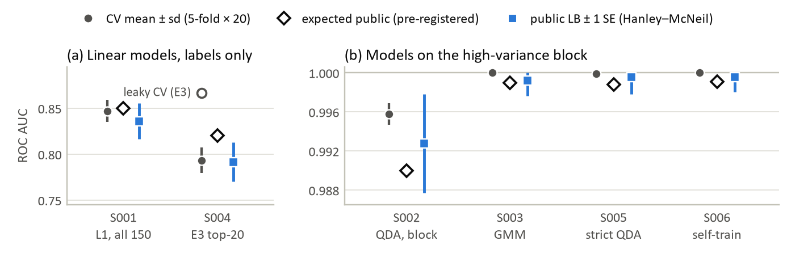
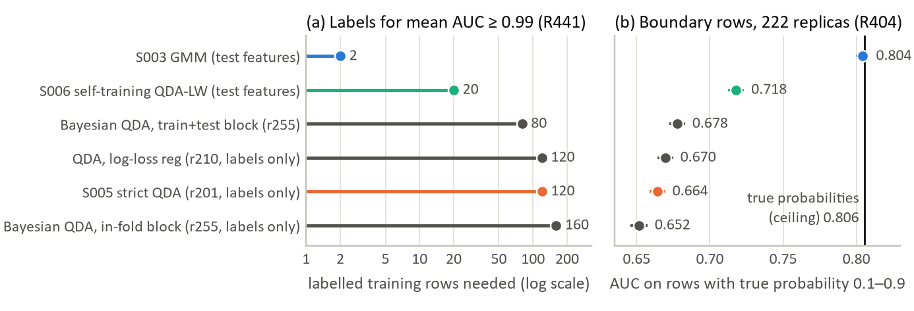

# DSAI4203 Small-Sample Classification Challenge: Core Report

**Team: TODO_TEAM_NAME** (Kaggle team: TODO_KAGGLE_TEAM_NAME)

Members: TODO Full Name 1, TODO Full Name 2, TODO Full Name 3 (roles: see the contribution table)

Final Kaggle selections (rule D010, default case; TODO: tick them on Kaggle, 23–25 Nov): **S003**, a Gaussian mixture fitted to the unlabelled train and test features (*transductive*; public 0.99923), and **S005**, a QDA that uses only the labelled rows (*strictly inductive*; public 0.99953). Private LB: after the deadline.

<!--
Limit: <= 6 pages INCLUDING this title block, tables, figures, the AI disclosure and the references.
English only. Every number must trace to a run_id or sub_id; no sandbox/ results.
Figures/tables only from scripts: link figures/<name>.png; paste tables from tables/<name>.md.
Page budget (sums to 6.0): title block 0.2 | 1 Problem formulation 0.6 | 2 Validation protocol 1.2 |
3 Submission history 1.2 | 4 Final solution 0.9 | 5 Analysis 1.3 | Use of generative AI 0.2 | References 0.4
Sources per section: docs/ARCHIVE_RULES.md section 10. Checks before export: reports/README.md.

Draft written 2026-11-01 by Claude Code (workflow agent core_writer); revised the same day by Claude Code (workflow
agent core_fixer) after three AI reviews (numbers, claims, rubric). Numbers come from
reports/tables/r440_core_numbers.csv (R440 audit) unless another source is named. Generated inputs (do not edit by hand):
  .venv\Scripts\python.exe scripts\submission_history.py   -> reports/tables/core_submission_history.{csv,md}
  .venv\Scripts\python.exe scripts\make_core_figures.py    -> reports/figures/core_*.png, reports/tables/core_*.{csv,md,json}
Run ids behind the short labels: R001 20261022-051627_r001_data_structure; R002 20261022-053218_r002_informative_subspace;
R003 20261022-050647_r003_sup_l1_all to 20261022-050732_r003_gmm2_all (8 runs); R101 20261022-064201_r101_bic_model_choice;
R103 20261022-073702_r103_replica_bootstrap;
R150 20261022-064606_r150_taxonomy; R154 20261022-065605_r154_class_structure; R205 20261022-072747_r205_select_supervised;
R206 20261022-074712_r206_label_budget; R249 20261022-082329_r249_sup_comparison;
R251 20261022-073743_r251_tabpfn2_all, 20261022-073935_r251_tabpfn2_hv, 20261022-074251_r251_tabicl_all, 20261022-074643_r251_tabicl_hv;
r201 = S005 20261022-071234_r201_qda_block; r209 = S006 20261022-080632_r209_selftrain_qda_lw; r210 20261022-082047_r210_qda_block_nll;
r255 20261022-070200_r255_bqda_eb_hv + 20261022-070202_r255_bqda_eb_trainonly;
R900 20261022-091506_r900_perm_null_a + 20261022-092943_r900_perm_null_b; R901 20261022-094812_r901_id_order_dupes;
R910 20261022-091211_r910_s003_gmm2_hv; R920 20261022-100551_r920_generator_alternatives;
R921 20261022-094951_r921_bayes_regret_replicas; R922 20261022-092146_r922_label_noise_private;
R936 20261022-172146_r936_final_selection; R404 20261022-194238_r404_inductive_pooled; R425 20261022-191747_r425_flip_grid_reweight;
R440 20261022-184020_r440_core_numbers; R441 20261022-182022_r441_label_budget_rerun; r930 20261022-095943_r930_qda_block_nll_ext;
E1 20261022-064054_e1_validation_protocol; R940 20261022-091211_r940_e1_pairs_check; E3 20261022-063908_e3_leakage;
E4 20261022-071414_e4_feature_stability; R320 20261022-074624_r320_e4_stable_vs_block;
README config route 20261022-212507_final_s003_gmm2_hv. Submissions: S001-S006 in registry/submissions.csv.
Sources of numbers added in the core_fixer revision: B004 under other priors = R922 summary.json posterior_by_prior;
P(beats S003) = reports/tables/r936_private_weighted.md (tn0, csv8, weighted_r156); flat-prior gains = R425 summary.json;
R205 grid caveat = R205 notes.md; 4.4e-11 = R910 notes.md; Null B 0.480-0.573 = reports/tables/r900_perm_null_B_summary.csv;
30 of 139 = registry/experiments.csv (split_sig 5708ce5c3828) + fold_scores.csv; sd ratios 1.68 / 1.47 = R901
summary.json block.ratio_profile; r930 post-hoc and tn1 -4.7e-4 = research/reports/r2_inductive.md section 2, reports/tables/r936_private.csv;
80% power MDD = E1 draft / research/reports/verify.md F1; upload times = registry/submissions.csv submitted_at_utc.
-->

*Codes:* S### = Kaggle submission, R### or r### = archived run (`registry/experiments.csv`), D### = decision, B### = pre-registered belief (`registry/`), E1–E4 = extensions.

## 1. Problem formulation
<!-- Task (250 rows, positive rate from scripts\verify_data.py, 150 features, 19,750 test rows, ROC AUC, ~2% public / ~98% private); why it is hard (p/n = 0.6; one 50-row fold SE ~0.065; public LB SE ~0.02); 1-2 EDA/research facts with run_id; train vs test distributions (ssc.data.summary); the goal = expected private AUC, not public. -->
The task is binary classification with 250 labelled rows (113 positive), 150 numeric features and 19,750 unlabelled test rows, scored by ROC AUC. The public leaderboard (LB) uses about 2% of the test rows (≈ 395; competition rule 3), the private LB the other 98%, revealed after the deadline. Our target is therefore the **expected private AUC**, not the public rank.

**Why it is hard.** With p/n = 0.6 a model fits noise easily, and every score is noisy: one 50-row validation fold at AUC 0.80 has a Hanley–McNeil standard error (SE) of 0.065, and a 395-row public score has SE 0.020 at AUC 0.85 and 0.0016 at 0.999 (Hanley & McNeil, 1982).

**Structure in the features** (R001, R150; on the role of the labels see Limitation 1). On the 20,000 train+test rows, 13 features have a standard deviation above 1.5 times the median (the *high-variance block*). Only 20 features correlate with any other; they span 12 dimensions with 8 exact linear dependencies, and the other 130 are independent noise. Train and test show no detectable shift (all KS tests p ≥ 0.01; a train-versus-test classifier scores AUC 0.499, R901). A two-component Gaussian mixture fitted to the block of all 20,000 rows splits the training labels into components with positive rates 0.000 and 0.991 (R002).

**The generator.** These facts match scikit-learn's `make_classification` (Guyon, 2003) exactly, with 12 informative, 8 redundant and 130 noise columns, one Gaussian cluster per class and `class_sep` ≈ 0.70, followed by a per-column affine map (we did not model other generators); a label-free likelihood search finds the same 12 informative columns (margin 13.0 nats, R920). Under the fitted generator the best possible (Bayes) AUC is 0.99995, the best linear rule reaches 0.947, and about 186 test rows (≈ 1%) have a true class probability between 0.1 and 0.9 (R154). We used the generator **only to simulate replica data sets with known labels** for evaluating procedures; replica rows never trained a submitted model, and we did not try to recover its seed or the hidden labels (D010). Good models therefore differ mainly near the class boundary, and a near-Bayes model's private score is limited by label noise (Section 4).

## 2. Validation protocol
<!-- From docs/VALIDATION_PROTOCOL.md (D002 + freeze decision): repeated stratified 5-fold x 20, seed 2026, shuffle=True, model seed fixed, all preprocessing/selection inside the Pipeline; why (E1: MDD with 95% CI for the neighbouring-candidate pair; one sentence per rejected alternative); comparing models: identical splits, paired difference, split SE = std of per-repeat differences / sqrt(20), Nadeau-Bengio corrected t-test, a win needs |diff| > 2 split SE AND corrected p < 0.05; leakage control (E3 evidence if owned); public-LB trust (Hanley-McNeil, scripts\lb_noise.py): bugs, not ranking; the final-model selection rule decided in advance (D0xx). -->
**Official CV** (D002): stratified 5-fold CV repeated 20 times; repeat *r* shuffles with seed 2026 + *r* (split signature `5708ce5c3828`, shared by all official runs, which are compared fold by fold), and model seeds are fixed, so the spread comes from the split alone. Every preprocessing and selection step (scaling, top-k filters, the in-fold block rule, nested tuning) sits in one scikit-learn pipeline (Pedregosa et al., 2011) refitted on each training part; steps that use only features (the block rule, the mixture) may use all 20,000 rows but never see a label (D007). We report mean AUC ± sd of the 20 repeat means.

**Why this scheme** (E1). With 50 split seeds per scheme on two neighbouring linear models, the minimum detectable difference (MDD = 2 sd of the paired difference, ≈ 50% power) was 0.057 for a 20% hold-out, 0.030 for one 5- or 10-fold run, 0.0083 [0.0070, 0.0104] for 5-fold × 10 and **0.0061 [0.0051, 0.0076] for 5-fold × 20**, the only scheme whose 95% CI lies below 0.01 (at 80% power even 5 × 20 is inconclusive: 0.0086 [0.0071, 0.0107]). Under a normal approximation a hold-out would order a 0.01 pair correctly only 64% of the time (the pair studied is about 0.004 apart, R940); more folds do not help, and leave-one-out gives no per-fold AUC.

**Comparing models; the public LB.** We use the paired mean difference over the 100 folds, its split SE (sd of the 20 per-repeat differences / √20), the fold win rate and the corrected t-test of Nadeau & Bengio (2003), which inflates the variance factor 1/J to 1/J + 50/200. An improvement needs |difference| > 2 split SE, corrected p < 0.05 and a fold win rate above 0.5 (`docs/VALIDATION_PROTOCOL.md`, `scripts/compare_runs.py`). The public LB, with SE 0.0016–0.02, is a bug check, never a ranking tool; every upload was pre-registered with an expected score and a belief (`registry/beliefs.md`).

**Leakage control.** E3 measured what a leak costs: a |corr| filter fitted on all 250 rows instead of inside each fold inflates CV by 0.073 at 20 features (corrected SE 0.020, p = 0.0003). Label-permutation tests with positive controls (R900) found no leak. Trained and scored on permuted labels, the seven honest pipelines tested (S003, five other candidates, E3 honest) average 0.477–0.496 and a leaky-filter control 0.697; trained on permuted labels and scored on the true ones, they average 0.480–0.573 (the mixture's scores are bimodal) and a control that reads the true labels from disk 1.000. Ids, row order and duplicates carry no signal (R901).

**When CV saturated.** From S003 on, many runs scored AUC 1.0 in all 100 folds (30 of the 139 official runs in `registry/experiments.csv`, three of them re-runs of S003; none strictly inductive). We then used (i) label-free BIC on the 20,000 rows (Schwarz, 1978), which picks K = 2 full-covariance components (K = 3: +851; tied, diagonal or spherical: worse by > 10⁵; R101); (ii) out-of-fold log-loss, only as a calibration check; (iii) a parametric bootstrap (Efron & Tibshirani, 1993): 222 replicas from the fitted generator, with test-label noise at the rates the data support and 8-decimal scores like the submission file, on which every procedure is re-run with the official splits and scored on the private split (R936, R425). They also show the limit of CV resolution (D011): the paired CV test between strict QDA and the mixture was non-significant in 222 of 222 cases, although strict QDA was truly worse in every one (R936). Near AUC 1, CV cannot resolve gaps below about 3·10⁻⁴: "not significant" is not "equally good".

**Final-selection rule** (D010, fixed before the public scores of S005 and S006; case 3 by D013). It replaced our setup protocol's rule (`docs/VALIDATION_PROTOCOL.md` §5: the simplest model within a CV tolerance band, from a clean git commit), which failed here: 30 runs tie at CV 1.0 and none comes from a commit (D004). Default: S003 + S005. If the instructor explicitly allows the unlabelled test features, including S006's retraining on algorithmic pseudo-labels of the test rows (competition data under D014): S003 + S006. If they are forbidden: the extended-grid QDA (r930, not yet uploaded; predicted public 0.99910, R404) + S005. r930 is a post-hoc variant (its grid was extended after r210 picked the grid floor); on the replicas it leads S005 by 1.9·10⁻⁴ but falls 4.7·10⁻⁴ below S003 when training labels are flipped, which S005 covers (R404, R936). Never a foundation-model run or S004.

## 3. Submission history
<!-- The JOURNEY, not only the final model. Table: paste reports/tables/core_submission_history.md from .venv\Scripts\python.exe scripts\submission_history.py (one row per uploaded submission: CV mean +/- std, pre-registered expected public, public, both surprises). Narrative from registry/journal.md, beliefs.md, decisions.md: question asked, LB answer, what changed. Relate surprises to the public-LB SE (< ~2 SE = noise). Private scores are published after the deadline and cannot appear here.
Table 1 below is reports/tables/core_journey.md (scripts/make_core_figures.py), the compact form of core_submission_history.md
with 5-decimal public scores and the surprises in SE units. Its SE convention is R440's (Hanley-McNeil at the expected AUC,
198/197); registry/beliefs.md quotes record_lb.py's SE at the observed score (179/216), hence +0.6 / -1.2 / +0.6 / +0.4 SE
there for S002 / S004 / S005 / S006. -->

*Figure 1. CV mean ± sd, pre-registered expectation and public score ± 1 SE for the six uploads, on two y-ranges (sources: Table 1; leaky CV of the E3 model from run `20261022-063908_e3_leakage`).*

| Sub   | Model                     | CV AUC ± sd     | Expected   | Public   | z(exp)   | z(CV)   |
|:------|:--------------------------|:----------------|:-----------|:---------|:---------|:--------|
| S001  | L1 logistic, all features | 0.8469 ± 0.0120 | 0.8500     | 0.83589  | −0.72    | −0.57   |
| S002  | QDA, label-free block     | 0.9958 ± 0.0011 | 0.9900     | 0.99277  | +0.55    | −0.60   |
| S003  | Transductive GMM (final)  | 1.0000 ± 0.0000 | 0.9990     | 0.99923  | +0.14    | −0.48   |
| S004  | E3: corr top-20 + L2      | 0.7934 ± 0.0142 | 0.8200     | 0.79136  | −1.35    | −0.10   |
| S005  | Strict QDA, nested reg    | 0.9999 ± 0.0002 | 0.9988     | 0.99953  | +0.42    | −0.21   |
| S006  | Self-training QDA-LW      | 1.0000 ± 0.0000 | 0.9991     | 0.99956  | +0.30    | −0.29   |

*Table 1. The six uploads in `registry/submissions.csv` (S001–S003 on 2026-10-21 UTC, S004–S006 on 10-22). CV: official 5 × 20, sd over repeats. Expected: pre-registered. z = (public − expected or CV)/SE, SE = Hanley–McNeil SE of the expected AUC on 395 rows. S002 chose its columns with train+test features; S003 and S006 are fitted on the unlabelled test rows; S001, S004 and S005 use no test data.*

Figure 1 and Table 1 show the six uploads. Each was pre-registered (B001–B007) and asked one question. S001–S003 (one batch, R003) went up within two minutes, as did S005–S006, so the public scores checked the pipeline and our calibration and, by design (D008, D010), steered no model choice:

- **S001: does a linear model's CV hold on the LB?** L1 logistic regression (Tibshirani, 1996) on all features: public 0.83589, 0.7 SE below expectation, so the CV estimate held (LB SE about 0.02).
- **S002: is the signal in the block's covariance?** QDA (Friedman, 1989) on the block: CV 0.9958 against 0.878 for LDA (R003), public 0.99277. The signal is mainly in the class covariances: rules that use only the covariances or only the means reach AUC 0.9998 and 0.947 (R154).
- **S003: does the unlabelled structure transfer?** CV 1.0000 in all 100 folds and public 0.99923 (first on the public LB at upload), as predicted ("about 0.999, not 1.0", B003). Its shortfall, 1 − AUC = 7.7·10⁻⁴, is 15 times what the fitted mixture predicts for itself with clean labels (5.2·10⁻⁵, R101), which points to label noise rather than ranking errors.
- **S004: the E3 leaderboard check.** Public 0.79136: 0.002 from honest CV (0.793), 0.075 below leaky CV (0.867), inside the registered 90% range 0.785–0.854, but 1.35 SE below our point expectation, taken from a proxy score instead of the honest CV.
- **S005, S006: the candidate second selections**, a strictly inductive QDA that never sees test features and a self-training QDA (Yarowsky, 1995) with Ledoit–Wolf covariances (Ledoit & Wolf, 2004). Both landed inside their pre-registered 80% intervals and slightly above S003, an outcome we had registered as about 20% and 25–28% likely; gaps of 3.0–3.3·10⁻⁴ (12–13 of ≈ 39,000 public pairs) are within the sd of public differences (3.3–6.6·10⁻⁴, R936), so by D010 they changed nothing.

**What we learned.** All six scores landed within 1.4 SE of expectation and 0.1–0.6 SE below their CV means. They share the same 395 public rows and their label noise, of which the training labels show no sign (R922), so a common small shortfall is expected, not CV optimism. Two expectations failed or look wrong. B003 blamed the gap to 1.0 on boundary rows; the evidence points to label noise. B004 (S003's private AUC ≥ 0.999 and within 0.001 of public, 70%) looks miscalibrated: given the public score its probability is 0.16 under a flat prior on the noise rate (0.14–0.17 under three other priors, 0.51 under a log-uniform one; R922). The private LB has not tested it; we kept B004 and added B008 (median 0.997, 90% 0.992–0.9996). We also corrected two earlier claims: zero label noise is disfavoured only 5:1, not "nearly impossible" (R922); QDA and the mixture are "indistinguishable" only in CV (D011).

## 4. Final solution
<!-- Pipeline exactly as in configs/<final>.yaml (scaler, selector, model, hyperparameters, test_pred mode) + run_id, git commit, split signature; how the pre-registered rule picked it from the official-CV candidate table (band, simplest model; number of configurations evaluated = winner's-curse caveat); CV mean +/- std and paired difference to the best simple baseline (split SE, corrected p); Kaggle final selections and why; reproduction: README.md 'Reproducing the final submission'. -->
**Model** (`configs/final_s003_gmm2_hv.yaml`, class `ssc.transductive.TransductiveGMM`). No setting below is tuned on labels; all were set by hand (Limitation 1):

1. Columns: the features whose sd over the 20,000 train+test rows exceeds 1.5 × the median sd (13), standardised with train+test statistics; no labels are used.
2. One K = 2 full-covariance Gaussian mixture, fitted by EM (Dempster et al., 1977) to these rows (scikit-learn `GaussianMixture`, `n_init` 5, `reg_covar` 1e-6, `random_state` 0), serves all folds.
3. In each training fold the labels only name the components: r(k) = (Σ P(k|x)·y + α·π) / (Σ P(k|x) + α) over the fold's rows, with α = 1 and π the fold's positive rate.
4. Score s(x) = P(1|x)·r(1) + P(2|x)·r(2); the submission averages the 100 fold models' scores (8 decimals).

**Run and provenance.** Run `20261022-050708_r003_gmm2_hv`, split signature `5708ce5c3828`, CV AUC 1.0000 in 100/100 folds; S003, sha256 prefix `3aae140e5837753f`. Re-runs on fresh Colab machines are bit-identical, by the original script (R910) and by the README's config route (run `20261022-212507_final_s003_gmm2_hv`); on a Windows laptop the scores differ by up to 4.4·10⁻¹¹, which changes 1 of the 19,750 8-decimal values (R910). No run is tied to a git commit (the repository has none yet; D004), so provenance rests on a code bundle saved after the run (consistent with it, but no proof of what ran; D012) and on these re-runs (D013). Reproduction: `README.md`, "Reproducing the final submission".

**Why this model.** (i) Label-free BIC selects exactly this mixture. (ii) On 1,000 replicas its expected AUC is only 2.6·10⁻⁷ below the Bayes posterior (R921). (iii) On 222 replicas the other candidates all have a lower expected private AUC; mean paired differences −6.3·10⁻⁵ (extended-grid QDA), −6.9·10⁻⁵ (S006), −1.16·10⁻⁴ (Bayesian QDA), −1.68·10⁻⁴ (log-loss-tuned QDA), −2.57·10⁻⁴ (S005) (R936; model-based, Limitation 2), though each of these five beats S003 on 6–21% of replica private splits. (iv) None of its settings came from a CV search, so its CV carries no tuning optimism (choosing among 46 supervised configurations inside the CV gives 0.9995 ± 0.0006, against 0.9999–0.99998 for the best single runs, partly as that menu's grid is coarser; R205; Varma & Simon, 2006), but its design was chosen after seeing the labels (Limitation 1).

**Final selections.** Kaggle ranks a team by the better of its two selections. On the replicas a second selection raises the expected private AUC by at most 1.45·10⁻⁵ (S006; S005 4.1·10⁻⁶; R936), or 2.0·10⁻⁵ and 7·10⁻⁶ under the flat prior used below (R425): at most 1/15 of the sd of a private score at a given noise rate (3.1·10⁻⁴, R936). D010 uses it as insurance against the open rule question on S003's use of test features, not to gain score. Rule 4 says "You may not use data from outside this competition to train your model"; the test features are competition data and no test label is used. Kaggle's Foundational Rule 4b forbids hand-labelling or human prediction of test records; our mixture is an algorithm fitted without labels. D007 adopts this reading; no instructor ruling is recorded yet (TODO members: ask; record date and answer). Hence the default S003 + S005: S005 complies under any reading.

**Expected private score.** Given the training labels and the public score (flat prior on f, the share of labels assigned at random, `flip_y` in `make_classification`), S003's private AUC has median 0.9973, mean 0.9968, 90% interval 0.9923–0.9996 and P(≥ 0.999) = 0.16 (R922; replicas agree, R425). Every near-Bayes model scores about 1 − f/2 (maximum-likelihood f = 0.003, support 0–0.015), so the private score is limited by label noise and likely about 0.002 below the public score: an expected gap, not a failure.

## 5. Analysis
<!-- What worked / did not, with evidence (compare_runs.py, experiments/*/notes.md); negative results count. CV vs expected vs public calibration; was the public LB as noisy as its SE predicted? Rejected ideas (registry/ideas.md) and what each owned extension taught the core task. Limitations and what you would do with more data/time (E2 if owned). -->
**What the labels alone can do.** In the supervised track (R249: 587 configurations; its 64-row comparison table re-computed in R440), no other model family came near QDA on the block (S005: 0.9999): L1 logistic 0.847 (S001), LDA 0.86, Gaussian naive Bayes 0.87, best penalised linear model 0.932 (0.938 with the block chosen on train+test features), RBF-SVM 0.951, kNN 0.902 (Hastie et al., 2009), Gaussian-process classification 0.976 (Rasmussen & Williams, 2006), tree ensembles ≤ 0.914 (LightGBM, Ke et al., 2017; XGBoost, Chen & Guestrin, 2016). The population limit for linear rules is 0.947 (R154).

**What the unlabelled rows add** (Figure 2). (a) Labels needed (R206, re-run on 80 new folds with new label draws in R441): the mixture ranks the validation rows perfectly with 2 labels (400 of 400 evaluations), self-training needs about 20, Bayesian QDA with a normal-inverse-Wishart prior (Murphy, 2007) on the label-free block 80, and the label-only QDAs 120–160 (S005: 120). With the regularisation fixed at 0.003, a value chosen with all 250 labels (R201), QDA needs 40 on the label-free block and 80 on an in-fold block (table only). (b) On the ≈ 185 boundary rows per replica the mixture ranks almost as well as the true probabilities (0.804 vs 0.806) and beats every other procedure in all 222 replicas: self-training 0.718, Bayesian QDA 0.652–0.678, label-only QDAs 0.66–0.70 (R404).

*Figure 2. (a) Fewest labelled rows with mean validation AUC ≥ 0.99 (R441: 80 official folds × 5 label draws; budgets where every fit is defined). (b) AUC on test rows whose true class probability (Bayes posterior) is in (0.1, 0.9), 222 replicas (R404); bars ±2 Monte-Carlo SE. Table views: `reports/tables/core_label_budget.md`, `core_boundary.md`.*

**Negative results.**

- *Refining the mixture:* restart ensembles, bagging, no regulariser, semi-supervised EM (Nigam et al., 2000) and self-training changed the expected AUC by at most 2.4·10⁻⁸ on 40 replicas drawn from the fitted mixture itself (the true model there by construction; R103); pseudo-labelled quadratic logistic regression (Lee, 2013) lost 4.5·10⁻⁴, supervised feature selection 3.5·10⁻⁴, a mixture on all 150 features 3.4·10⁻⁵ (8 replicas) and tied covariances 0.23. We spent no uploads on such variants.
- *Foundation models:* TabPFN v2 (Hollmann et al., 2025) scored 0.985 / 0.989 and TabICL v2 (Qu et al., 2026) 0.993 / 0.999 (all features / block; R251), below QDA; their weights were trained outside this competition, so they stayed analysis-only (rule 4; D010).
- *Feature stability* (E4, R320): the bootstrap-stable features are the top-|corr| ones, and QDA on them scores 0.961 against 0.996 on the block (p = 0.0006).

**Limitations.** (1) The block and K = 2 were chosen after R001/R002 had looked at the training labels, so S003's CV is not fully blind to them. But the block is reproduced from the test rows alone and its threshold 1.5 lies in the gap between the 13th and 14th largest sd ratios (1.68 and 1.47; R901), BIC picks K = 2 without labels (R101), and the public score used unseen labels. (2) Replica comparisons assume the fitted generator, which is somewhat harder for supervised QDA than the real data (R936), so replica gaps are model-based. (3) An AI assistant did almost all of the recorded work: design, code, runs, uploads and drafting (below). **With more labels** the supervised models would improve (E2), but not the mixture, which is already at the Bayes limit.

## Use of generative AI
<!-- Rule 6: tool, purpose, who checked it; copy from registry/ai_usage.md. The scaffold was generated with Claude Code (Anthropic Claude); every member must be able to explain every detail.
Adapted from the draft paragraph in registry/ai_usage.md (2026-11-01). Its two clauses marked "keep only when true" (members
confirmed the decisions / each member can explain the parts they own) are left out because they are not true yet; add them
back only when they are. Replace the TODO with what each member actually re-ran, rewrote and checked. -->
We used Claude Code (Anthropic; Claude Opus 5.5), an agentic coding assistant with access to our repository, the competition data and our Google Colab sessions. It set up the environment and tracking code; proposed every recorded idea (I001–I014); designed, coded and ran all 214 archived runs, including the final model; wrote the registry entries, including every pre-registered belief (B001–B008), the rule reading D007, the rule paraphrase D014 and the selection rule D010; drafted the extensions and this report; and uploaded S001–S006 through the Kaggle web page on a member's account, as the member had authorised (at most 3 per day, each pre-registered). AI agents also designed and ran every check of this output: bit-exact re-runs (R910), permutation tests with positive controls (R900), replicas with known labels (R103, R921, R936), unit tests (`tests/`), a separate verification round and an audit, before drafting, of 242 numbers planned for this report (R440: 235 verified; the 7 that failed are corrected or not used). TODO (members): what each of you re-ran, rewrote and checked, and which decisions you confirmed. These checks do not replace our own review: under rule 6 each member must be able to explain every part (`registry/ai_usage.md`).

## References
<!-- Rule 4: copy only 'status: used' entries from registry/references.md (scikit-learn, NumPy, pandas, SciPy, matplotlib; Nadeau & Bengio 2003, Hanley & McNeil 1982, and any others actually used). One line each, consistent style.
All entries below have "status: used" in registry/references.md. To fit the page limit they are set as compact run-on
lists (the style of E1 and E2), titles omitted: the works cited in the text and the software line, then every other "used"
entry (exploratory runs, E2/E4 methods), which rule 4 and docs/ASSIGNMENT_CHECKLIST.md also require; full entries stay in
registry/references.md. Versions: requirements-lock.txt; NumPyro / JAX / huggingface_hub from registry/references.md. -->
*Software* (Python 3.11): scikit-learn 1.9.1 (Pedregosa et al., 2011) with its LIBLINEAR solver (Fan et al., 2008), NumPy 2.4.6 (Harris et al., 2020), pandas 3.0.6 (McKinney, 2010), SciPy 1.17.1 (Virtanen et al., 2020), matplotlib 3.11.2 (Hunter, 2007), joblib 1.6.0, threadpoolctl 3.7.0, PyYAML 6.0.3, tabulate 0.10.0, JupyterLab 4.6.4, LightGBM 4.7.0 and XGBoost 3.2.0; for analysis only, TabPFN 9.2.0 and TabICL 2.2.0 with weights from the Hugging Face model cards Prior-Labs/TabPFN-v2-clf and jingang/TabICL (accessed 2026-10-22 with huggingface_hub 2.2.0) on PyTorch 2.14.1 (Paszke et al., 2019), and NumPyro 0.22.0 (Phan et al., 2019; Bingham et al., 2019) on JAX 0.10.2 (Bradbury et al., 2018).

*Cited above:* Chen & Guestrin (2016), XGBoost, *Proc. KDD*, 785–794; Dempster et al. (1977), *JRSS B* 39, 1–38; Efron & Tibshirani (1993), *An Introduction to the Bootstrap*, Chapman & Hall; Fan et al. (2008), LIBLINEAR, *JMLR* 9, 1871–1874; Friedman (1989), *JASA* 84, 165–175; Guyon (2003), design of the NIPS 2003 variable selection benchmark; Hanley & McNeil (1982), *Radiology* 143, 29–36; Harris et al. (2020), NumPy, *Nature* 585, 357–362; Hastie et al. (2009), *The Elements of Statistical Learning*, 2nd ed., Springer; Hollmann et al. (2025), TabPFN, *Nature* 637, 319–326; Hunter (2007), Matplotlib, *Comput. Sci. Eng.* 9, 90–95; Ke et al. (2017), LightGBM, *NeurIPS* 30, 3146–3154; Ledoit & Wolf (2004), *J. Multivar. Anal.* 88, 365–411; Lee (2013), *ICML Workshop*; McKinney (2010), pandas, *Proc. SciPy*, 56–61; Murphy (2007), tech. report, Univ. of British Columbia; Nadeau & Bengio (2003), *Machine Learning* 52, 239–281; Nigam et al. (2000), *Machine Learning* 39, 103–134; Paszke et al. (2019), PyTorch, *NeurIPS* 32, 8024–8035; Pedregosa et al. (2011), scikit-learn, *JMLR* 12, 2825–2830; Qu et al. (2026), TabICLv2, arXiv:2602.11139; Rasmussen & Williams (2006), *Gaussian Processes for Machine Learning*, MIT Press; Schwarz (1978), *Ann. Stat.* 6, 461–464; Tibshirani (1996), *JRSS B* 58, 267–288; Varma & Simon (2006), *BMC Bioinformatics* 7, 91; Virtanen et al. (2020), SciPy, *Nature Methods* 17, 261–272; Yarowsky (1995), *Proc. ACL*, 189–196.

*Also used in our runs* (rule 4; full entries in `registry/references.md`): Beaumont et al. (2002), *Genetics* 162, 2025–2035; Bingham et al. (2019), Pyro, *JMLR* 20, 1–6; Bishop (2006), *Pattern Recognition and Machine Learning*, Springer; Blei & Jordan (2006), *Bayesian Anal.* 1, 121–143; Bradbury et al. (2018), JAX, github.com/jax-ml/jax; Breiman (2001), random forests, *Mach. Learn.* 45, 5–32; Carvalho et al. (2010), *Biometrika* 97, 465–480; Cawley & Talbot (2010), *JMLR* 11, 2079–2107; Chang & Lin (2011), LIBSVM, *ACM TIST* 2, 27; Cover & Hart (1967), *IEEE Trans. Inf. Theory* 13, 21–27; D'Agostino & Pearson (1973), *Biometrika* 60, 613–622; Defazio et al. (2014), SAGA, *NeurIPS* 27, 1646–1654; Efron (1979), *Ann. Stat.* 7, 1–26; Figueroa et al. (2012), *BMC Med. Inform. Decis. Mak.* 12, 8; Gelman & Rubin (1992), *Stat. Sci.* 7, 457–472; Gelman et al. (2013), *Bayesian Data Analysis*, 3rd ed., CRC; Geurts et al. (2006), extra trees, *Mach. Learn.* 63, 3–42; Golub & Van Loan (2013), *Matrix Computations*, 4th ed.; Hoffman & Gelman (2014), NUTS, *JMLR* 15, 1593–1623; Mardia (1970), *Biometrika* 57, 519–530; Phan et al. (2019), NumPyro, arXiv:1912.11554; Piironen & Vehtari (2017), *Electron. J. Stat.* 11, 5018–5051; Platt (1999), *Advances in Large Margin Classifiers*, 61–74; Pritchard et al. (1999), *Mol. Biol. Evol.* 16, 1791–1798; Qu et al. (2025), TabICL, *ICML*; Vehtari et al. (2021), *Bayesian Anal.* 16, 667–718; Wilks (1938), *Ann. Math. Stat.* 9, 60–62; Zhou et al. (2004), label spreading, *NeurIPS* 16, 321–328; Zhu & Ghahramani (2002), label propagation, CMU-CALD-02-107.
