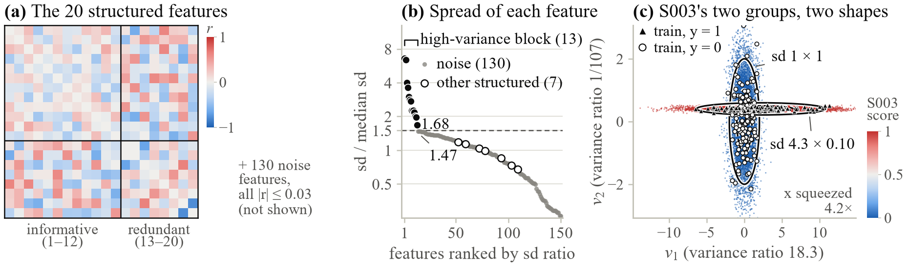
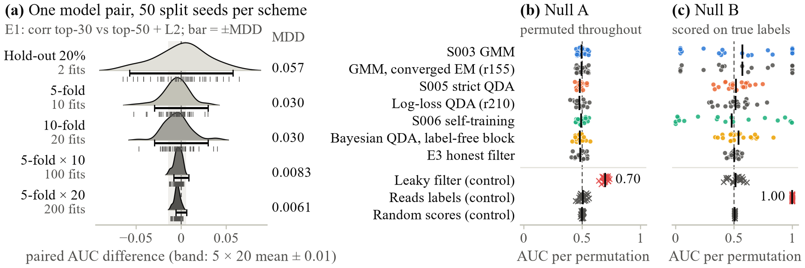
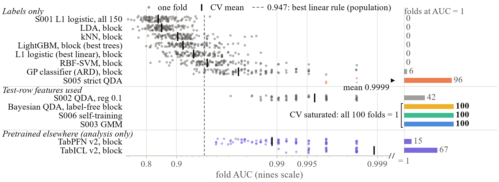
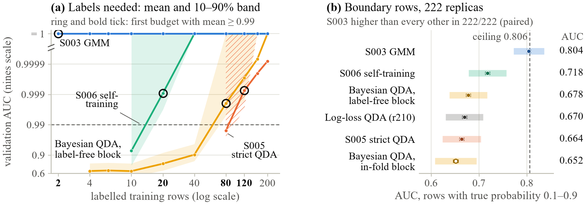

# DSAI4203 Small-Sample Classification Challenge: Core Report

**Team: TODO_TEAM_NAME** (Kaggle team: TODO_KAGGLE_TEAM_NAME)

Members: TODO Full Name 1, TODO Full Name 2, TODO Full Name 3 (roles in the contribution table)

**Abstract.** With 250 labelled and 19,750 unlabelled rows, how far can unlabelled structure replace labels, and how can a model be chosen once cross-validation saturates? Almost entirely, we find: a two-component Gaussian mixture fitted without labels to all 20,000 rows separates the classes, and labels only name its components. Its expected score is within 2.6 × 10⁻⁷ of the Bayes optimum on simulated data; its public score is 0.99923. With 30 runs tied at perfect cross-validated scores, the choice rested on a label-free criterion, simulations with known labels and a rule fixed before the last two uploads, not on ranking public scores. Label noise, not the model, should limit the private score (expected ≈ 0.997). By default the rule selects this mixture (S003) and S005, a quadratic discriminant analysis (QDA) trained without test data and so valid under any reading of the competition rules.

<!--
Limit: <= 6 pages INCLUDING this title block, tables, figures, the AI disclosure and the references.
English only. Every number must trace to a run_id or sub_id; no sandbox/ results.
Figures/tables only from scripts: link figures/<name>.png; paste tables from tables/<name>.md.
Measured 2026-11-23 after the review fixes (Times New Roman 11 pt, code spans also in Times New Roman, references in 10 pt
via the small markers): 6 pages, 5.91 used, about 4 lines free at the end of page 6 (the members' TODOs need about 3-4).
Sections run on without page breaks; if a section ends 2-3 lines short of a page, the next one starts on a new page and the
part can grow by 0.3 page (seen in this revision): check the page count after every edit.
Layout: build_report.py keeps each figure with its caption and does not float it, so a figure that no longer fits moves to the
next page and leaves a gap. The text is ordered so that pages 1-5 fill (Figure 3 and Table 1 after "What each upload showed",
Figure 6 after "Negative results"); one added line on pages 1-5 can cost up to 0.1 page. Check with
  .venv\Scripts\python.exe scripts\build_report.py --parts core --out (a PDF outside reports/)
Sources per section: docs/ARCHIVE_RULES.md section 10. Checks before export: reports/README.md.

History. Draft written 2026-11-01 by Claude Code (workflow agent core_writer); revised the same day by Claude Code (workflow
agent core_fixer) after three AI reviews (numbers, claims, rubric; research/reports/review_round1.md). Rewritten 2026-11-23
by Claude Code (workflow agent writer) around six figures and the Times New Roman layout (previous text: git HEAD): prose
shortened and reordered; the reviewed facts and caveats kept. Changes of fact: "the repository has none yet" -> all runs
predate the first commit (D016, first commit 2026-11-15); R900 ranges printed at two decimals (0.48-0.50 / 0.70;
0.48-0.57 / 1.00), as in Figure 2 (S003's Null B mean is 0.5725 exactly).
Revised 2026-11-23 by Claude Code (workflow agent fixer) after three AI reviews of that rewrite (numbers, claims, reader):
counts 139 -> 140 official runs and 214 -> 215 archived runs (the 2026-11-01 S005 re-run 20261101-123515_r201_qda_block);
KS tests sourced to R001; Null A folds are not the official ones (R900 per-perm split_sig); Section 4 (iii) limited to the
five candidates of Figure 4a (R936 also lists GMM variants r105 / r155 / r102 at -1.0 / -1.7 / -1.0e-6); D010 case wording
(no ruling or only the unsupervised use allowed -> default, D015; both forbidden -> case 3); Figure 1c described as S003's
estimate; S005/S006 leads compared with R936's predicted sd of their public scores (public_pred_sd 3.3e-4 / 6.6e-4; the sd
of the public difference itself is 3.23e-4 / 6.54e-4); semi-supervised EM with two components per class lost 3.7e-6 (R103);
a summary line added under the title. Moved out of the running text in this revision for the page limit: "We also corrected
two of our own claims" (both corrections are listed below and the facts stay in Sections 2 and 4); "Private LB: after the
deadline"; the R249 64-row comparison table, re-computed in R440; full venues of the "Also used" references (in
registry/references.md; the three book entries that could not be identified now name the book).
Details moved out of the running text in that rewrite (all still in the archive): hold-out P(correct order at 0.01) = 0.64,
a normal approximation for a pair about 0.004 apart (R940), and the 5- and 10-fold MDD 0.030 (core_protocol_schemes.md);
the corrected t-test inflates 1/J to 1/J + 50/200, and "wins most folds" = fold win rate > 0.5 (docs/VALIDATION_PROTOCOL.md);
BIC: K = 3 +851, tied / diagonal / spherical > 1e5 worse (R101); E3 leak: corrected SE 0.020; the S005/S006 leads of
3.0-3.3e-4 are 12-13 of about 39,000 public pairs (R936); second-selection gains 1.45e-5 (S006) and 4.1e-6 (S005) under
R936's R156 weights, 2.0e-5 and 7e-6 under the flat combined prior and 2.31e-5 and 1.0e-5 under the flat train-only prior
(R425; the text says "at most 2.3e-5"), i.e. about 1/15 of the replica sd of S003's R156-weighted private AUC, 3.1e-4
(R936; per-level sds 2.9-5.5e-4 for f > 0); per-candidate mean differences -0.63 / -0.69 / -1.16 / -1.68 / -2.57e-4 (Figure 4a, core_selection.md);
labels-only L1 logistic (all features) 0.847 and LDA 0.86, TabPFN / TabICL on the block 0.989 / 0.999 (Figure 5,
core_landscape.md, R251); R441 = R206 re-run on 80 new folds with new label draws; R920: a label-free likelihood search finds
the same 12 informative columns (margin 13.0 nats); R901: ids, row order and duplicates carry no signal; the two earlier claims we
corrected (zero label noise was called "nearly impossible", R922: it is disfavoured only 5:1, kept in Section 4; QDA and
the mixture are "indistinguishable" only in CV, D011); three of the 30 saturated official runs are re-runs of S003; official split signature 5708ce5c3828 (all official runs, S003 included); reproduction re-run of the README route
20261022-212507_final_s003_gmm2_hv.
Revised 2026-11-24 by Claude Code (workflow agent, formal-article rewrite, draft B; previous text: git 259279b): rewritten as a
formal article around one research question (how far the unlabelled rows can replace labels, and how to choose a model once CV
saturates), stated in an Abstract (replacing "In short." and the "Codes" line) and at the start of Section 1; terms and
abbreviations defined at first use; archive codes only as bracketed citations; Figure 6 moved up to its first mention; captions
start with a title and leave encodings shown inside the figures to the figures; references give venue, volume and pages. A short
Section 6 (Conclusion) was drafted but left out to stay within 5.85 pages. Facts, caveats, figures and Table 1 unchanged; the
members' Kaggle-ticking item moved from the summary line to "Final selections" (Section 4). Numbers and details taken out of the
visible text are listed, with sources, in the section comments ("Moved out 2026-11-24" and the lines after it).
Measured 2026-11-24 with the job's draft_build.py (same builder): 6 pages, 5.85 used; Figure 6 now sits before "Negative results",
so the layout note above ("Figure 6 after Negative results") describes the previous text.
Synthesised 2026-11-24 by Claude Code (workflow agent, final synthesis after two AI judges; base: draft B, grafts from drafts A and
C): the archive-tag convention is the italic line after the Abstract (HOUSE_STYLE.md section 2 wording) and Section 1 no longer
repeats the research question; the Abstract now explains S005 (a QDA trained without any test data) and gives the public 0.99923
and the 2.6e-7 gap to the Bayes optimum (R921); restored to the text: the 5-fold x 10 MDD CI, S004's registered 90% range, null
B's bimodal mixture scores and the control mapping, the design-after-labels clause in (iv), Figure 3's encodings, "each noise
level taken as normal" (Figure 4b), the split-signature gloss and the Windows 1-of-19,750 change, the f/2 wrong labels and the
1/8 likelihood interval, the replica design (clean training labels, R156-weighted test-label noise, 16 public/private splits per
replica), the r930 magnitudes and predicted public 0.99910 (case 3) and ARD (Figure 5); evaluative wording softened; long
sentences and semicolon lists split; references in the house style (HOUSE_STYLE.md section 1). Correction of draft B, not of the
baseline: Figure 2 gloss "r155: tighter-prior mixture" -> "tightly converged mixture" (r155 config.yaml: alpha 1.0 as in
S003, tol 1e-8). No baseline value changed. Numbers and details moved out of the visible text are listed, with sources, in the
section comments ("Synthesis 2026-11-24 (final)"). Run-in heads are not numbered (the numbers cost lines). Measured with the
job's draft_build.py: 6 pages, 5.84 used, the 10 members' placeholders kept, no warnings; pages 1-5 full; Figure 6
directly after its first mention; Works cited and Also used run on in one small-type paragraph.
Fixed 2026-11-24 by Claude Code (workflow agent, core fixer) after three AI reviews of the synthesis (fidelity CF1-CF19,
substance CS1-CS20, language CL1-CL30): misleading or over-strong wording corrected (Abstract "should cap the private score near
0.997" -> "should limit the private score (expected ≈ 0.997)", as in the baseline; "we select" -> "the rule selects"; "a rule
fixed in advance" -> "fixed before the last two uploads"; S004 "matched", not "predicts", the LB; S002 "mainly" in the
covariance; "a Gaussian process" at 0.976; "any block"; "about 80-120" labels), lost details restored (20 label permutations,
the 80%-power CI, "not plotted", the definitions of null A and B, E2's 500-row numbers in Limitation 4), tags moved to the runs
that computed the numbers ([R922, B008], [R441], [D004, D015]) and to clause ends, terms defined (r155, r210, label-free block,
the 1/8 likelihood interval), language and notation as proposed in CL1-CL30; Table 1 and the figure links unchanged. Details and
sources: the "Review fixes 2026-11-24" lines in the section comments. Not applied for the page budget (each costs one line on
pages 2-4, which moves the "5. Analysis" heading to page 5: 5.89-5.90 used): CS5 (the original rule's wording), CS15 (S005's
bit-identical re-runs), CS20 (a log-loss result); their facts are in the Section 2 and 4 comments. Correction (comment only) of
the 2026-11-23 fixer note above: the public_pred_sd values "3.3e-4 / 6.6e-4" listed for S005 / S006 belong to S006 / S005 (R936,
reports/tables/r936_public_abc.md, tn0 csv8 window 0.00015: r201 = S005 6.65e-4, r209 = S006 3.31e-4; public_diff_sd 6.54e-4 /
3.23e-4 likewise reversed; B006 sd 0.00066, B007 sd 0.00033); the visible range 3.3-6.6 × 10⁻⁴ and "at most one predicted sd"
(S005 0.45 sd, S006 1.0 sd) are unaffected. No baseline value was corrected in the visible text. Measured with the job's
draft_build.py: 6 pages, 5.84 used, the 10 members' placeholders kept, no warnings; pages 1-5 full, no stranded heading; the
Abstract takes nine lines and page 1's spare foot space.
Numbers come from reports/tables/r440_core_numbers.csv (R440 audit; its 7 failed claims are not used) unless another
source is named. Generated inputs (do not edit by hand):
  .venv\Scripts\python.exe scripts\submission_history.py   -> reports/tables/core_submission_history.{csv,md}
  .venv\Scripts\python.exe scripts\make_core_figures.py    -> reports/figures/core_*.png, reports/tables/core_*.{csv,md,json}
Figures (inputs with sha256 and the script's cross-checks: reports/tables/core_manifest.json). Heights of F1 and F2 were
reduced on 2026-11-23 through the script's size parameters (F1_H 1.48 -> 1.32, F1 figsize 2.12 -> 1.96, zoom 0.62 -> 0.56,
colour bar lowered; F2 figsize 2.36 -> 2.17, H_AX 1.62 -> 1.43, row labels re-spaced): printed 1.99 -> 1.83 in and
2.28 -> 2.09 in; the F1c x squeeze is now 4.19x (core_data.md). Figures 3, 5 and 6 are shown at 94.5% width: their smallest
text is 8 pt, so it prints at >= 7.5 pt; Figures 1, 2 and 4 (7.5 pt text) stay at full width.
Figure changes in the 2026-11-23 review fixes (same sizes): F1a shows only the 20 structured features (the 130 noise
features, all |r| <= 0.03, are a note); F1c titled as S003's groups; F2a band = pooled 5 x 20 mean +- 0.01 (as in E1's
figure), title 'split seeds'; F3 questions all phrased as questions, legend moved off the axis break; F4 S005 mean label
boxed, shorter group headers; F6a legend shows the mean tick, r930 named in its label; F6b bands labelled by the
simulated levels inside them (0.003-0.005, 0.0055-0.01); maths text ($v_1$, $f$) in Times New Roman.
  Figure 1 = figures/core_data.png (F1): data/raw train+test features; S003 scores (20261022-050708_r003_gmm2_hv test_pred.npy);
    R901 summary.json (block13, sd ratios 1.675 / 1.473); R150 feature taxonomy. Table view: tables/core_data.md.
  Figure 2 = core_protocol.png (F2): E1 paired_estimates.csv + paired_difference.csv; R900 r900_perm_null_{A,B}_per_perm.csv.
    Table views: core_protocol_schemes.md (MDD 0.057 / 0.030 / 0.030 / 0.0083 / 0.0061), core_protocol_nulls.md.
  Figure 3 = core_journey.png (F3): registry/submissions.csv; E3 summary.json leaky_auc_mean 0.867. Table 1 = core_journey.md.
  Figure 4 = core_selection.png (F6): (a) research/r935_r933_pooled.npz, the archived input of R936, checked against R936
    private.csv (tn0, csv8, weighted_r156); (b) R922 r922_likelihood_fine.csv + r922_private_by_flip.csv, each noise level
    taken as normal; this reproduces R922's summary within 6e-5 (core_predictive.md). Table view: core_selection.md.
  Figure 5 = core_landscape.png (F4): fold_scores.csv of the 14 runs listed in core_landscape.md (r003_sup_l1_all,
    r200_lda_block, r201_knn_block, r203_lgbm_block_nested, r200_l1_block, r201_svm_block, r202_gpc_ard_block,
    r201_qda_block, r003_sup_qda_hv, r255_bqda_eb_hv, r209_selftrain_qda_lw, r003_gmm2_hv, r251_tabpfn2_hv, r251_tabicl_hv);
    0.947 = R154.
  Figure 6 = core_unlabeled.png (F5): (a) R441 label_budget_evals.csv, label_budget_first_hit.csv; (b) r404_boundary.csv.
    Table views: core_label_budget.md, core_budget_curves.csv, core_boundary.md.
Run ids behind the short labels: R001 20261022-051627_r001_data_structure; R002 20261022-053218_r002_informative_subspace;
R003 20261022-050647_r003_sup_l1_all to 20261022-050732_r003_gmm2_all (8 runs); R101 20261022-064201_r101_bic_model_choice;
R103 20261022-073702_r103_replica_bootstrap;
R150 20261022-064606_r150_taxonomy; R154 20261022-065605_r154_class_structure; R205 20261022-072747_r205_select_supervised;
R206 20261022-074712_r206_label_budget; R249 20261022-082329_r249_sup_comparison;
R251 20261022-073743_r251_tabpfn2_all, 20261022-073935_r251_tabpfn2_hv, 20261022-074251_r251_tabicl_all, 20261022-074643_r251_tabicl_hv;
r201 = S005 20261022-071234_r201_qda_block; r209 = S006 20261022-080632_r209_selftrain_qda_lw; r210 20261022-082047_r210_qda_block_nll;
r255 20261022-070200_r255_bqda_eb_hv + 20261022-070202_r255_bqda_eb_trainonly;
R900 20261022-091506_r900_perm_null_a + 20261022-092943_r900_perm_null_b; R901 20261022-094812_r901_id_order_dupes;
R910 20261022-091211_r910_s003_gmm2_hv; R920 20261022-100551_r920_generator_alternatives;
R921 20261022-094951_r921_bayes_regret_replicas; R922 20261022-092146_r922_label_noise_private;
R936 20261022-172146_r936_final_selection; R404 20261022-194238_r404_inductive_pooled; R425 20261022-191747_r425_flip_grid_reweight;
R440 20261022-184020_r440_core_numbers; R441 20261022-182022_r441_label_budget_rerun; r930 20261022-095943_r930_qda_block_nll_ext;
E1 20261022-064054_e1_validation_protocol; R940 20261022-091211_r940_e1_pairs_check; E3 20261022-063908_e3_leakage;
E4 20261022-071414_e4_feature_stability; R320 20261022-074624_r320_e4_stable_vs_block;
README config route 20261022-212507_final_s003_gmm2_hv. Submissions: S001-S006 in registry/submissions.csv.
Other number sources: B004 under other priors = R922 summary.json posterior_by_prior; P(beats S003) 6-21% and the
mean differences 0.63-2.57e-4 = reports/tables/r936_private_weighted.md (tn0, csv8, weighted_r156) = core_selection.md;
flat-prior gains = R425 summary.json; R205 grid caveat = R205 notes.md; 4.4e-11 = R910 notes.md;
Null A/B ranges = reports/tables/r900_perm_null_{A,B}_summary.csv = core_protocol_nulls.md;
30 of 140 = registry/experiments.csv (split_sig 5708ce5c3828) + fold_scores.csv; sd ratios 1.68 / 1.47 = R901
summary.json block.ratio_profile; r930 post-hoc and tn1 -4.7e-4 = research/reports/r2_inductive.md section 2, reports/tables/r936_private.csv;
r930 predicted public 0.99910 and case 3 = D013 item 1 (r404_public_abc.csv); 80% power MDD = E1 draft / research/reports/verify.md F1;
upload times = registry/submissions.csv submitted_at_utc; boundary AUCs (0.804 / 0.806) = core_boundary.md;
fixed-reg label budgets 40 / 80 = core_label_budget.md rows marked * (table only); first commit = D016.
Main session 2026-11-25 (Claude Code), after the formal rewrite: Figure 2's panel label for r155 corrected in src/ssc/plotstyle.py from 'GMM, tight prior (r155)' to 'GMM, converged EM (r155)' (run config: alpha 1.0 as S003, 12 informative columns, tol 1e-8, max_iter 5000; research/lib_gen_replica.py TransductiveGMMTight) and Figure 2 re-rendered with make_core_figures.py --only F2; captions of Figures 2 and 5 completed; '(rule 4)' -> '(competition rule 4)' in Negative results; S001 '(0.6 SE below)' -> '(0.6 SE below CV)'. Measured: 6 pages, 5.88 used.
Main session 2026-11-25, after a fresh-eyes proofread: Figure 2 caption defines EM and names r210 as in Figure 6 ('QDA tuned by log-loss'); Abstract 'any rule reading' -> 'any reading of the competition rules'; Section 3 S002 'scores 0.9958' -> 'has CV 0.9958' (a CV value, not a public score) and 'Each batch (S001–S003, S005–S006) went up ...'; Section 4 '(rounded to eight decimals)'. Measured: 6 pages, 5.88 used.
2026-11-25 (main session, at the member's request): the AI-use statement is removed from this part for now; the member will write the AI disclosure together with the contribution table (course rule 6 requires it in the submitted report; facts in registry/ai_usage.md; previous wording in git 63b56f9). Limitation (3) on AI use removed with it; (4) renumbered (3).
2026-11-25 (main session, at the member's request): the reference list of this part moved to one complete, alphabetical list for the whole document, reports/references.md (written by scripts/make_references.py from registry/references.md; built as part 'refs' after the extensions).
-->

*Bracketed identifiers cite the project archive: runs (R, r), decisions (D), pre-registered beliefs (B) and ideas (I). Cited works are listed in the References at the end of the document.*

## 1. Problem formulation
<!-- Task (250 rows, positive rate, 150 features, 19,750 test rows, ROC AUC, ~2% public / ~98% private); why it is hard; EDA facts with run_id; train vs test; the goal = expected private AUC, not public.
Moved out 2026-11-24: the public SE of 0.020 at AUC 0.85 (Hanley-McNeil; docs/VALIDATION_PROTOCOL.md section 4) is now quoted
only at S004 ("about 0.02"); the generator's 12 informative, 8 redundant and 130 noise columns (R150, R920) are shown in Figure 1a
and match the 20 structured features in 12 dimensions. "A classifier separating them" = R901's adversarial validation, AUC 0.499
+- 0.025 on all 150 features (R901 notes.md). The archive's folders are registry/ and experiments/; B = pre-registered beliefs
(registry/beliefs.md), I = ideas (registry/ideas.md). "Good models differ mainly on these boundary rows" restates the baseline's
"Good models differ near this boundary" (R154).
Synthesis 2026-11-24 (final; base draft B): the research question is no longer repeated here (it opens the Abstract), and
the archive-tag key is the italic line after the Abstract (HOUSE_STYLE.md section 2). Back to the baseline wording "models fit
noise easily"; the block is defined with "over all 20,000 rows", as in the glossary. Moved out of the visible text: the 20
structured features span 12 dimensions (R150; rank 12 in reports/tables/core_data.md); the fitted generator's class_sep ~ 0.70
and per-column affine map (R150, R920); "a near-Bayes model is limited by label noise (Section 4)" (stated in the Abstract and in
Section 4, Expected private score; R922); "Hanley-McNeil" before "standard error" (the citation Hanley & McNeil, 1982 follows;
docs/VALIDATION_PROTOCOL.md section 2).
Review fixes 2026-11-24 (core fixer): "a classifier separating them" -> "a train-versus-test classifier" (an AUC of 0.499 means
it cannot separate them; R901); "with p = 150 features, scored by ROC AUC" and "the public SE" (CL21); the Figure 1 caption
cites R150 for the feature roles (header: R150 feature taxonomy) and writes "sd / median sd" as on the panel axis. -->
We rank 19,750 test rows from *n* = 250 labelled rows (113 positive) with *p* = 150 features, scored by ROC AUC (area under the receiver operating characteristic curve). The public leaderboard (LB) scores about 2% of the test rows (≈ 395; competition rule 3) and the private LB the rest, so we target the expected private AUC. Estimates are noisy: at *p*/*n* = 0.6, models fit noise easily, a 50-row fold at AUC 0.80 has a standard error (SE) of 0.065, and the public SE is 0.0016 at 0.999 (Hanley & McNeil, 1982).

**Structure in the features** (Figure 1). Only 20 features correlate with any other; the other 130 are noise [R150]. The 13 features whose standard deviation (sd) over all 20,000 rows exceeds 1.5 times the median sd form the *high-variance block*. A two-component Gaussian mixture model (GMM) fitted to it on all 20,000 rows without labels splits the training rows into components with positive rates 0.000 and 0.991 [R002]: the classes are visible without labels. Train and test show no detectable shift: all 150 Kolmogorov–Smirnov tests give *p* ≥ 0.01 [R001], and a train-versus-test classifier (adversarial validation) scores AUC 0.499 [R901]. We found this structure after seeing the labels (Limitation 1).

*Figure 1. Feature structure of all 20,000 rows. (a) Correlations of the 20 structured features (roles inferred under `make_classification` [R150]). (b) sd / median sd; the 13 above 1.5 form the block [R901]. (c) The block on the two directions where S003's score-weighted groups (training rows: by label) differ most and least in variance (S003's estimate, not the true classes); ellipses: 1 and 2 sd; x squeezed 4.2×.*

**The generator.** The data match scikit-learn's `make_classification` (Guyon, 2003) exactly, with one Gaussian cluster per class [R150, R920]; we modelled no other generator. Under the fitted generator the classes differ mainly in covariance (rules using only the covariances or only the means reach AUC 0.9998 and 0.947; S003's fit agrees, Figure 1c). The best possible (Bayes) AUC is 0.99995, and only ≈ 186 test rows (1%) have a true class probability in (0.1, 0.9) [R154]: good models differ mainly on these *boundary rows*. We used the generator only to simulate replicate data sets with known labels (*replicas*): no replica trained a submitted model, and we never sought the seed or hidden labels [D010].

## 2. Validation protocol
<!-- docs/VALIDATION_PROTOCOL.md (D002, frozen by D015); why (E1 MDD); comparing models; leakage control; public-LB trust; final-selection rule decided in advance (D010, given in Section 4).
Shortened 2026-11-23 (details kept in the archive): hold-out P(correct order at 0.01) = 0.64 (normal approximation; pair ~0.004 apart, R940)
and the 5- / 10-fold MDD 0.030 are in core_protocol_schemes.md; the corrected t-test inflates 1/J to 1/J + 50/200 and the protocol
also needs a fold win rate > 0.5 (docs/VALIDATION_PROTOCOL.md); BIC: tied, diagonal or spherical covariances > 1e5 worse (R101).
Moved out 2026-11-24: the 95% CIs of the 5 x 10 MDD (0.0070-0.0104) and of the 80%-power MDD (0.0071-0.0107) (E1; R940;
research/reports/verify.md F1). E1's pair (Figure 2a): in-fold |corr| top-30 vs top-50 features + L2 logistic regression
(liblinear, C = 0.05; reports/extensions/e1_validation_protocol.md). Null A stratifies its folds on the permuted labels (R900
per-perm split_sig). r155 = 20261022-080453_r155_gmm2_inf_tight. The comparison rule: docs/VALIDATION_PROTOCOL.md section 3,
scripts/compare_runs.py; pre-registrations: registry/beliefs.md; the 30 saturated runs: registry/experiments.csv.
Figure 2's caption leaves to the figure's own panel titles: 50 split seeds per scheme and bars = +-MDD (panel a); the permutation
CV seed 2026; null B uses the official folds, and the mixture's null-B scores are bimodal (hence its wide 0.48-0.57 range).
Synthesis 2026-11-24 (final): restored to the text: the 5 x 10 MDD CI 0.0070-0.0104 (E1; core_protocol_schemes.md); "the
mixture's scores are bimodal" (null B; R900); the control mapping, leaky filter 0.70 under null A and label reader 1.00 under
null B (R900; Figure 2); "|correlation| filter (absolute label correlation)"; the baseline's "bug and calibration check, not a
ranking tool"; the replica design: clean training labels, test-label noise weighted by its posterior (R156 =
20261022-081314_r156_flip_posterior), 16 public/private splits per replica (research/reports/r2_inductive.md section 1; r933
configs, n_draws 16). The three added tools are three sentences (no semicolon list). Still only here: the 80%-power CI
0.0071-0.0107. Moved out: "Ten folds do not beat five" (5- and 10-fold MDD both 0.030; E1, core_protocol_schemes.md; printed in
Figure 2a); three of the 30 saturated runs are re-runs of S003 (registry/experiments.csv); from the Figure 2 caption, "(leaky
filter and label reader should fire, random scores should not)" (the text says which control fires under which null) and
"r210: log-loss-tuned QDA" (the panel label reads "Log-loss QDA (r210)"). Figure 2 gloss of r155 corrected: r155
(20261022-080453_r155_gmm2_inf_tight) is the S003-type mixture on the 12 informative columns with EM run to tol 1e-8
(config.yaml; alpha 1.0, as in S003); the panel label "GMM, tight prior (r155)" (src/ssc/plotstyle.py line 72) is a misnomer
that a caption cannot change; draft B's gloss "tighter-prior mixture" repeated it. The caption now reads "r155: tightly converged
mixture" (EM is defined only in Section 4).
Review fixes 2026-11-24 (core fixer): "Its 95% CI alone lies below 0.01" -> "It alone has a 95% CI below 0.01" (the only scheme
tested; E1, D015 item 1); the 80%-power CI 0.0071-0.0107 is back in the text (it was "still only here"), so that the MDD 0.0086
no longer reads as conclusive; "per scheme" is left to Figure 2a's panel title ("50 split seeds per scheme"). Figure 2 caption:
"20 label permutations" restored (R900 configs, n_perm 20); null A trains and evaluates on permuted labels, null B trains on
permuted labels and evaluates on the true labels of the official splits (R900 notes); "paired AUC differences" (panel a axis)
and the permutation CV "5-fold x 20, seed 2026" (R900 configs) are left to the figure and this comment; "Black tick" -> "Tick";
"r155: tightly converged mixture, not a tighter prior" (r155 config: alpha 1.0 as in S003, tol 1e-8, max_iter 5000, on the 12
informative columns; the 12 columns are not named in the caption for space); "r210: S005 tuned by log-loss" (r210 config: S005's
11-value reg_param grid, inner neg_log_loss; r201 = S005 uses the inner AUC). Official CV: the models, not the rows, are called
transductive (CL11); "any block" (S001 uses all features, S004 an in-fold correlation filter); "the corrected t-test", as in E1
and E3; "giving 100 folds" (was "on 100 splits"); "posterior-weighted test-label noise" -> "test-label noise at rates the data
support" (baseline wording; R156 is the posterior over the noise rate). Not added for the page budget (CS20): out-of-fold
log-loss ranks r209 0.0071 < r210 0.0087 < r201 0.0146 (research/reports/verify.md, "Log-loss comparison") and measures
calibration, not ranking (verify.md); in the text it remains one of the three tools and the tuning criterion of r210. -->
**Official cross-validation.** Our official cross-validation (CV) is stratified 5-fold CV repeated 20 times (seed 2026 + *r* for repeat *r*; fixed model seeds), giving 100 folds shared by all official runs [D002]. Every preprocessing and selection step is in one scikit-learn pipeline (Pedregosa et al., 2011) refitted per training fold. Models whose label-free steps (the block rule, the mixture) use all 20,000 rows but never a label are *transductive* [D007]; *strictly inductive* models learn from the labelled rows alone, re-deriving any block per training fold. A model is better only if its paired mean gain over the 100 folds exceeds 2 split SE (sd of the 20 per-repeat gains / √20), the corrected *t*-test (Nadeau & Bengio, 2003) gives *p* < 0.05, and it wins most folds. The public LB was a bug and calibration check, not a ranking tool: every upload was pre-registered, and the selection rule predates the last two public scores [D010].

**Why 5-fold × 20** (Extension E1; Figure 2a). For two neighbouring linear models and 50 split seeds, the minimum detectable difference (MDD: twice the sd of the paired difference, about 50% power) is 0.057 for a 20% hold-out but 0.0061 for 5-fold × 20. It alone has a 95% confidence interval (CI) below 0.01 (0.0051–0.0076; 5-fold × 10: 0.0083, 95% CI 0.0070–0.0104). At 80% power even 5-fold × 20 is inconclusive (MDD 0.0086, 95% CI 0.0071–0.0107), and leave-one-out gives no per-fold AUC.

*Figure 2. Protocol tests. (a) Paired AUC differences (Extension E1). (b, c) Mean CV AUC under 20 label permutations [R900], used to train and score (null A) or only to train (null B); tick: mean; crosses: controls, red if they fire. EM: expectation–maximisation; r210: QDA tuned by log-loss.*

**Leakage control** (Figure 2b, c). In Extension E3, a |corr| filter (absolute label correlation) fitted on all 250 rows before splitting raised CV by 0.073 at 20 features (*p* = 0.0003). Permutation tests with positive controls found no leak [R900]. Seven honest pipelines average 0.48–0.50 under null A and 0.48–0.57 under null B (the mixture's scores are bimodal), whereas a leaky filter reaches 0.70 under null A and a label reader 1.00 under null B. Identifiers, row order and duplicates carry no signal [R901].

**When CV saturated.** From S003 on, 30 of the 140 official runs scored AUC 1 in all 100 folds (none strictly inductive), so CV could not rank them. Nor can it resolve gaps below about 3 × 10⁻⁴. On the 222 replicas below, the paired CV test of a strictly inductive quadratic discriminant analysis (QDA) against the mixture was never significant, although on clean test labels the QDA was worse on every replica [R936, D011]. "Not significant" is not "equally good". We therefore added three tools. The label-free Bayesian information criterion (BIC; Schwarz, 1978) on all 20,000 rows picks *K* = 2 full-covariance components [R101]. Out-of-fold log-loss measures calibration. A parametric bootstrap (Efron & Tibshirani, 1993) re-runs every procedure on the official splits of 222 replicas with clean training labels and test-label noise at rates the data support [R156], scored on 16 private splits each [R936, R425].

## 3. Submission history
<!-- The journey: one row per upload (CV, pre-registered expectation, public, surprises in SE units); question asked, LB answer, what changed. Private scores appear only after the deadline.
Table 1 below is reports/tables/core_journey.md (scripts/make_core_figures.py), the compact form of core_submission_history.md
with 5-decimal public scores and the surprises in SE units. Its SE convention is R440's (Hanley-McNeil at the expected AUC,
198/197); registry/beliefs.md quotes record_lb.py's SE at the observed score (179/216), hence +0.6 / -1.2 / +0.6 / +0.4 SE
there for S002 / S004 / S005 / S006. Upload days (UTC): S001-S003 2026-10-21, S004-S006 10-22 (shown in Figure 3).
The S005/S006 leads of 3.0-3.3e-4 are 12-13 of about 39,000 public pairs (R936).
Moved out 2026-11-24: S003 was first on the public LB at upload (registry/journal.md, 10-22 entry); S004 fell inside its registered
90% range 0.785-0.854, and its expectation 0.82 came from the 19,750-row proxy value 0.819 (B005, registry/beliefs.md; B005's
lesson: use the honest CV as the expectation). S002's LDA 0.878 = 20261022-050653_r003_sup_lda_hv (0.87785). The red circle
in Figure 3 is S004's leaky CV (E3 summary.json leaky_auc_mean 0.867). Figure 3's encodings are in its legend (dots: official CV
mean +- sd; diamonds: pre-registered expectation; squares: public score +- 1 SE, with an arrow from the expectation; red ring:
leaky CV).
Synthesis 2026-11-24 (final): restored to the text: S004's registered 90% range 0.785-0.854 (B005) and Figure 3's encodings,
including the red ring for S004's leaky CV (0.867; E3 summary.json). "CV and expectations were well calibrated" softened to
"close to expectation"; "no public score could steer the next model" limited to a batch, as in the baseline. Wording shortened,
no fact moved: "an outcome we gave about 20% (S005) and 25-28% (S006)" (B006, B007); S003's registered reason (B003: errors on
boundary rows). The CV encoding of Figure 3 (CV mean +- sd, 5 x 20) is printed in the figure's legend.
Review fixes 2026-11-24 (core fixer): S001's evidence is now its LB score 0.6 SE below its CV (Table 1, z(CV) -0.57); the
earlier text quoted 0.7 SE below expectation (z(exp) -0.72; B001, whose expectation 0.85 came from the CV 0.847). "located the
signal mainly in the covariance" (baseline; R154: means alone 0.947). [R003], the batch of runs behind S001-S003, moved to the
clause end. S003's sentence reordered; "The pre-registered reason" is B003's (about 1% of test rows on the boundary). S004
"found that honest CV matched the LB" (E3: partly by chance, public SE 0.023) instead of "showed that honest CV predicts the
LB"; "registered" -> "pre-registered"; "at most about one" -> "at most one" (S005's lead 3.0e-4 is 0.45 of its predicted sd
6.6e-4, S006's 3.3e-4 is 1.0 of 3.3e-4; R936). Figure 3 caption: the leaky CV is Extension E3's. Table 1 caption: "S002's
label-free block uses training and test features" defines the table's "label-free block" (the high-variance block of Section 1). -->
**What each upload showed.** Each upload (Figure 3, Table 1) asked one question and was pre-registered with an expected score and a belief [B001–B007]. Each batch (S001–S003, S005–S006) went up within two minutes, so no public score could steer the next model of the batch [R003, D008, D010]. S001, an L1-penalised logistic regression (Tibshirani, 1996), showed that its CV holds on the LB (0.6 SE below CV). S002 located the signal mainly in the covariance: on the block, QDA (Friedman, 1989) has CV 0.9958, linear discriminant analysis (LDA) 0.878. S003, the transductive mixture, scored about 0.999 as predicted [B003]: unlabelled structure transfers. The pre-registered reason, boundary-row errors, looks wrong: the shortfall from 1 (7.7 × 10⁻⁴) is 15 times the fitted mixture's own prediction with clean labels (5.2 × 10⁻⁵) [R101], pointing to label noise. S004 (Extension E3) found that honest CV matched the LB: it landed 0.002 from its honest CV, well within the SE of about 0.02, while its leaky CV was 0.075 too high. S004 fell inside its pre-registered 90% range (0.785–0.854), but our point expectation, from a proxy score, was 1.35 SE too high. The second-selection candidates S005 and S006 are a strictly inductive QDA and a self-training QDA (Yarowsky, 1995) with Ledoit–Wolf covariances (QDA-LW; Ledoit & Wolf, 2004). Both landed in their pre-registered 80% intervals and slightly above S003, an outcome we gave about 20% (S005) and 25–28% (S006). Their leads of 3.0–3.3 × 10⁻⁴ are at most one predicted sd of their public scores given S003's, 3.3–6.6 × 10⁻⁴ [R936], so the selection rule stands [D010].

*Figure 3. Six uploads on a nines scale (AUC x at −log10(1 − x); 1 above the break). Public score ± 1 Hanley–McNeil SE at the expected AUC (≈ 395 rows), with an arrow from the pre-registered expectation; red ring: S004's leaky CV (Extension E3). "Final": default selections [D010], not yet ticked.*

| Sub   | Model                          | CV AUC ± sd     | Expected   | Public   | z(exp)   | z(CV)   |
|:------|:-------------------------------|:----------------|:-----------|:---------|:---------|:--------|
| S001  | L1 logistic, all features      | 0.8469 ± 0.0120 | 0.8500     | 0.83589  | −0.72    | −0.57   |
| S002  | QDA, label-free block          | 0.9958 ± 0.0011 | 0.9900     | 0.99277  | +0.55    | −0.60   |
| S003  | Transductive GMM (final)       | 1.0000 ± 0.0000 | 0.9990     | 0.99923  | +0.14    | −0.48   |
| S004  | E3: corr top-20 + L2           | 0.7934 ± 0.0142 | 0.8200     | 0.79136  | −1.35    | −0.10   |
| S005  | Strict QDA, nested reg (final) | 0.9999 ± 0.0002 | 0.9988     | 0.99953  | +0.42    | −0.21   |
| S006  | Self-training QDA-LW           | 1.0000 ± 0.0000 | 0.9991     | 0.99956  | +0.30    | −0.29   |

*Table 1. Uploads (`registry/submissions.csv`). CV: official 5-fold × 20, sd over repeats; Expected: pre-registered; z = (public − expected or CV)/SE, SE as in Figure 3. S002's label-free block uses training and test features, S003 and S006 also use the test rows, and S001, S004 and S005 use no test data.*

**What we learned.** All six landed close to expectation (within 1.4 SE) and 0.1–0.6 SE below their CV means. A small common shortfall is expected, not a sign of CV optimism: all six share the ≈ 395 public rows and their label noise, invisible in the training labels [R922].

## 4. Final solution
<!-- Pipeline as in configs/final_s003_gmm2_hv.yaml + run_id, commit, split signature; why the rule picked it; CV and comparison; Kaggle final selections and why; reproduction: README.md 'Reproducing the final submission'.
Second-selection gains: 1.45e-5 (S006) and 4.1e-6 (S005) under R936's R156 weights; 2.0e-5 and 7e-6 under R922's flat prior,
2.31e-5 and 1.0e-5 under its train-only variant (R425); about 1/15 of the replica sd of S003's private AUC, 3.1e-4 (R936).
"Up to two" selections: D008 (docs/COMPETITION_RULES.md section 3: confirm the number on the Submissions tab).
Moved out 2026-11-24: Windows re-runs change 1 of the 19,750 8-decimal values (R910); the Colab re-runs used the original script
and the README config route (R910; 20261022-212507_final_s003_gmm2_hv); the nested choice's sd 0.0006 (R205); the original rule
is docs/VALIDATION_PROTOCOL.md section 5 (simplest model within a CV tolerance band, from a clean git commit); the case-3 model
(r930) is predicted at public 0.99910 (D013 item 1, r404_public_abc.csv), leads S005 on the replicas by 1.9e-4 and falls 4.7e-4
below S003 under flipped training labels (R936 tn1; research/reports/r2_inductive.md section 2). R156's weights in Figure 4a are
its posterior over flip_y given the training labels and S003's public score (20261022-081314_r156_flip_posterior). The likelihood
behind "maximum-likelihood f = 0.003, support 0-0.015, f = 0 disfavoured 5:1" combines the 250 training labels and S003's public
score (R922 notes.md: LR(flip 0) = 0.20; support = within 1/8 of the maximum, [0, 0.0147]). Figure 4's caption leaves to the figure:
222 replicas (panel title), r930 "post hoc" (its label); each noise level is taken as normal in panel b (R922, core_predictive.md).
The log-loss-tuned QDA of the case-3 sentence is r210, whose nested choice hit the grid's lower edge (reg 0.001; D011 item 4).
Synthesis 2026-11-24 (final): restored to the text: the split-signature gloss ("a hash of the validation folds shared by all
official runs" = SHA1 of all validation index sets, docs/VALIDATION_PROTOCOL.md section 2); the README re-run route and the
Windows sentence with "1 of the 19,750 eight-decimal values" (R910); the clause "Its design was chosen after seeing the labels
(Limitation 1), but" in (iv), with (Varma & Simon, 2006) on "real here"; "each noise level taken as normal" (Figure 4b); "about
f/2 of the labels are wrong" (research/reports/review_round1.md: flip_y = share of labels assigned at random) and the 1/8
likelihood interval (R922 notes.md: >= 1/8 of the maximum on [0, 0.0147]) in place of "support". Draft B's "S005 hedges its
weakness to flipped training labels" is replaced by "S005 covers that QDA's weakness under flipped training labels", which gives
the weakness to the extended-grid QDA (r930), as in the baseline. Moved within the text: "No setting was tuned on labels; all
were set by hand (Limitation 1)" from Model to (iv) ("all settings were set by hand, none by a CV search"); the block's sd over
all 20,000 rows is in its definition (Section 1); step (4) is written as the sum over the two components, s(x) = Sum_k P(k|x) r(k).
"a later code bundle" = a code bundle saved after the run (D012). Also restored: r930 leads S005 by 1.9e-4 on the replicas and
falls 4.7e-4 below S003 under flipped training labels (R936 tn1; research/reports/r2_inductive.md section 2), and its predicted
public score 0.99910 (D013 item 1, r404_public_abc.csv). Figure 4's caption leaves to the panels: the 222 replicas
(panel a title), r210 and r930 (panel labels "Log-loss QDA (r210)" and "Ext.-grid QDA (r930, post hoc)"), the solid line
("public 0.99923", panel b); the replica design is in Section 2 (When CV saturated) with the R156 weights. P(>= 0.999) under
the other priors now sits in a parenthesis after 0.16 (same numbers; R922 summary.json posterior_by_prior).
Review fixes 2026-11-24 (core fixer): the flat-prior results are tagged [R922, B008]: R922 computes them (summary.json
posterior_by_prior uniform_0_0.1: q50 0.99733, mean 0.99684, q05-q95 0.99230-0.99959, P_B004_private_ge_0.999 0.1626), B008 is
the registered prediction (median about 0.997, 90% 0.992-0.9996, P about 0.15); the other priors now have their own sentence.
B004 (registry/beliefs.md): S003's private AUC >= 0.999 and within 0.001 of public, 70%, pending; with public 0.99923 this is
P(private >= 0.999), R922 summary.json P_B004_private_ge_0.999. "1/8 likelihood interval" -> "likelihood >= 1/8 of the maximum"
(R922 notes.md). "is likely about" -> "should be about". The replaced rule: "none from a git commit [D004, D015]"
(registry/experiments.csv: git_commit no-commit for all 215 runs; D015 item 2 records the replacement); "which failed" (the
baseline's word) for space. Rule reading: "We read neither as banning S003 [D007]" makes the reading explicit (D007, D014 item
2). "case 3" dropped from the text (D010 item 3 as revised by D013 item 1); the case-3 QDA is "strictly inductive" (r930 config:
features block(in-fold highvar), uses_unlabeled_test_features false). "consistent with it" -> "consistent with the run" (D012
item 1). Figure 4 caption: "given training labels" (R922 conditions on the 250 training labels and S003's public score); f is
already italic there, as the whole caption is italic. Model: subscript k italic, "eight decimals". Not added for the page
budget: CS5, the original rule's wording (simplest model within a CV tolerance band, from a clean git commit;
docs/VALIDATION_PROTOCOL.md section 5); CS15, S005's provenance: a bit-identical Colab re-run
20261022-091224_r910_r201_qda_block (R910; D012 item 1) and the README route 20261101-123515_r201_qda_block (2026-11-01; fold
AUCs, oof and test_pred identical; submission sha256 prefix 3be09c0723286457 = S005; registry/ai_usage.md row of 2026-11-01). -->
**Model** (`configs/final_s003_gmm2_hv.yaml`, class `ssc.transductive.TransductiveGMM`). (1) The input is the high-variance block, standardised with train-plus-test statistics. (2) One *K* = 2 full-covariance GMM, fitted by expectation–maximisation (EM; Dempster et al., 1977; `GaussianMixture`, `n_init` 5, `reg_covar` 10⁻⁶, `random_state` 0), serves all folds. (3) In each training fold the labels only name the components: *r*(*k*) = (Σ *P*(*k*|*x*)·*y* + *α*·*π*) / (Σ *P*(*k*|*x*) + *α*) over the fold's rows, with *α* = 1 and *π* the fold's positive rate. (4) The score *s*(*x*) = Σ*k* *P*(*k*|*x*)·*r*(*k*) is averaged over the 100 fold models (rounded to eight decimals).

**Run and provenance.** Run `20261022-050708_r003_gmm2_hv` (AUC 1 in all 100 folds; split signature `5708ce5c3828`, a hash of the validation folds shared by all official runs) produced S003 (sha256 prefix `3aae140e5837753f`). Colab re-runs, including the `README.md` route ("Reproducing the final submission"), are bit-identical; on Windows the scores differ by up to 4.4 × 10⁻¹¹, changing one of the 19,750 eight-decimal values [R910]. All runs predate our first git commit [D016], so provenance rests on these re-runs [D013] and on a later code bundle, consistent with the run but no proof of what ran [D012].

**Why this model.** As CV cannot separate the candidates, the evidence comes from elsewhere. (i) Label-free BIC selects exactly this mixture [R101]. (ii) On 1,000 replicas its expected AUC is 2.6 × 10⁻⁷ below the Bayes optimum [R921]. (iii) On 222 replicas the five alternatives of Figure 4a have lower mean private AUC, by 0.63–2.57 × 10⁻⁴, though each beats S003 on 6–21% of replica private splits [R936]; these gaps are model-based (Limitation 2). (iv) Its design was chosen after seeing the labels (Limitation 1), but every setting was fixed by hand, none by a CV search, so its CV has no tuning optimism. Such optimism (Varma & Simon, 2006) is real here: a nested choice among 46 supervised configurations scores 0.9995, against 0.9999–0.99998 for the best single runs, partly owing to a coarser grid [R205].

*Figure 4. Selection evidence. (a) Replica private AUC − S003's [R936]. (b) S003's private AUC given training labels and public score (flat prior on f; normal at each noise level) [R922]; dashed: 0.999.*

**Final selections.** A rule written before the last two public scores fixes the selections [D010]. It replaced the protocol's original rule, which failed: 30 runs tied at CV 1, none from a git commit [D004, D015]. Kaggle counts a team's better selection (up to two [D008]); on the replicas a second one adds at most 2.3 × 10⁻⁵ to the expected private AUC [R936, R425] but insures against an open rule question. Competition rule 4 bans outside data, and Kaggle's Foundational Rule 4b bans hand-labelling or human prediction of test records. We read neither as banning S003 [D007]: the test features are competition data, no test label is used, and the mixture is fitted without labels. No instructor ruling is recorded yet (TODO members: ask; record date and answer). Until then the default is S003 + S005, as S005 complies under any reading (TODO members: tick both on Kaggle, 23–25 Nov). If the instructor explicitly allows both uses of the test features (the unsupervised fit and S006's retraining on algorithmic pseudo-labels of test rows [D014]), the rule picks S003 + S006; if only the first, the default stands [D015]. If both are forbidden [D013], it picks S005 and a post hoc, strictly inductive extended-grid QDA, not uploaded (predicted public 0.99910; we extended its grid after the log-loss-tuned QDA chose the lowest value) [R404, r930]. That QDA leads S005 by 1.9 × 10⁻⁴ on the replicas, but under flipped training labels it falls 4.7 × 10⁻⁴ below S003, a weakness S005 covers [R936]. Foundation models and S004 are never chosen.

**Expected private score** (Figure 4b). S003's private AUC should be about 0.002 below public, a gap expected from label noise, not a failure. If a share *f* of the labels is assigned at random (`flip_y`), about *f*/2 are wrong, and a near-Bayes model scores about 1 − *f*/2. Given the training labels and public score, the maximum-likelihood *f* is 0.003 (likelihood ≥ 1/8 of the maximum: 0–0.015), and *f* = 0 is disfavoured only 5:1. With a flat prior on *f*, the private AUC has median 0.9973, mean 0.9968, 90% interval 0.9923–0.9996 and *P*(≥ 0.999) = 0.16 [R922, B008], far below the 70% of our earlier, untested belief [B004]. Three other priors give 0.14–0.17 and a log-uniform one 0.51 [R922]. The replicas agree [R425].

## 5. Analysis
<!-- What worked / did not, with evidence; negative results; CV vs expected vs public; what each extension taught the core task; limitations; more data/time (E2).
Labels-alone numbers not repeated in the text (in Figure 5 / core_landscape.md / r249_comparison.csv): L1 logistic, all features 0.847 (S001); LDA 0.86.
Moved out 2026-11-24 (Figure 5 / core_landscape.md / R249): naive Bayes 0.87, kNN 0.902, tree ensembles <= 0.914 (LightGBM),
RBF-SVM 0.951 (the text keeps the maximum, the Gaussian process at 0.976); best penalised linear model 0.932 (0.938 with the
train+test block; R249); with the regularisation fixed at 0.003, QDA needs 40 labels on the label-free block (core_label_budget.md,
rows marked *). R441 is R206 re-run on 80 new folds with new label draws. The label budget is the number of labelled training
rows (Figure 6a x axis); at 200 labels there is one label draw instead of five; band = 10-90% range, line = mean (panel title).
The fixed regularisation is 0.003, chosen with all 250 labels (R201; core_label_budget.md). The 150-feature mixture's loss of
3.4e-5 (8 replicas, R103) stays visible. TabPFN / TabICL on the block: Figure 5 (0.989 / 0.999, R251). Boundary rows: true probability
0.1-0.9 (Section 1; R404). The tree ensembles are LightGBM (Ke et al., 2017) and XGBoost (Chen & Guestrin, 2016).
Synthesis 2026-11-24 (final): "In Extension E4, QDA ..." (comma); "stability is not usefulness" limited to QDA (E4 itself finds
the stable features worth keeping for a linear model; reports/extensions/e4_feature_stability.md, Conclusion); "ARD: automatic
relevance determination" in the Figure 5 caption (panel label "GP classifier (ARD), block"); citations inside one bracket in
alphabetical order. Moved out: draft B's sentence "QDA works as the classes differ in covariance, which it must learn from labels
alone" (an interpretation; the covariance structure is stated in Section 1, R154); from the Figure 5 caption, the count of 14
models (runs listed in the header comment and core_landscape.md), "none lies between 0.9984 and 1" (fold_scores.csv of the 14
runs; core_landscape.md) and "labels-only block models re-derive the block in each training fold" (stated for strictly inductive
models in Section 2); from "What the unlabelled rows add", "(perfect in all 400 evaluations)" (R441 label_budget_evals.csv) and
"repeated on new folds" (R441 = R206 re-run on 80 new folds with new label draws; the Figure 6 caption gives 80 official folds x 5
label draws).
Review fixes 2026-11-24 (core fixer): "from about 80-120 to 2 [R441]": both ends come from R441 (core_label_budget.md: GMM 2;
strict in-fold QDA with reg 0.003 80; S005's nested procedure 120); R206 reported about 4 (GMM) and about 80 (strictly
supervised), so it no longer tags the sentence; D013 item 2 asks for "about 80-120". "S005's label-only QDA" -> "S005"; its
80-label budget with the fixed regularisation is marked "not plotted" (table rows marked *). "a Gaussian process" =
r202_gpc_ard_block 0.9757 (R440 P7: one run per sentence; GP variants on the train+test block reach 0.9775-0.9778,
r202_gpc_ard_block_tt and r255_gpc_ard_hv). "Pretrained outside the competition": their weights (D014 item 5). Limitation (4)
gives E2's numbers (E2 Conclusion: S001's model, the L1 baseline, about 0.91-0.92 with 500 training rows against 0.847 at 250
rows, QDA under 0.002 (+0.0008), the GMM nothing). More time is not discussed: D015 lists 5-fold x 50 as an alternative (2.5
times the cost; it does not lift the CV ceiling). Figure 5 caption split into a title and the encodings. "|corr|" as in E4. -->
**What the labels alone can do** (Figure 5). Of 587 supervised configurations, QDA on the block led by far (S005: 0.9999) [R249]. Linear models stay below their population limit, 0.947 [R154]. Naive Bayes, *k*-nearest neighbours (Hastie et al., 2009), tree ensembles (Chen & Guestrin, 2016; Ke et al., 2017), support vector machines and a Gaussian process (Rasmussen & Williams, 2006) reach at most 0.976.

*Figure 5. Fold AUCs of 14 models under the official CV; bars count the folds at AUC 1. ARD: automatic relevance determination.*

**What the unlabelled rows add** (Figure 6). They cut the number of labels needed for a mean validation AUC of 0.99 from about 80–120 to 2 [R441]. Two labelled rows suffice for the mixture, about 20 for self-training, 80 for a Bayesian QDA with a normal-inverse-Wishart prior (Murphy, 2007) on the label-free block, and 120 for S005 (80, not plotted, with regularisation tuned on all 250 labels). They also sharpen the ranking: on the ≈ 185 boundary rows per replica, the mixture nearly matches the true probabilities (AUC 0.804 against 0.806) and beats every other procedure in all 222 replicas [R404].

*Figure 6. What the unlabelled rows add. (a) Validation AUC by labelled rows, 80 official folds × 5 label draws [R441]; curves start where all fits are defined. (b) AUC on the ≈ 185 boundary rows of 222 clean-label replicas [R404]; dark bar ± 2 Monte Carlo SE, light ± 1 sd; r210: QDA tuned by log-loss.*

**Negative results.** Refining the mixture (restarts, bagging, no regulariser, self-training or semi-supervised EM with *K* = 2; Nigam et al., 2000) changed the expected AUC by at most 2.4 × 10⁻⁸ on 40 replicas of the fitted mixture, their true model [R103]. Pseudo-labelled quadratic logistic regression (Lee, 2013) lost 4.5 × 10⁻⁴, supervised feature selection 3.5 × 10⁻⁴, a mixture on all 150 features 3.4 × 10⁻⁵ (8 replicas), two components per class in semi-supervised EM 3.7 × 10⁻⁶ and tied covariances 0.23. Foundation models TabPFN v2 (Hollmann et al., 2025) and TabICL v2 (Qu et al., 2026) scored 0.985 and 0.993 on all features, below QDA [R251]. Pretrained outside the competition, they stayed analysis-only (competition rule 4) [D010]. In Extension E4, QDA on the bootstrap-stable (top-|corr|) features scores 0.961 against 0.996 on the block (*p* = 0.0006) [R320]: for QDA, stability is not usefulness.

**Limitations.** (1) The block and *K* = 2 were chosen after seeing the training labels [R001, R002], so S003's CV is not fully blind to them. But the block is reproduced from the test rows alone. Its threshold of 1.5 lies in the gap between the 13th and 14th largest sd ratios (1.68 and 1.47; Figure 1b), BIC picks *K* = 2 without labels, and the public score used unseen labels. (2) Replica comparisons assume the fitted generator, which is somewhat harder for supervised QDA than the real data [R936], so replica gaps are model-based. (3) More labels would help only the weaker supervised models (Extension E2): 500 training rows would lift S001 to about 0.91–0.92 and QDA by under 0.002, but not the near-Bayes mixture.

**Software and other sources.** All computations used Python 3.11 with scikit-learn 1.9.1 (Pedregosa et al., 2011), its LIBLINEAR and LIBSVM solvers (Chang & Lin, 2011; Fan et al., 2008), NumPy 2.4.6 (Harris et al., 2020), pandas 3.0.6 (McKinney, 2010), SciPy 1.17.1 (Virtanen et al., 2020), Matplotlib 3.11.2 (Hunter, 2007), LightGBM 4.7.0 (Ke et al., 2017), XGBoost 3.2.0 (Chen & Guestrin, 2016), joblib 1.6.0, threadpoolctl 3.7.0, PyYAML 6.0.3, tabulate 0.10.0 and JupyterLab 4.6.4. The analysis-only foundation models used TabPFN 9.2.0 (Hollmann et al., 2025) and TabICL 2.2.0 (Qu et al., 2026), with the Hugging Face weights Prior-Labs/TabPFN-v2-clf (licence priorlabs-1-1) and jingang/TabICL (huggingface_hub 2.2.0; accessed 2026-10-22), on PyTorch 2.14.1 (Paszke et al., 2019); Bayesian models used NumPyro 0.22.0 (Bingham et al., 2019; Phan et al., 2019) on JAX 0.10.2 (Bradbury et al., 2018). Exploratory runs that are not reported here also used approximate Bayesian computation (Beaumont et al., 2002; Pritchard et al., 1999), Bayesian inference (Bishop, 2006; Blei & Jordan, 2006; Carvalho et al., 2010; Gelman & Rubin, 1992; Gelman et al., 2013; Hoffman & Gelman, 2014; Piironen & Vehtari, 2017; Vehtari et al., 2021), further learning methods (Breiman, 2001; Cover & Hart, 1967; Defazio et al., 2014; Geurts et al., 2006; Platt, 1999; Qu et al., 2025; Zhou et al., 2004; Zhu & Ghahramani, 2002) and statistical methods (Cawley & Talbot, 2010; D'Agostino & Pearson, 1973; Efron, 1979; Figueroa et al., 2012; Golub & Van Loan, 2013; Mardia, 1970; Wilks, 1938).
